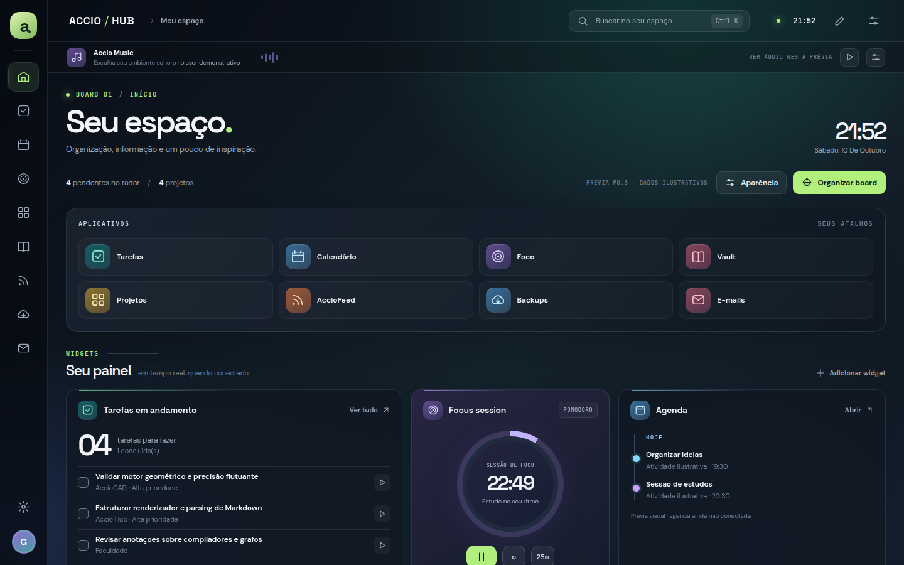
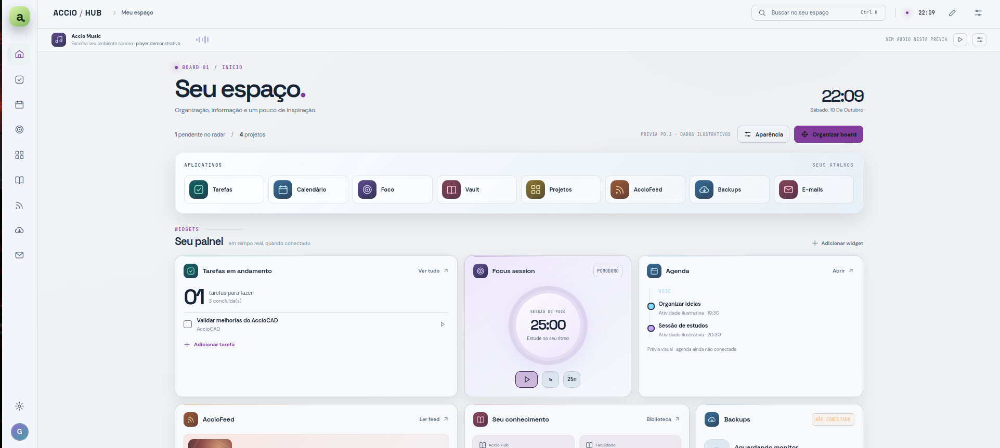
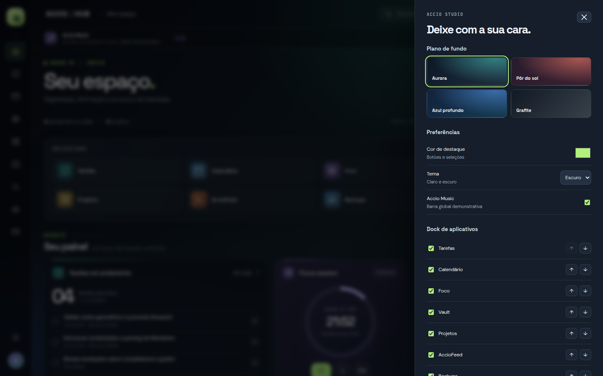
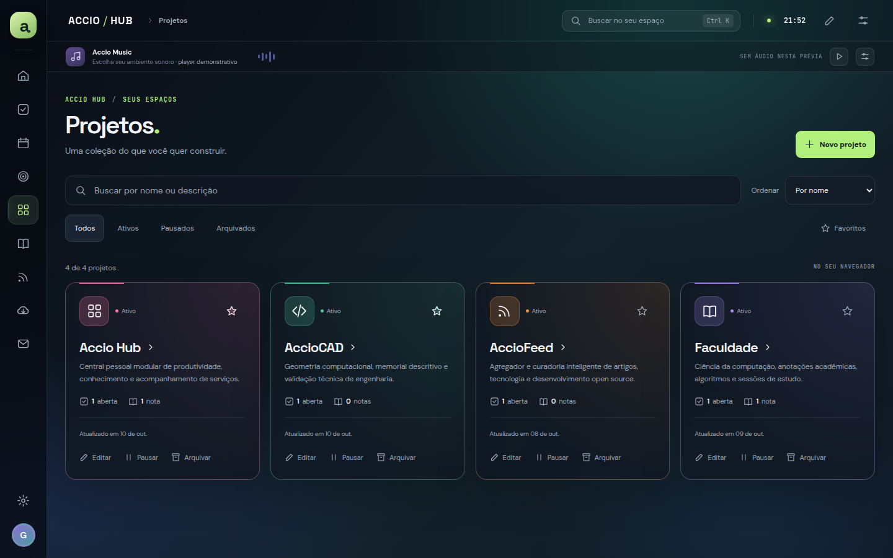
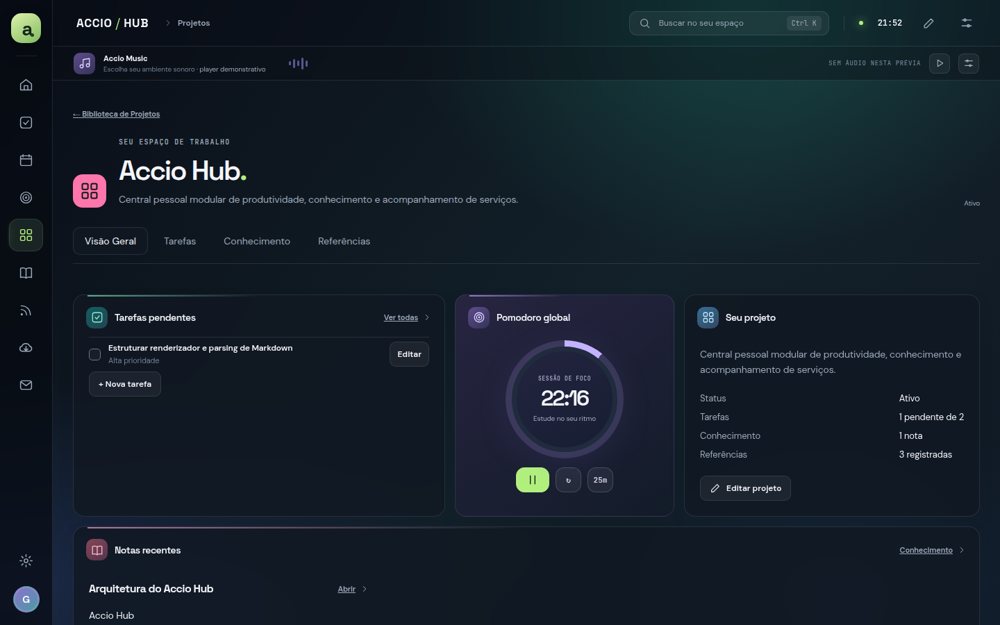
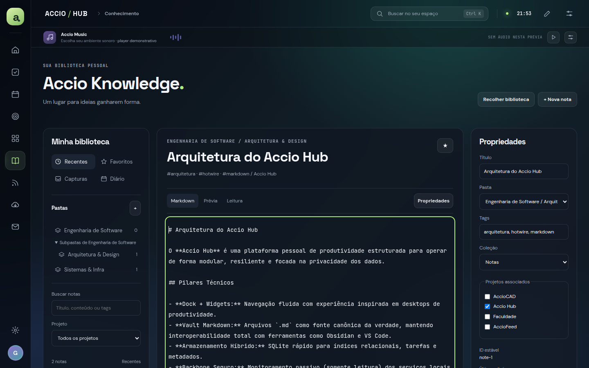
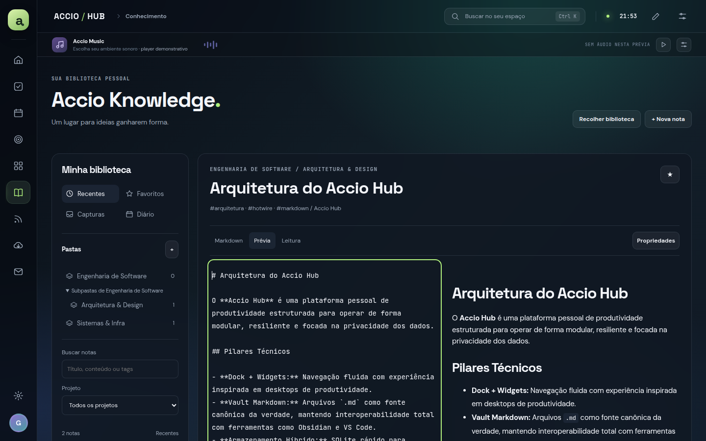
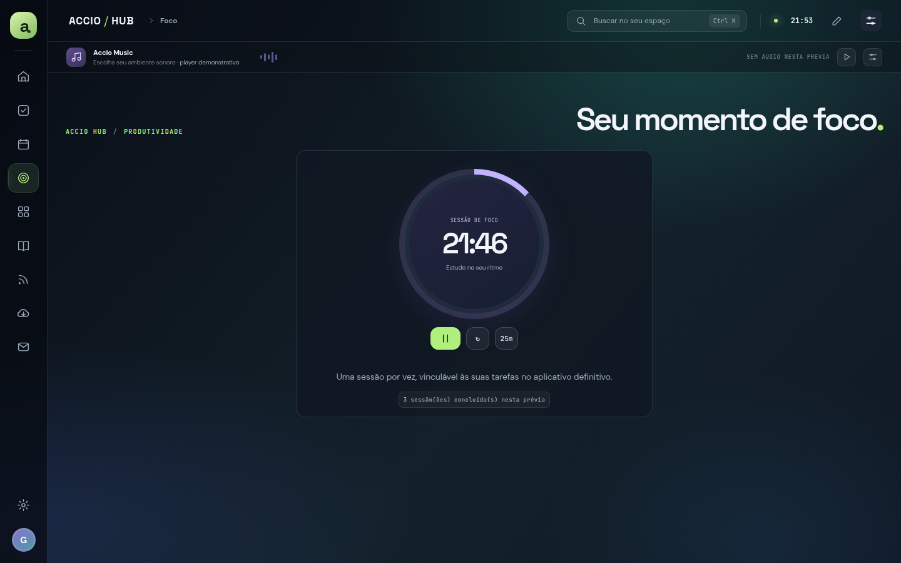
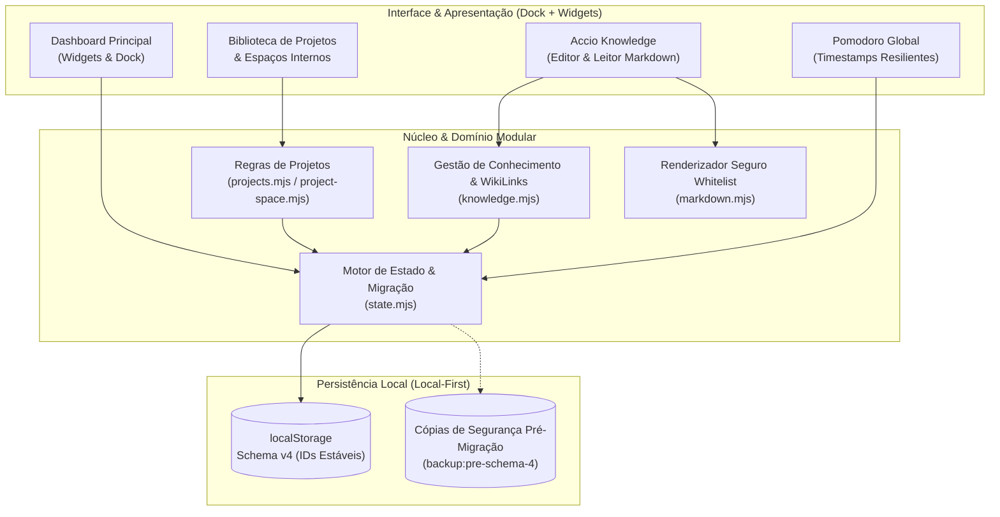

# Accio Hub

> **Central pessoal de produtividade, organização de projetos e gestão do conhecimento em ambiente local.**

[](docs/ROADMAP.md)
[](docs/ARCHITECTURE.md)
[](#tecnologias)
[](docs/P0.4_FINAL_VERIFICATION.md)

---



---

## Sumário

- [Sobre o Projeto](#sobre-o-projeto)
- [Proposta e Identidade Visual](#proposta-e-identidade-visual)
- [Funcionalidades](#funcionalidades)
  - [Dashboard — Dock + Widgets](#1-dashboard--dock--widgets)
  - [Personalização Completa](#2-personalização-completa)
  - [Biblioteca e Gestão de Projetos](#3-biblioteca-e-gestão-de-projetos)
  - [Espaços Internos de Trabalho](#4-espaços-internos-de-trabalho)
  - [Accio Knowledge — Gestão de Notas e Markdown](#5-accio-knowledge--gestão-de-notas-e-markdown)
  - [Temporizador de Foco (Pomodoro)](#6-temporizador-de-foco-pomodoro)
  - [Persistência Local e Resiliência de Dados](#7-persistência-local-e-resiliência-de-dados)
  - [Módulos Demonstrativos nesta Fase](#8-módulos-demonstrativos-nesta-fase)
- [Arquitetura e Decisões de Engenharia](#arquitetura-e-decisões-de-engenharia)
- [Tecnologias](#tecnologias)
- [Qualidade, Testes e Metodologia](#qualidade-testes-e-metodologia)
- [Como Executar Localmente](#como-executar-localmente)
- [Roadmap de Evolução](#roadmap-de-evolução)
- [Autor](#autor)

---

## Sobre o Projeto

O **Accio Hub** nasceu de uma necessidade prática: centralizar o fluxo de trabalho pessoal e acompanhar a saúde de serviços e rotinas em uma estação de trabalho Ubuntu — especialmente rotinas de backup, notas técnicas e projetos de desenvolvimento —, sem a dependência de plataformas proprietárias em nuvem ou dashboards administrativos dispersos.

Ao longo do planejamento técnico, a proposta evoluiu de um simples painel de monitoramento para um **ambiente pessoal integrado de produtividade e conhecimento**, unindo três pilares:

1. **Visão Executiva Instantânea:** abrir o aplicativo e identificar, em poucos segundos, prioridades do dia, status de projetos e tarefas ativas.
2. **Ambiente de Trabalho Focado:** alternar com fluidez entre sessões de foco (Pomodoro), biblioteca de projetos e escrita técnica aprofundada em Markdown.
3. **Soberania dos Dados (Local-First):** manter notas, registros e configurações sob controle direto do usuário, sem bloqueios de plataforma (*vendor lock-in*).

---

## Proposta e Identidade Visual

O Accio Hub adota o paradigma **Dock + Widgets**, inspirado na estética limpa e funcional de dashboards modernos como o **Homarr**, na metodologia de organização e foco do **Super Productivity** e na flexibilidade de arquivos do **Obsidian**:

- **Desktop Pessoal:** navegação compacta e periférica que prioriza a área de trabalho útil.
- **Tipografia Expressiva:** combinação balanceada de tipografia moderna (`DM Sans`, `Space Grotesk` e `JetBrains Mono`) com suporte nativo a fontes *fallback* de sistema para operação 100% offline.
- **Superfícies Translúcidas e Temas Customizáveis:** suporte a temas Claro e Escuro, múltiplos papéis de parede CSS procedurais e ajuste de cores de destaque.

---

## Funcionalidades

### 1. Dashboard — Dock + Widgets

O painel inicial do Accio Hub reúne os principais módulos de forma organizada, permitindo visualização rápida e customização direta:

- **Dock Lateral e Dock de Aplicativos:** atalhos rápidos com categorização visual e ordenação flexível.
- **Widgets Reorganizáveis e Redimensionáveis:** suporte a arrastar e soltar (*drag & drop*) ou ajuste acessível via teclado, com larguras modulares variando de 3 a 12 colunas em um grid responsivo.
- **Busca Rápida Global (<kbd>Ctrl + K</kbd>):** paleta de comandos para localização imediata de telas, tarefas ativas e notas de conhecimento por título, conteúdo e tags.
- **Captura Rápida (<kbd>Ctrl + Shift + N</kbd>):** criação instantânea de notas a partir de qualquer ponto da interface.



---

### 2. Personalização Completa

A personalização visual e estrutural é um requisito de primeira classe no produto:

- **Temas Dinâmicos:** alternância fluida entre tema **Escuro** e tema **Claro**.
- **Papéis de Parede CSS:** quatro ambientes visuais desenvolvidos com gradientes puros (*Aurora/Northern*, *Pôr do Sol/Ember*, *Azul Profundo/Ocean* e *Grafite/Graphite*).
- **Cor de Destaque Personalizada:** seletor nativo para adaptar botões, anéis de foco e elementos interativos.
- **Controle de Densidade e Visibilidade:** possibilidade de ocultar ou reordenar widgets e ícones do dock conforme a preferência de cada momento.



---

### 3. Biblioteca e Gestão de Projetos

A **Biblioteca de Projetos** permite catalogar iniciativas, estudos e desenvolvimentos contínuos com clareza visual e filtros avançados:

- **Cards Visuais com Identidade Própria:** definição de ícone temático, cor característica, descrição técnica e contador dinâmico de tarefas pendentes e notas vinculadas.
- **Filtros e Estados do Ciclo de Vida:** visualização por status (*Todos*, *Ativos*, *Pausados*, *Arquivados*) e favoritos com persistência de preferências.
- **Arquivamento e Restauração Seguros:** projetos arquivados preservam integralmente seus vínculos com tarefas e notas existentes, com reversibilidade garantida e prevenção contra novas associações acidentais.
- **Busca Textual e Ordenação:** filtragem em tempo real por nome/descrição e ordenação por ordem alfabética ou atividade recente.



---

### 4. Espaços Internos de Trabalho

Cada projeto possui seu próprio espaço contextualizado com quatro áreas de navegação dedicadas:

- **Visão Geral:** resumo executivo do projeto contendo métricas de progresso, atalho para o Pomodoro global, tarefas pendentes prioritárias e notas recentes.
- **Tarefas:** quadro de atividades vinculadas ao projeto por ID estável, com níveis de prioridade e alternância rápida de conclusão.
- **Conhecimento:** listagem das notas associadas diretamente ao projeto, permitindo criação contextual de novas páginas.
- **Referências:** repositório de links externos com validação de protocolos seguros (`https://`, `http://`) e documentações de apoio.



---

### 5. Accio Knowledge — Gestão de Notas e Markdown

O módulo de conhecimento foi projetado para oferecer uma experiência ergonômica e confortável tanto para anotações rápidas quanto para sessões prolongadas de estudo e documentação técnica:

- **Estrutura de Pastas e Subpastas:** árvore hierárquica aninhada com contadores por pasta e **prevenção algorítmica total contra ciclos** (uma pasta pai não pode ser movida para dentro de seus próprios descendentes).
- **Três Modos de Exibição:**
  - **Markdown:** editor textual focado, com preservação de cursor e sem interferências visuais.
  - **Prévia:** divisão lado a lado (*split-view*) entre código-fonte e renderização HTML segura em tempo real.
  - **Leitura:** visualização tipográfica limpa e centralizada para estudo focado.
- **Modo Imersivo (Zen):** recolhimento independente da biblioteca lateral e do painel de propriedades para máxima área de escrita.
- **Autosave com Debounce (450ms):** salvamento automático não obstrusivo com sinalização explícita de estado (`Alterações pendentes · salvando…` $\to$ `Salvo neste navegador`) e atalho manual <kbd>Ctrl + S</kbd>.
- **WikiLinks Bidirecionais (`[[Nota]]`):** resolução inteligente por título que vincula páginas através de IDs estáveis internos. Se uma nota de destino for criada posteriormente, o link é resolvido de forma reativa sem adulterar o texto Markdown original do autor.
- **Compartilhamento Multiprojeto:** notas podem pertencer a múltiplos projetos simultaneamente via array relacional (`projectIds`), evitando duplicação de dados.





---

### 6. Temporizador de Foco (Pomodoro)

O recurso de foco auxilia na cadência de trabalho sem impor atritos desnecessários:

- **Temporizador Global Baseado em Timestamps:** a contagem regressiva calcula o tempo restante a partir de timestamps reais (`focusEnd`), permanecendo resiliente mesmo ao alternar entre páginas da aplicação.
- **Durações Sugeridas:** alternância rápida entre blocos de **25 minutos** e **45 minutos**, com pausa, reinício e contabilização de sessões concluídas.
- **Presença Ubíqua:** acessível tanto pelo widget na tela inicial, pela página dedicada de **Foco**, quanto pelo painel de controle dentro dos espaços de projetos.



---

### 7. Persistência Local e Resiliência de Dados

O protótipo opera 100% no navegador, implementando um pipeline rigoroso de gerenciamento de estado:

- **Schema Versionado (Versão 4):** validação estrita de integridade com migrações automatizadas e determinísticas a partir de versões anteriores.
- **Backup Preventivo Automático:** antes de migrar qualquer estrutura de dados, o motor grava uma cópia de segurança intacta sob a chave `accio-hub-p0.3-studio:backup:pre-schema-4` (com sufixo único contra sobrescrita acidental).
- **Proteção Contra Corrupção de Dados:** caso seja detectado um JSON corrompido ou schema incompatível, o sistema trava gravações, exibe alerta visível e opera em memória, preservando integralmente o armazenamento físico pré-existente.
- **Tolerância a Falhas de Armazenamento:** em caso de restrições de cota (`QuotaExceededError`), rascunhos em digitação permanecem preservados em memória, prevenindo perda de notas durante sessões de escrita.
- **Identificadores Estáveis:** projetos, pastas, notas e referências utilizam UUIDs ou IDs numéricos independentes de nomes e caminhos de pastas, preparando a futura transição para arquivos físicos.

---

### 8. Módulos Demonstrativos nesta Fase

Para garantir transparência técnica total, os seguintes módulos estão presentes na interface atual como **protótipos conceituais/demonstrativos**, antecipando a experiência visual planejada para as próximas etapas:

- **Accio Music:** barra global e painel expandido presentes para validação de layout; reprodução de áudio planejada para fase posterior.
- **Cards de Agenda, AccioFeed e Backups:** apresentam estruturas visuais e dados sintéticos exemplares, aguardando conexão com APIs e scripts locais reais nas fases definitivas.

---

## Arquitetura e Decisões de Engenharia

O Accio Hub foi estruturado com foco em baixo acoplamento, alta coesão e independência de ferramentas externas:



### Decisões Principais:

1. **Separação Rígida entre Modelo e Visualização:** módulos de domínio (`state.mjs`, `projects.mjs`, `knowledge.mjs`, `markdown.mjs`) são independentes do DOM, permitindo testes unitários puros sem emulação de navegador.
2. **Renderização Markdown Segura por Whitelist:** o motor [`markdown.mjs`](prototype/markdown.mjs) não delega HTML arbitrário para a página; todas as tags do usuário são convertidas em texto puro ou sanitizadas contra vetores de Cross-Site Scripting (XSS). Protocolos perigosos (`javascript:`, `data:`, `vbscript:`) e credenciais embutidas são estritamente neutralizados.
3. **Markdown Canônico como Fonte da Verdade:** a formatação original do usuário e caracteres de formatação são preservados integralmente sem mutações artificiais de texto, assegurando compatibilidade com o futuro Vault em arquivos `.md`.

---

## Tecnologias

### Stack Atual do Protótipo (P0.4):

- **HTML5 Semântico:** estruturação baseada em landmarks (`main`, `aside`, `nav`, `article`, `header`), atributos WAI-ARIA e semântica pura.
- **CSS Moderno:** CSS Custom Properties (tokens de design), CSS Grid, Flexbox, efeitos de vidro (`backdrop-filter`) e regras responsivas sem frameworks de utilitários externos.
- **JavaScript (ES Modules):** código modular nativo em JavaScript moderno, sem necessidade de bundlers (Webpack, Vite) ou transpiladores na fase atual.
- **Web Storage API:** gerenciamento de estado estruturado via `localStorage` com versionamento de schema.
- **Node.js Test Runner (`node:test`):** suíte de testes automatizados executada diretamente sobre o motor nativo do Node.js, sem dependências externas instaladas no repositório.
- **Git:** controle rigoroso de versão com commits semânticos e tags anotadas de homologação (`p0.4-approved`).

### Stack Planejada para a Aplicação Definitiva (P1 em diante):

> [!NOTE]
> A implementação da versão definitiva terá início após a fase P0. O protótipo navegável atual serviu para validar exaustivamente produto, fluxos, modelos e design antes de iniciar a camada de backend.

- **Ruby on Rails 8:** robustez, convenções estabelecidas e produtividade no backend.
- **Hotwire (Turbo + Stimulus):** interfaces reativas em tempo real sem o peso de frameworks SPA complexos.
- **Tailwind CSS:** sistema de utilitários alinhado aos tokens visuais estabelecidos na baseline P0.3.
- **SQLite:** banco de dados relacional rápido, embutido e de fácil backup para tarefas, projetos e metadados.
- **Vault Markdown Real:** armazenamento físico de notas em arquivos `.md` locais em disco, compatíveis diretamente com editores como Obsidian e Visual Studio Code.
- **PWA (Progressive Web App):** aplicativo instalável no desktop e dispositivos móveis.
- **Tailscale:** conectividade segura em malha fechada para acesso remoto entre o desktop Ubuntu, notebook e celular.

---

## Qualidade, Testes e Metodologia

O desenvolvimento do Accio Hub segue uma abordagem estritamente orientada a especificações e verificação contínua, documentada nos relatórios presentes na pasta [`docs/`](docs/):

- **Desenvolvimento Incremental em Etapas:** cada ciclo de implementação (modelagem de estado, biblioteca de projetos, espaços contextuais e módulo de conhecimento) seguiu planos incrementais com critérios de aceitação verificáveis.
- **Duplo Papel e Auditorias Cruzadas:** o fluxo de trabalho utiliza agentes de IA especializados (**Codex** para implementação e **Antigravity** para auditoria independente e investigação adversária).
- **Habilidades Especializadas no Fluxo:** integração de skills de engenharia como `verification` (planejamento e comprovação de mudanças), `bug-hunt` (exploração de casos de borda), `diagnose` (análise de causas-raiz), `codebase-map` (mapeamento arquitetural) e `agent-browser` (interação e inspeção no navegador real).
- **Cobertura Comprovada nos Relatórios:**
  - **66 testes unitários automatizados** cobrindo regras de negócio, ciclo de vida de projetos, migrações de schema e integridade do conhecimento.
  - **51 cenários de teste de navegador automatizados** exercitando interações completas, integridade de foco, autosave e responsividade em múltiplas larguras (1440px, 390px e 320px).
  - **Auditoria de Acessibilidade com `axe-core`:** conformidade com diretrizes WCAG 2.1, navegação por abas com setas direcionais (<kbd>ArrowLeft</kbd>, <kbd>ArrowRight</kbd>, <kbd>Home</kbd>, <kbd>End</kbd>) e armadilha de foco em modais com <kbd>Tab</kbd>, <kbd>Shift + Tab</kbd> e <kbd>Escape</kbd>.
  - **Homologação Manual do Usuário:** validação visual humana no Mozilla Firefox aprovando a interface e o Pomodoro adaptativo.

---

## Como Executar Localmente

Como o protótipo da fase P0.4 utiliza módulos JavaScript nativos e tecnologias web padrão, **não é necessário instalar gerenciadores de pacotes ou compilar código**.

### Pré-requisitos:

- Navegador moderno (Chromium, Chrome, Firefox, Safari ou Edge).
- Python 3 (geralmente pré-instalado em distribuições Linux e macOS).

### Passo a Passo:

1. Clone o repositório:
   ```bash
   git clone https://github.com/leogoecking/Accio-HUB.git
   cd Accio-HUB
   ```

2. Inicie o servidor local na porta `4173` apontando para a pasta `prototype`:
   ```bash
   python3 -m http.server 4173 --bind 127.0.0.1 --directory prototype
   ```

3. Acesse no navegador:
   ```text
   http://127.0.0.1:4173/
   ```

### Executar a Suíte de Testes Automatizados:

Se você tiver o Node.js instalado (v18 ou superior):

```bash
# Executa todos os testes unitários nativamente (sem npm install)
node --test prototype/tests/*.test.mjs
```

---

## Roadmap de Evolução

```text
[P0.3] Baseline Visual Aprovada ───► [P0.4] Protótipo Homologado ───► [P1] Fundação Rails & SQLite ───► [P2+] Módulos Finais
       • Dock + Widgets aprovado            • Projetos & Espaços                     • Rails 8 + Hotwire               • Integrações reais
       • Identidade de desktop              • Accio Knowledge + Markdown             • Vault Markdown em disco         • AccioFeed & Backups
       • Temas e personalização             • Migrações & Schema v4                  • SQLite relacional               • Áudio no Accio Music
```

- **P0.3 (Concluída):** Aprovação da identidade visual de referência no commit `0018bb4`.
- **P0.4 (Homologada):** Implementação e validação da Biblioteca de Projetos, Espaços de Trabalho, Accio Knowledge (Markdown, pastas e WikiLinks), Pomodoro global e persistência resiliente. Encerramento registrado com a tag `p0.4-approved`.
- **P1 (Próxima Fase):** Fundação da aplicação definitiva em Ruby on Rails 8, Hotwire (Turbo + Stimulus), SQLite e introdução do Vault Markdown real com armazenamento em arquivos `.md` locais.
- **Fases Futuras:**
  - Domínio completo de tarefas contextuais e subtarefas.
  - Monitoramento passivo (somente leitura) dos serviços e rotinas de backup do Ubuntu (Restic e systemd).
  - Conexão com a API real do agregador AccioFeed.
  - Integração de áudio e ambientação sonora no Accio Music.
  - Módulo avançado de personalização do Pomodoro (ciclos configuráveis, notificações de sistema e perfis de foco).

---

## Autor

Desenvolvido por **Leandro Goecking**.

- **LinkedIn:** [linkedin.com/in/leogoecking](https://www.linkedin.com/in/leogoecking/)

---

*Accio Hub — Organização, informação e um ambiente pessoal de produtividade sob medida.*
