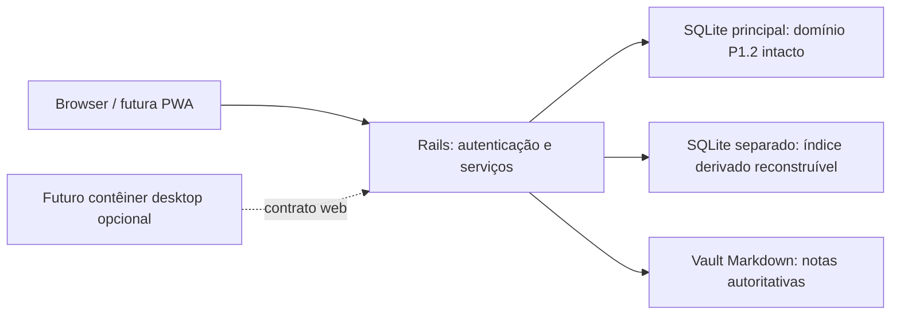

> **Estado atual — 25/10/2026:** P1.3-01 encerrada no escopo técnico/sintético por aceite humano após revalidação independente. Ver [encerramento técnico](P1.3_01_CLOSURE.md) e [recheck](P1.3_01_AUDIT_RECHECK.md). O texto abaixo preserva o registro de sua própria execução; estados e proibições anteriores não substituem esse aceite específico. P1.3-02 e nível C continuam sem autorização.

# ADR — Estratégia de plataforma do Accio Hub

Data: 23/10/2026. Fase: **P1.3 / Fase 0, exclusivamente planejamento**.

**Consolidação de 24/10/2026:** Rails 8 + Hotwire permanece a base; PWA é futura. Tauri é somente candidato opcional a empacotamento posterior. Nenhuma migração para Electron ou Flutter está autorizada. A Opção B de índice separado foi adotada por instrução humana atual, somente no desenho documental. Implementação/empacotamento continuam sem autorização; ver [decisões da Fase0](P1.3_PHASE0_DECISIONS.md).

**Status:** manutenção da decisão já aprovada **Rails + PWA** (PRODUCT, DEC-009). A análise e os detalhes de distribuição abaixo são propostas para revisão; não autorizam empacotamento, acesso remoto ou implementação. Não há fundamento técnico confirmado para substituir a stack nesta fase.

## 1. Referência examinada e decisões anteriores

Registro histórico da análise original de 23/10, não reexecutado nesta consolidação: `main` e `origin/main` foram conferidas após fetch e apontam para **`56a1189c7bdaa800cb44168a51edc3292cc95a76`**, merge da P1.2. O checkout estava limpo. A P1.2 e o CI estão contidos nessa referência. Foi observado **success** no [CI da main](https://github.com/leogoecking/Accio-Hub/actions/runs/39995794677), para esse mesmo SHA; não foi iniciada nova execução de testes nesta análise.

Base normativa: [AGENTS](../AGENTS.md), [PRODUCT](PRODUCT.md), [ARCHITECTURE](ARCHITECTURE.md), [ROADMAP](ROADMAP.md), [P1.0](P1.0_ARCHITECTURE_PLAN.md), [encerramento P1.2](P1.2_FINAL_CLOSURE.md) e [baseline](DESIGN_BASELINE.md). Os cabeçalhos e trechos antigos de PRODUCT/ARCHITECTURE que ainda descrevem fixtures ou fases anteriores são históricos; a implementação atual e o encerramento P1.2 prevalecem para o diagnóstico.

Decisões a preservar:

- Rails8, ERB, Hotwire/Turbo/Stimulus, SQLite e CSS homologado; sem conversão para Tailwind ou reescrita de frontend.
- Interface Dock + Widgets, identidade P0.3/P0.4, temas, fundos, tipografia e Music global.
- Arquivos Markdown como fonte da verdade das notas, índice reconstruível; projetos/tarefas/preferências/foco continuam transacionais no SQLite.
- Aplicativo pessoal local-first, Linux prioritário; instalações futuras independentes no Windows terão dados e credenciais próprios.
- Execução atual somente em loopback, autenticação e CSRF; Android/acesso remoto e sincronização não estão implementados.
- P1.2: A aprovado, B aprovado com ressalvas, **C não autorizado**. Um contêiner desktop ou uma PWA não resolvem por si as pendências operacionais de backup/chaves.

## 2. O que existe hoje

O Rails já entrega autenticação, preferências, projetos, tarefas, referências e Pomodoro. A UI Conhecimento ainda é demonstrativa; o protótipo `prototype/knowledge*.mjs` é a referência funcional a transportar incrementalmente. Não existe Vault operacional no Rails.

Há templates gerados em `rails/app/views/pwa/`, mas `routes.rb` não os publica e o layout não registra manifest/service worker. O manifest possui valores genéricos e o service worker contém apenas comentários. **PWA é direção aprovada, não funcionalidade homologada do checkout.** Esta Fase0 não os ativa.

Separar três problemas evita uma decisão de plataforma enganosa:

1. **Interface:** navegador/PWA ou janela nativa.
2. **Servidor e persistência:** execução do Ruby/Rails, SQLite, Vault e recuperação.
3. **Entrega:** instalação, atualizações, assinatura, permissões e suporte por SO.

Trocar o item1 não elimina os itens2 e3. A comparação abaixo é uma avaliação arquitetural para este repositório, não um benchmark de desempenho ou tamanho.

## 3. Comparação

| Critério | Rails + PWA — principal | Tauri2 | Electron | Flutter |
|---|---|---|---|---|
| Reutilização | Máxima: ERB/CSS/Stimulus, autenticação, serviços e testes existentes | Alta para UI web se mantiver Rails; requer host Rust/IPC e validação de webviews | Alta para UI web se mantiver Rails; acrescenta processo principal/preload e distribuição desktop | Baixa para UI nativa: ERB/Stimulus/CSS não viram widgets Dart; regras Rails só se mantido backend e novo contrato de cliente |
| Ubuntu/Windows | Navegação web; instalação PWA depende do navegador. Backend local Windows ainda precisa ser validado | Framework desktop disponível; WebKitGTK no Linux e WebView2 no Windows introduzem matriz de renderização | Framework desktop disponível, com Chromium/Node embarcados; pacote e manutenção próprios | Framework suporta desktop, mas exige toolchains, UI e integração nativa por plataforma |
| Android futuro | Cliente web/PWA do mesmo servidor autenticado; Ubuntu precisa estar acessível | Tauri2 oferece caminho móvel, sem provar distribuição de Ruby/Rails no Android | O alvo documentado é desktop; Android exigiria outro cliente | Alvo Android disponível, mas seria outro cliente para os contratos atuais |
| SQLite e Markdown | Rails acessa o disco do host; navegador envia comandos autenticados | Via Rails mantido, ou ponte Rust que duplicaria domínio se acessasse dados por fora | Via Rails mantido; acesso direto por Node criaria segunda fronteira de escrita | Via backend Rails, ou plugins/FFI e reimplementação local dos contratos |
| Backend Rails local | Já funciona no Ubuntu; distribuição do runtime é trabalho separado | Sidecar precisa de runtime Ruby/gems/bibliotecas/assets e lifecycle por alvo | Processo filho igualmente precisa do runtime Ruby; Node não executa Rails | Flutter não empacota Rails automaticamente; backend externo/sidecar seria outro problema |
| Segurança | Mantém sandbox do browser e fronteira autenticada única no Rails | Capacidades/IPC mínimos, CSP e isolamento do processo; sem acesso irrestrito ao disco | Sandbox/context isolation, Node desativado no renderer, IPC validado e atualizações constantes | Permissões/plugins/FFI e acesso a dados precisam de política própria; novo cliente amplia superfície |
| Operação/manutenção | Menor mudança neste projeto; servidor e dados ainda exigem operação segura | Acrescenta Rust, plugins, webviews e builds por SO, além do Rails se preservado | Acrescenta Electron/Chromium/Node, preload e builds, além do Rails | Maior reescrita e matriz Dart/plugins/API; não justificada pelo objetivo atual |
| Distribuição/updates | Assets web e backend atualizados separadamente; PWA não instala nem atualiza Ruby | Instaladores/atualizador do ecossistema, com assinatura e plano de migração do backend | Ferramentas de pacote/assinatura/update; particularidades por SO | Empacotamento e canais de distribuição por plataforma; compatibilidade de dados precisa ser projetada |

Fundamentos externos da comparação:

- PWA exige HTTPS ou ambiente local elegível; suporte de instalação varia. A ausência de instalação por manifest no Firefox não impede usar a interface como site. Não prometemos o mesmo modo de instalação em todos os navegadores. [MDN: instalação](https://developer.mozilla.org/en-US/docs/Web/Progressive_web_apps/Guides/Making_PWAs_installable).
- APIs de arquivos do navegador têm permissões e suporte próprios; elas não são substituto transparente do Vault no servidor. Service workers operam no contexto web e podem interceptar/cachear requisições; não são um runtime Rails. [File System API](https://developer.mozilla.org/en-US/docs/Web/API/File_System_API), [Service Worker API](https://developer.mozilla.org/en-US/docs/Web/API/Service_Worker_API).
- Tauri usa webviews do sistema e um núcleo Rust; sua documentação de sidecars exige binários adequados a cada target. O suporte móvel do framework não comprova que nosso servidor Ruby possa acompanhá-lo. [Arquitetura](https://v2.tauri.app/concept/architecture/), [pré-requisitos](https://v2.tauri.app/start/prerequisites/), [sidecars](https://v2.tauri.app/develop/sidecar/), [plataformas Tauri2](https://v2.tauri.app/start/).
- Electron embarca Chromium/Node e documenta Windows/macOS/Linux. Sua orientação de segurança inclui isolamento e tratamento rigoroso de conteúdo/IPC; a aplicação precisa acompanhar o ciclo de manutenção do framework. [Introdução](https://www.electronjs.org/docs/latest), [segurança](https://www.electronjs.org/docs/latest/tutorial/security), [releases](https://www.electronjs.org/docs/latest/tutorial/electron-timelines).
- Flutter documenta Ubuntu, Windows e Android; a persistência SQLite envolve dependências e suporte por plataforma. Isso não fornece tradução da interface ERB existente. [Plataformas](https://docs.flutter.dev/reference/supported-platforms), [SQLite](https://docs.flutter.dev/cookbook/persistence/sqlite).

## 4. Recomendação

**Manter Rails + PWA como arquitetura principal.** Implementar o Vault atrás dos serviços Rails e da autenticação existente, reutilizando UI web e contratos. PWA completa, empacotamento desktop e Android não são pré-requisitos para um Vault correto e não entram na implementação funcional da P1.3 sem escopo próprio.

Não foi identificada necessidade atual de API exclusiva do SO, operação independente no Android ou comportamento offline que exija trocar de plataforma. Reescrever em Flutter ou deslocar persistência para Rust/Node adicionaria custo e risco aos contratos homologados sem resolver o problema central de consistência Markdown/SQLite.

Tauri pode ser candidato futuro a **contêiner opcional**, se surgir necessidade comprovada de launcher, bandeja ou integração nativa. Electron permanece apenas alternativa comparada neste ADR; sua adoção e qualquer migração para Flutter não estão autorizadas. Não se escolhe um vencedor desktop sem ensaio de distribuição, segurança, acessibilidade e lifecycle no Ubuntu e Windows. Nenhum deles está autorizado nesta fase.

O plano consolidado do Vault adota a Opção B: um SQLite derivado separado para FTS5, preservando o banco transacional/backup P1.2 após incompatibilidade prospectiva demonstrada em memória; isso não cria outro backend. A escolha arquitetural foi determinada no pedido humano de consolidação; configuração e evolução do schema próprio serão homologadas no corte03, antes de implementação autorizada desse corte. Markdown e metadados portáveis são autoritativos; não há FK/JOIN entre bancos nem alteração do principal. O índice não integra o backup autoritativo e será reconstruído após restore.

Uma eventual janela nativa deve consumir os mesmos comandos do Rails. Não abrir o SQLite nem escrever Markdown diretamente por IPC/Node/Dart em paralelo ao motor do Vault. Não duplicar sessão de foco ou preferências no contêiner.

## 5. Modos de uso e distribuição

| Modo | Modelo recomendado | Estado |
|---|---|---|
| Ubuntu local | Backend Rails e Vault no disco local, browser/PWA em loopback | Backend atual; PWA e Vault ainda não homologados |
| Windows como cliente do Ubuntu | Mesmo servidor, HTTPS e acesso autenticado restrito | Futuro; não acessa SQLite/Vault por compartilhamento de arquivos |
| Windows como instalação independente | Runtime/backend/dados/chaves próprios; mesma UI web | Futuro; exigir prova nativa de caminhos, locks, ACLs, rename e restauração |
| Android como cliente | Browser/PWA conecta ao servidor disponível | Futuro; loopback do telefone não aponta ao Ubuntu |
| Android offline independente | Exigiria outro contrato de persistência/sync e recuperação | Fora do escopo; não é prometido por esta decisão |

O middleware loopback, hosts permitidos e trusted proxies atuais não autorizam exposição remota. HTTPS/proxy/Tailscale e política de origem/sessão exigirão revisão e testes específicos antes de habilitar qualquer cliente remoto. Não se altera configuração do Ubuntu nesta fase.

Uma PWA futura deverá cachear apenas assets públicos elegíveis; notas, prévias, busca, autenticação, comandos e respostas privadas devem permanecer fora do cache do service worker, preservando `Cache-Control: no-store`. Não haverá fila offline de gravações sem contrato explícito de conflitos. Atualizar o browser/PWA não atualiza o backend nem transforma dados antigos automaticamente.

Para instalações independentes: código/instalador não inclui banco, Vault, conta ou segredo de outra instalação. Atualizações futuras precisam de backup verificável, compatibilidade de schema, caminho de recuperação e proteção dos dados fora do diretório do aplicativo. Não há compartilhamento implícito nem SQLite em pasta de rede/sincronização como mecanismo multi-dispositivo.

O Gemfile.lock atual inclui plataformas Linux/macOS, não Windows; runtime/gems nativas e instalação local Windows ainda precisam de ensaio próprio. Um cliente Windows do servidor Ubuntu não exige esse runtime no cliente.

Todos os contêineres exigiriam supervisão do Rails (porta loopback disponível, prontidão, instância única, desligamento, logs redigidos e não execução como administrador), Ruby/gems nativas por arquitetura e chaves fora do pacote público. Sidecar não é sinônimo de executável Rails portátil pronto. Atualizações também precisariam coordenar versão de UI/backend/dados. [Updates Tauri](https://v2.tauri.app/plugin/updater/), [updates Electron](https://www.electronjs.org/docs/latest/tutorial/updates), [distribuição Flutter Windows](https://docs.flutter.dev/deployment/windows) e [Linux](https://docs.flutter.dev/deployment/linux) mostram mecanismos distintos, não uma solução já validada para o Accio Hub.

## 6. Condições objetivas para revisar a decisão

Reabrir este ADR somente com um requisito concreto e um experimento comparativo:

1. API nativa essencial indisponível ou inviável no browser para o fluxo aprovado.
2. Necessidade aprovada de aplicativo Android independente/offline, com contrato de sincronização financiado e definido.
3. Falha de distribuição/suporte do backend local que um contêiner efetivamente resolva, com protótipo empacotado e restauração testada por SO.
4. Requisito medido de acessibilidade, desempenho ou renderização que não possa ser atendido na arquitetura atual.

Comparar esforço total, preservação da identidade/contratos, superfície de ataque, instalação limpa, update/rollback e suporte; não decidir apenas por tamanho anunciado do binário ou preferência de linguagem. As avaliações de custo acima são inferências para esta codebase, não números medidos.

## 7. Resultado e limites desta Fase0

Direção existente preservada. Novos detalhes são submetidos à revisão com [P1.3_PLAN.md](P1.3_PLAN.md). Não foram instalados frameworks, criados servidores ou acessados diretórios privados. Nenhum empacotamento, PWA funcional, alteração de código ou integração com IA implementado. Sem commit, staging, push, merge ou tag. A aprovação sintética P1.2 não foi convertida em liberação operacional C.

Revisão documental de 24/10: comparação histórica preservada; não se revalidaram versões/suporte externos nem benchmarks. Alterações limitadas ao estado de decisão, diagrama e fronteiras do índice. Nenhuma implementação autorizada por este ADR.
