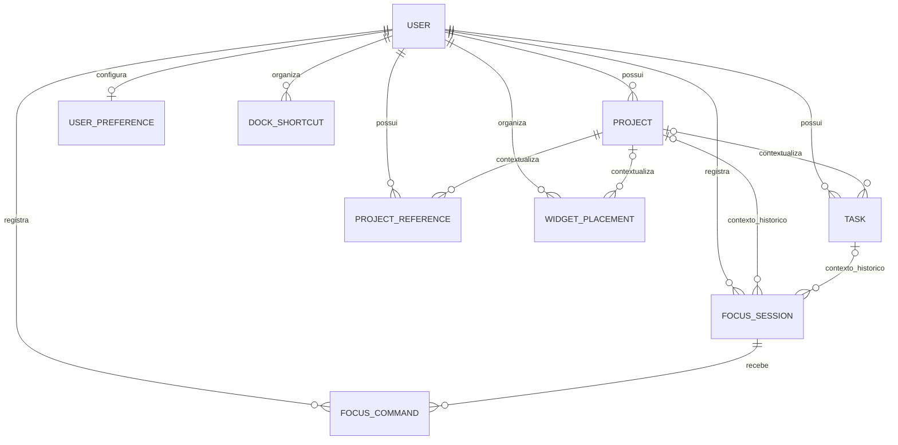

# Accio Hub — P1.2B: Fundação relacional SQLite

**Data:** 2026-10-12. **Estado:** aprovada após auditoria independente do Antigravity, sem bloqueadores. Registro em commit autorizado antes da P1.2C.
**Conclusão verification:** confirmado nos cenários sintéticos descritos abaixo.
P1.2C não iniciada. Nenhum banco pessoal/existente foi migrado nesta sessão.

## 1. Preparação, autorização e ambiente

Skills utilizadas: `codebase-map` e `verification`. O gate estabeleceu provas
nos modelos, no SQLite sem validações Rails, em transações e em processos Rails
independentes. Sucesso exige preservar autenticação/cookies e impedir vínculos
inválidos, escritas em projetos arquivados, sobrescritas obsoletas e foco duplicado.

- `main` limpa, atualizada de `origin/main`, em `f3728575b17b3b4e44378bf782d243766b01c130`.
- Ancestralidade da tag anotada `p1.1-approved` confirmada em main;
  commit `a6c2772a6c53b122345a5753ebee7cb2aa9443d6`.
- Branch criada a partir dessa main: `p1-persistence`.
- `p0.4-approved` preservada, commit `0d8bd98621cea42424373214ea5b5dc2b7faca85`;
  identidade visual continua em `0018bb4`.
- AGENTS, arquitetura, roadmap, planos/verificações anteriores e implementação
  de autenticação/preferências/demonstrações foram inspecionados.
- [Planejamento P1.2A aprovado](P1.2A_SQLITE_PLAN.md) registrado em docs nesta entrega,
  mantendo as decisões P1.0 e o histórico da P1.1.

| Ferramenta | Versão/ambiente observado |
|---|---|
| Sistema | Ubuntu 26.04.1 LTS, x86_64 Linux |
| Ruby / Rails | 3.3.6 / 8.1.3.1 |
| sqlite3 gem / SQLite | 2.9.6 / 3.53.2 |
| RuboCop | 1.92.0; rubocop-rails 2.38.0; performance 1.27.0 |
| Brakeman | 8.1.0 |
| Autoload | Zeitwerk, verificado via Rails |

Dependências existentes em `rails/vendor/bundle` foram reutilizadas. Nenhuma gem,
dependência global, serviço ou configuração global do Ubuntu foi instalada/alterada.

## 2. Modelos e tabelas

Oito modelos/tabelas adicionados, sem seeds de produto. `users` e `auth_sessions`
da P1.1 conservam schema, credenciais e comportamento. `User` recebe associações.

| Modelo / tabela | Estrutura e contrato |
|---|---|
| Project / projects | UID, proprietário, nome normalizado, descrição, ícone/tint/cor, favorito, status, origem do arquivamento e datas; `archive!`/`restore!`; exclusão física recusada |
| Task / tasks | UID, proprietário, projeto opcional, título, status, prioridade, posição e conclusão; vínculos por ID |
| ProjectReference / project_references | UID, proprietário/projeto, título, link/material, URL, descrição e posição; URLs HTTP/HTTPS sem credenciais validadas no Rails |
| UserPreference / user_preferences | Singleton por usuário; tema/fundo/destaque/densidade/Music, presets de foco, filtros da biblioteca; versão de formato, inicialização, digest e snapshot de cookie para futura transição |
| DockShortcut / dock_shortcuts | Módulo do catálogo, posição e visibilidade; identidade usuário/módulo imutável |
| WidgetPlacement / widget_placements | Contexto home/project, projeto opcional coerente, widget de catálogo, posição, span homologado e visibilidade |
| FocusSession / focus_sessions | UID, contexto histórico opcional de projeto/tarefa, preset 1500/2700s, elapsed, status e checkpoints; uma tentativa ocupante por usuário |
| FocusCommand / focus_commands | Chave de comando, usuário/sessão, tipo, versão esperada, SHA-256 da solicitação, parâmetros e resultado JSON; recibo técnico imutável |

Os sete modelos sujeitos a edição têm `lock_version` e timestamps operacionais.
FocusCommand é append-only, registra a versão esperada e não usa versão editável.
Projetos/tarefas/referências também têm datas opcionais de origem, distintas dos
timestamps operacionais; não são fabricadas datas legadas. Detalhes de campos e
tipos no [plano A](P1.2A_SQLITE_PLAN.md) e em `rails/db/schema.rb`.



Não há tabela nem conteúdo de notas. Não há controllers, rotas ou formulários
novos de produto. Todas as telas continuam demonstrativas e somente leitura.

### Identidade pública

`uid` é texto opaco, imutável e único por proprietário/entidade; novos registros
recebem UUID quando o UID é omitido. UIDs legados não exigem formato UUID.
O valor armazenado não é slug nem é alterado ao renomear.

`PublicUid.encode/decode` e `to_param` usam prefixo `u-` e Base64 URL-safe sem padding.
Decodificação exige representação canônica, UTF-8 válido, UID não vazio e sem NUL.
Testados Unicode, barras, espaços, `%`, `?`, `#` e ID numérico representado como
texto. A codificação não é segredo/autorização; futuras rotas decodificarão e
buscarão o UID exclusivamente nas associações do administrador autenticado.

## 3. Migrações, restrições e índices

Quatro migrações aditivas, sem editar a migração homologada da autenticação:

1. `20261012010000`: projetos, tarefas e referências.
2. `20261012020000`: preferências, Dock e widgets.
3. `20261012030000`: foco e recibos.
4. `20261012040000`: gatilhos de proteção de escrita.

SQL e Rails verificam presença, catálogos, booleans, limites, versões inteiras
não negativas e formatos aplicáveis. JSON de recibos/snapshot deve ser objeto.
Nomes de projetos têm chave normalizada NFKC/minúsculas, única inclusive em
projetos arquivados. A aplicação calcula essa chave; SQL aplica sua unicidade.

Todas as tabelas têm FK de usuário. FKs compostas `(user_id, project_id)`,
`(user_id, task_id)` e `(user_id, focus_session_id)` apontam para índices únicos
`(user_id, id)`, com RESTRICT. Não é possível relacionar proprietários distintos
ignorando validações Rails. `PRAGMA foreign_keys=1` confirmado, e
`PRAGMA foreign_key_check` não encontrou violações nas bases verificadas.

Índices únicos: usuário/UID em quatro entidades; usuário/nome de projeto;
singleton de preferências; usuário/módulo e usuário/posição de Dock;
usuário/chave de comando. Consultas por status, atividade e contexto/ordem
têm índices correspondentes.

| Índice parcial | Unicidade e predicado |
|---|---|
| widget_home_key | usuário/widget, `context='home'` |
| widget_home_position | usuário/posição, `context='home'` |
| widget_project_key | usuário/projeto/widget, `context='project'` |
| widget_project_position | usuário/projeto/posição, `context='project'` |
| one_global_focus | usuário, status ready/running/paused/awaiting_confirmation |

Os índices foram inspecionados em `sqlite_master` e exercitados por inserções
que ignoram callbacks/validações. NULL em projeto não contorna unicidade home.
Os CHECKs de contexto restringem também quais widgets pertencem a cada tela.

### Arquivamento e proteção SQL

25 gatilhos `accio_*` protegem identidades/proprietários, projetos arquivados,
conteúdo vinculado, contexto inicial de foco, tentativas encerradas e recibos.

Arquivar conserva tarefas, referências e seus IDs. Atualizar/criar/excluir
tarefa, referência ou widget de projeto arquivado falha inclusive por SQL direto.
A troca para outro projeto também verifica o vínculo anterior, impedindo contorno
pelo formulário global. Restauração isolada recupera active/paused; alterações
simultâneas de conteúdo durante restauração são recusadas. Projetos não podem
ser excluídos fisicamente neste corte.

Foco global já existente pode pausar, reconciliar sua conclusão ou ser encerrado
após arquivamento, liberando o temporizador sem alterar conteúdo do projeto.
Novo foco, retomada de pausa, mudança de duração ou contexto arquivado são
recusados. Esse contrato localizado evita prender o temporizador global; não
implementa o motor de transições nem concede edição a projeto/tarefa arquivados.

Rails omite gatilhos no dump Ruby padrão de SQLite. O initializer
`sqlite_trigger_schema.rb` inclui somente gatilhos `accio_*` em `schema.rb`.
Isso conserva o fluxo Rails e evita instalar um executável SQLite para dump SQL.
Migração e `db:schema:load` produziram definições idênticas dos índices e dos
25 gatilhos, comprovadas em bancos diferentes.

## 4. Concorrência, transações e contratos de foco

- Edição via Active Record usa optimistic locking. Projeto, tarefa, referência,
  preferência, Dock, widget e foco recusam versões antigas.
- Reordenação de Dock/widgets exige permutação completa e versão esperada da
  preferência, usada como raiz do agregado. Posições temporárias positivas fora
  da faixa ocupada evitam colisões; ajuste final e versão ficam no mesmo commit.
- Contextos vazios também são validados: projeto alheio/arquivado não pode
  provocar alteração de versão por uma reordenação sem registros.
- Inicialização conjunta de preferência/Dock/widgets é transacional e conserva
  snapshot de recuperação. Falha no último widget deixa as três tabelas vazias.
- Recibo de foco e efeito passam por `FocusCommand.record!` na mesma transação.
  Repetição compatível devolve recibo sem executar bloco; mesma chave com tipo,
  sessão, versão ou parâmetros diferentes é incompatível. JSON canônico evita
  diferença causada somente pela ordem de chaves.
- Uma solicitação nova com versão obsoleta é recusada. Falha de resultado inválido
  desfaz efeito e recibo e permite retentativa da versão original.

Campos e CHECKs permitem os seis estados básicos de foco, datas coerentes e
tempo decorrido entre zero e duração. O índice global cobre também ready e
paused; sessões encerradas preservam histórico sem ocupar o temporizador.
Contextos pertencem à tarefa ao criar a tentativa e continuam históricos se a
tarefa posteriormente mudar de projeto. Contexto/UID são imutáveis.

`record!` é uma primitiva de idempotência para comandos start/pause/reset/complete.
A interpretação desses comandos, relógio/reconciliação e interface serão P1.2E;
o chamador futuro implementará as transições permitidas dentro do bloco.

## 5. Testes e evidências

Todos os bancos usados nesta sessão foram novos, privados, temporários e
sintéticos. O script em `rails/script/relational-check.rb` não aceita caminho de
banco pessoal. Usa a migração original P1.1 via `db:migrate:up`, insere administrador
e sessões sintéticas e aplica as quatro novas migrações. Outro banco é criado por
`db:schema:load`; as provas de concorrência executam processos independentes.

Reprodução principal, dentro de `rails/`:

```sh
bundle exec ruby script/relational-check.rb
bundle exec rubocop
bin/brakeman --no-pager
```

Zeitwerk foi executado com `RAILS_ENV=test` e `ACCIO_DATABASE_PATH` para banco
temporário isolado. Nenhum servidor público foi iniciado.

| Verificação | Resultado e evidência |
|---|---|
| Baseline antes das mudanças | 23 testes, 224 asserções, zero falhas/erros — [log](assets/p1.2b/baseline-tests.log) |
| Suíte Rails completa final | **51 testes, 440 asserções, zero falhas/erros/skips** — [log](assets/p1.2b/rails-tests.log) |
| Evolução da base sintética P1.1 | Credencial sintética inalterada, duas sessões preservadas, domínio vazio — [migração](assets/p1.2b/migration-from-p11.log), [resultados](assets/p1.2b/process-results.json) |
| Schema load equivalente | Índices e 25 gatilhos idênticos à migração; FKs íntegras — [log](assets/p1.2b/schema-load.log) e resultados JSON |
| SQL direto | FKs simples/compostas, CHECKs, UIDs, índices parciais, identidades e recibos imutáveis exercitados nos testes |
| Edição entre dois processos | Um commit; outra versão obsoleta recusada; lock_version=1 |
| Reordenação entre dois processos | Um commit; outra versão obsoleta recusada; posições finais 0/1/2 sem colisão |
| Retentativa concorrente de foco | Dois processos recebem recibo de ID 2; um registro e um incremento de efeito |
| Ocupação global concorrente | Uma inserção aceita; segunda recusada pelo índice SQL; um ocupante |
| Rollback | Arquivamento revertido; inicialização incompleta revertida; posições temporárias e versão revertidas após gatilho sintético de falha; efeito sem recibo revertido |
| Reabertura em novo processo Rails | Atributos de todas as oito entidades idênticos; recibo reexecutado retorna resultado original sem efeito novo |
| Brakeman | 79 verificações; zero erros e avisos — [log](assets/p1.2b/brakeman.log) |
| RuboCop | 64 arquivos, zero infrações — [log](assets/p1.2b/rubocop.log) |
| Zeitwerk | All is good — [log](assets/p1.2b/zeitwerk.log) |

Concorrência/reabertura/durabilidade detalhadas em
[process-results.json](assets/p1.2b/process-results.json). As quatro corridas usam
barreiras para que ambos os processos tenham a mesma versão antes da disputa.

A fixture adversarial de proprietário diferente é criada somente em Rails test:
desabilita temporariamente CHECKs para inserir User 2 sintético, já que a P1.1
exige User 1 único, e os reabilita antes de exercitar todas as restrições de domínio.
A restrição de administrador único não foi relaxada na aplicação/migração.

### Regressão da autenticação e do cookie

Suíte existente repetida: login válido/inválido, normalização de e-mail, expiração,
logout, rate limit, CSRF, rotas protegidas, ausência de cadastro, loopback e
recuperação local com revogação de sessões. Migração compara o hash dos atributos
do usuário e a contagem de sessões antes/depois sem registrar senha/digest.

O teste HTTP de aparência verifica que uma preferência SQLite light/ocean não
altera o tema/fundo servido pelo cookie; PATCH de aparência também não altera
esse registro nem cria Dock/widgets. Interface autenticada e login mantêm o
contrato P1.1. Nenhuma inicialização operacional ou importação de cookies ocorreu.

Não houve teste visual/browser novo nesta fase: HTML/CSS/JS/controllers/rotas
permanecem iguais à main homologada e não foram conectados às tabelas. A aprovação
manual Firefox da P1.1 é histórico; não é apresentada como novo teste da P1.2B.

## 6. WAL e synchronous=FULL

Configuração somente da aplicação: foreign_keys=true, journal_mode=wal,
synchronous=full e timeout de 5000 ms. Consultas no Rails reaberto confirmaram
foreign_keys=1, journal_mode=wal e synchronous=2. Nenhuma configuração global mudou.

Benchmark sintético, três rodadas de 200 commits individuais por configuração:

| Modo WAL | Mediana por 200 commits | Média por commit derivada da mediana | Registros após reabertura |
|---|---|---|---|
| NORMAL | 4,841 ms | 0,0242 ms | 600 |
| FULL | 122,026 ms | 0,6101 ms | 600 |

FULL foi cerca de 25 vezes mais caro neste ensaio, mas o custo absoluto permanece
pequeno para comandos pessoais de baixa frequência. Recomenda-se FULL neste
corte pela prioridade de durabilidade e transações curtas. O ensaio mede esse
ambiente/disco, não capacidade geral nem latência de uma requisição completa.

Em WAL, FULL sincroniza também cada commit; NORMAL pode perder commits após
queda do sistema/energia. WAL permite leitura concorrente, mas apenas um escritor
e uso no mesmo host. Fundamentação: [SQLite synchronous](https://www.sqlite.org/pragma.html#pragma_synchronous)
e [WAL](https://www.sqlite.org/wal.html). A prova executada confirma reabertura e
concorrência de processos, não simula perda de energia nem garante o comportamento
do hardware, filesystem ou backups. Não colocar o SQLite em compartilhamento de rede.

## 7. Achados, riscos e limites

Nenhum bloqueador confirmado permanece nos cenários verificados. Durante a
verificação foram corrigidos: preparação que carregava automaticamente schema
atual antes de testar a base P1.1; dump sintético desatualizado após revisão de
migração ainda não publicada; retentativas de teste com objetos Active Record
alterados em memória; e validação de reordenação em contextos vazios.
Falhas intermediárias foram investigadas; a rodada final acima usa schema e
implementação atuais. Nenhuma evidência vermelha foi considerada aprovação.

| Limite/risco | Classificação e tratamento |
|---|---|
| Escrita operacional/cookies/timer ainda desconectados | Limite autorizado; requer P1.2C/D/E |
| Dois escritores podem atingir timeout sob contenção longa | Não bloqueador para a estrutura; camadas futuras deverão dar feedback/retentativa segura, sem sobrescrita automática |
| Optimistic locking exige escritas pelo contrato Rails | Limite técnico; SQL manual não compara/incrementa automaticamente lock_version; triggers/FKs/CHECKs continuam protegendo invariantes cobertas |
| Validação completa de URL e normalização Unicode vivem no Rails | SQL limita protocolo/campos/uniqueness; importação futura deve passar pelos modelos, não confiar em SQL bruto |
| Estado Active Record em memória após rollback | Recarregar/reconstruir objetos antes de retentar; inicialização C deve buscar associações frescas, sem reutilizar singleton cacheado após falha |
| Hook do SchemaDumper depende do Rails fixado | Repetir equivalência migração/schema load ao atualizar Rails ou adicionar gatilhos |
| Durabilidade física, falha de disco/energia e backups | Não exercitados; nenhuma garantia adicional de restauração declarada |
| UIDs legados e campos desconhecidos | Estrutura compatível; importação/relatório de schemas P0.4 somente P1.4 |

## 8. Arquivos alterados e próximas condições

- `rails/app/models/`: oito modelos, associações em User e concerns PublicUid,
  ProjectWriteProtection e OrderedPlacement.
- `rails/db/migrate/`: quatro migrações novas; `rails/db/schema.rb` equivalente.
- `rails/config/database.yml` e initializer de preservação de gatilhos.
- Três suítes `relational_*_test.rb`, helper sintético e testes de regressão em
  `test/integration/foundation_test.rb`.
- `rails/script/relational-check.rb`, README, evidências em `docs/assets/p1.2b/`.
- AGENTS, ARCHITECTURE, ROADMAP, estado da P1.0, plano aprovado P1.2A e este relatório.

Protótipo, assets, JS, views, controllers, rotas, autenticação/sessões/reset,
Gemfile e lockfile não foram alterados; nenhuma dependência adicionada.
`git diff --check` e inspeção dos arquivos novos concluídos sem problemas.
Não foram adicionados bancos, chaves, credenciais ou arquivos pessoais.
As tags homologadas permanecem iguais; working tree contém apenas a entrega B
e sua documentação, sem staging, commit, tag ou push nesta sessão.

Pendências P1.2C: bootstrap transacional autenticado/CSRF, validação do cookie,
snapshot e confirmação de persistência antes de removê-lo, tratamento de falhas,
recuperação explícita, versões do agregado e navegadores com cookies divergentes.
Somente depois o SQLite se tornará a fonte operacional definitiva de aparência.
P1.2D/E conectarão módulos; limpeza segura de sessões expiradas fica na P1.2F.
Vault/Markdown permanece na P1.3, dados pessoais/importação na P1.4.

**Homologação:** entrega B aprovada pelo usuário após auditoria independente do
Antigravity, sem bloqueadores. Commit autorizado na abertura da P1.2C; a nova
etapa possui autorização própria e deverá permanecer sem commit até revisão.
