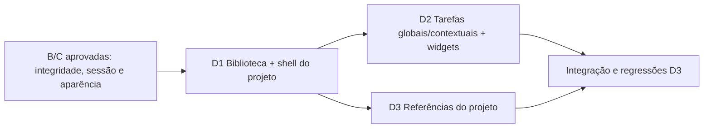

# Accio Hub — P1.2D: Projetos, tarefas e referências persistentes

**Data:** 2026-10-12. **Estado:** planejamento aprovado; D1 encerrada tecnicamente com ressalvas; exclusivamente D2 autorizada.
O contrato de intenção de criação com token assinado foi explicitamente aprovado.
D2 autorizada expressamente, incluindo movimentação pelo editor global e intenção assinada adaptada. D3 depende de autorização própria. D2 sem commit até revisão.
D1: `af5e24bab30d90bbb89c19b9798b69b20d1d9185`; Firefox C/D1, contraste e rascunhos em RAM continuam como ressalvas.
**Branch/base:** `p1-persistence`, commit `a7f11abfd8dde4709e88668aef941790411c92b8`.
O checkout estava limpo após registrar a P1.2C; somente este plano foi acrescentado.
Mapa com codebase-map, profundidade standard, limitado aos três fluxos de produto,
seus pontos de entrada Rails e às regressões adjacentes.

Referências: [P1.2A aprovada](P1.2A_SQLITE_PLAN.md),
[P1.2B](P1.2B_VERIFICATION.md), [P1.2C](P1.2C_VERIFICATION.md),
[arquitetura](ARCHITECTURE.md), [design](DESIGN_BASELINE.md).
Identidade: `0018bb4`. Comportamento/interface de produto: `p0.4-approved`
(`0d8bd98621cea42424373214ea5b5dc2b7faca85`), preservada integralmente.

## 1. Diagnóstico confirmado e mapa de dependências

| Origem / entrada | Comportamento observado | Caminho proposto para D |
|---|---|---|
| [projects.mjs](../prototype/projects.mjs) | Nomes normalizados, catálogo de ícones/cores, favoritos, status, restauração, busca sem acentos, ordenação e contagens por ID | `Project` existente, consultas Ruby e apresentação ERB |
| [project-library.mjs](../prototype/project-library.mjs) | Biblioteca, toolbar/filtros, cards, formulário com prévia, feedback, foco e Escape | Partials da biblioteca/formulário e controllers Stimulus pequenos |
| [project-space.mjs](../prototype/project-space.mjs) | Rota por ID/aba; seleção de tarefas/notas/referências; validação contextual e atividade | Consultas por associações; controllers HTTP e transações |
| [project-space-view.mjs](../prototype/project-space-view.mjs) | Visão Geral, quatro abas, formulários contextuais, bloqueio de escrita contextual em arquivados | Shell do projeto em D1; tarefas em D2; referências em D3; Conhecimento delimitado até P1.3 |
| [app.js](../prototype/app.js), `taskRow`, `widgetContent`, `innerPage`, eventos de tarefas | Lista global, criação global com projeto opcional, conclusão, contadores, atalhos e composição do dashboard | Mesmo registro SQLite em lista global, projeto e widgets |
| [state.mjs](../prototype/state.mjs) | Schemas/IDs/vínculos no localStorage | Somente referência de compatibilidade; importação pessoal reservada à P1.4 |
| `rails/config/routes.rb`, `StudioController#show` | `/`, `/apps/:page` e preferências; módulos de produto ainda demonstrativos | Rotas reais graduais, mantendo links da Dock e caminhos anteriores úteis |
| `rails/app/presenters/studio.rb`, `studio/_module`, `_board`, `widgets/_projects`, `widgets/_tasks` | Catálogos e fixtures de apresentação, números e registros literais | Preservar catálogos; retirar fixtures das superfícies conectadas ao SQLite |
| `rails/app/models/{project,task,project_reference}.rb` | Validações, versões, vínculos e proteção de arquivados já disponíveis | Reutilizar sem alterar modelos nesta sessão ou presumir mudanças futuras |
| `PublicUid`, `ProjectWriteProtection`, quatro migrações B e `schema.rb` | Identidade opaca/reversível, isolamento, FKs, CHECKs e 25 gatilhos | Base obrigatória de autorização e integridade |
| Autenticação/ApplicationController, AppearancePreferences, Stimulus `studio` | Administrador autenticado; no-store; agregado de aparência versionado; navegação/foco | Reutilizar, testando integração dos novos controllers com o shell |

Fluxos confirmados no protótipo:

```text
Biblioteca → regra projects.mjs → state.projects → persist/render
Dashboard/lista global → state.tasks → touchProjects → persist/render
Espaço por ID → spaceRecords → saveSpaceItem → coleção compartilhada → persist/render
```

Não há cópias próprias de tarefas por tela. `projectId` identifica a relação, não
o nome. Referências usam um projeto; notas usam vários, em um único registro.
No Rails, apenas preferências/autenticação estão operacionais; o banco possui as
estruturas B, mas as telas de produto ainda não consultam esses registros.

Dependências reais:



A divisão D1/D2/D3 é adequada. Referências dependem tecnicamente de D1, podendo
ser desenvolvidas sem tarefas; a entrega D3 também fecha a integração com D2.
Recomenda-se execução sequencial, com revisão/autorização entre entregas. O shell
interno deve começar em D1 para que seus links não levem a uma demonstração de
outro projeto. Atualização do dashboard acompanha cada módulo, desde sua conexão.

## 2. Contratos comuns de identidade, autorização e persistência

- SQLite é a fonte dos três módulos; queries começam em `Current.user.projects`,
  `Current.user.tasks` e `Current.user.project_references`. Nenhum `user_id` recebido
  do navegador define propriedade. Rotas aninhadas restringem também ao projeto.
- Usar `PublicUid.encode/decode/to_param` existentes. Exemplo de rota com token
  `u-...`; o UID armazenado continua literal, inclusive legado numérico como texto,
  espaços, Unicode e barras. Renomear não modifica UID nem FK interna.
- UID inválido/não canônico, registro ausente ou de outro proprietário retorna
  estado 404 compreensível, sem revelar existência alheia. Codificação não autoriza acesso.
- Atributos permitidos explicitamente por ação; `uid`, proprietário, datas de origem,
  chaves normalizadas e versões geradas não são editáveis pelo formulário.
  Apenas a versão esperada é entrada de concorrência.
- Datas operacionais são atribuídas pelo servidor. Campos `origin_*` ficam intactos;
  dados/datas do protótipo não são copiados ou fabricados nesta fase.
- Todas as escritas autenticadas usam CSRF. Não adicionar endpoints de escrita GET,
  seeds automáticos, storage paralelo no navegador ou callbacks que importem exemplos.
- Não propor migração de schema como pré-requisito. Qualquer necessidade de alterar
  modelo, índice ou gatilho exige justificativa, diff proposto e aprovação específica.

## 3. Biblioteca e espaços — D1

**Operações:** criar, consultar, editar nome/descrição/ícone/cor, definir favorito,
pausar/ativar, arquivar e restaurar. Não haverá exclusão física de projeto.

Reutilizar limites existentes: nome até 80; descrição até 500; unicidade da chave
NFKC/minúsculas inclusive arquivados; ícones/tints do catálogo; cor hex opcional.
Uma edição que não muda a cor preserva `color: nil` e o tint legado, como na P0.4.
Prévia de ícone/cor/nome pode ser Stimulus, mas a validação definitiva é Rails/SQLite.

`favorite` e status serão enviados como **estado desejado**, com versão esperada,
evitando inverter novamente em uma retentativa. Arquivar/restaurar reutiliza os
métodos existentes, preservando `archived_from`, tarefas, referências e vínculos.
Restauração é um comando isolado; não pode salvar simultaneamente novo nome/cor.

**Arquivados:** consultáveis, somente leitura. Cards e espaços devem desabilitar
edição, favorito e demais escritas, mantendo restauração. A P0.4 ainda oferece
favorito/edição no card arquivado e conclusão global sem essa barreira; prevalece
o contrato mais restritivo aprovado em A/B e solicitado pelo usuário. Reutilizar
a aparência, corrigindo a disponibilidade das ações; não afrouxar os gatilhos.

**Busca/filtros:** nome ou descrição, sem distinção de caixa/acentos; Todos, Ativos,
Pausados, Arquivados; Favoritos; nome ou atividade recente. Busca vazia e nenhum
resultado são estados distintos. Ordenação precisa de desempate estável por UID.

SQLite `LIKE`/`lower` não será presumido equivalente à busca JavaScript Unicode.
Para o volume pessoal inicial, aplicar filtros relacionais no banco e normalização
de busca/ordem nos registros já restritos ao proprietário. Comparar fixtures
portuguesas, acentos e nomes numéricos com a P0.4. Não adicionar ICU/FTS nesta etapa;
diferenças de collation que não possam ser resolvidas de forma simples serão
apresentadas antes de alterar o contrato de ordenação.

**Preferências da biblioteca:** o modelo existente possui status/sort/favorites_only.
Pesquisa textual e aba/endereço ficam na URL; filtros homologados podem persistir
por PATCH autenticado com whitelist desses três campos e versão do agregado C.
GET não grava preferências. Esse comando não altera tema, Dock, widgets, Music
ou backup legado, nem amplia o DTO de aparência C. Atualização dos filtros incrementa
a versão raiz e pode conflitar com Personalizar em outra aba; ambas interfaces
devem explicar e preservar suas respectivas edições.

**Espaço interno:** rota por UID, retorno à biblioteca, Visão Geral e quatro abas.
Informações do projeto reais desde D1. Contagens de tarefas/referências consultam
tabelas reais já existentes, ainda que vazias. Tarefas editáveis entram em D2,
referências em D3. Conhecimento não deve exibir notas sintéticas associadas ao UID
real, contagem fictícia ou zero que alegue consulta ao Vault; usar estado explícito
“Conhecimento deste projeto será conectado na P1.3”. Foco continua demonstrativo.

## 4. Tarefas — D2

**Global:** criar e editar título/prioridade, consultar, concluir/reabrir. Projeto é
opcional: “Pessoal” representa FK nula, sem criar projeto com esse nome. Listar os
mesmos registros utilizados nos espaços e no widget. O novo controle de edição
global reutilizará o formulário contextual e os estilos existentes.

**Contextual:** criação define o projeto pela rota autenticada. Edição consulta
`project.tasks` e preserva esse vínculo; parâmetro de outro projeto não o substitui.
Lista contextual não pode incluir tarefas de outros projetos ou pessoais.

Proposta para edição global: permitir selecionar outro projeto editável ou Pessoal,
preservando UID; revalidar projeto de origem e destino. A mudança de projeto é uma
decisão de UX pendente na seção 11; caso aprovada, não permitirá retirar tarefa de
origem arquivada para contornar sua proteção.

Reutilizar título até 120, prioridades `normal/high` apresentadas como Normal/Alta,
status `pending/completed`. Concluir define `completed_at` no servidor; reabrir
limpa-o. Alteração só de título/prioridade não reinventa data de conclusão.
Checkbox envia o status desejado e versão, com feedback; erro restaura o estado
confirmado e mantém uma intenção local recuperável.

Tarefas ligadas a projeto arquivado permanecem visíveis e identificadas como
somente leitura na lista global e dashboard; não podem ser concluídas, editadas,
movidas ou removidas. Arquivar não conclui tarefas nem altera sua prioridade.

Manter a ordenação de coleção aprovada: novas tarefas primeiro, com posição
persistida e desempate estável. Não iniciar sistema de arraste/reordenação de
tarefas: a reordenação homologada de widgets não implica esse recurso.

**Dashboard:** widget mostra até quatro pendentes, como P0.4; estatística considera
as tarefas reais globais, incluindo arquivadas identificadas como bloqueadas.
Contagem e tela “Ver tudo” usam o mesmo universo. Projetos no resumo excluem
arquivados; mini-widget lista ativos, com contagens por FK e singular/plural correto.
Não ocultar pendências arquivadas silenciosamente para fazer a contagem parecer menor.

Busca global poderá incluir tarefas persistidas conforme a P0.4, com consulta
autenticada limitada e resultados ERB; apps/atalhos permanecem. Notas demonstrativas
não serão oferecidas como conteúdo associado aos novos registros. Ctrl+K/Escape
devem continuar funcionando; Ctrl+Shift+N continua captura de nota demonstrativa
até P1.3. O botão “Adicionar tarefa” passa a abrir o formulário real.

## 5. Referências e integração — D3

Criar, consultar e editar título, tipo, URL e descrição dentro do projeto, com UID
estável e versão esperada. Origem vem da rota; consultar a referência dentro da
associação do proprietário/projeto. Edição contextual não muda `project_id`.

Reutilizar título até 120, descrição até 2000, tipos link/material. Link exige URL
completa HTTP/HTTPS com host e sem credenciais. Material admite URL vazia e descrição,
como na P0.4; não implica upload ou leitura de arquivo local. Normalizar espaços
externos na entrada sem interpretar HTML. Usar `ProjectReference#safe_url` existente.

Testar javascript/data/file, URLs relativas, malformadas, userinfo, controles e
variações de caixa/espaços. O CHECK SQL existente verifica prefixo e campos, não
substitui a validação completa Rails. Helpers devem igualmente recusar href perigoso
ao apresentar um registro incompatível, sem apagá-lo. Texto sempre escapado; links
externos com `target=_blank` e `rel=noopener noreferrer`. O servidor não baixa URL,
resolve preview remoto ou executa materiais.

Novas referências primeiro, com `position` e desempate estável; edição conserva
posição/UID. Leitura de referências e sua quantidade no projeto usam a mesma query.
Arquivadas são consultáveis com links seguros; criar/editar permanece bloqueado.

**Exclusões:** o protótipo examinado não oferece remoção de tarefas/referências.
Recomenda-se transportar criação/leitura/edição/conclusão e arquivamento reversível
de projeto neste corte. “CRUD” nos testes não autoriza criar remoção física adicional.
Caso se deseje essa operação, decidir confirmação, recuperação e vínculos de foco
antes de implementá-la; FKs/restrições não serão contornadas.

## 6. Arquitetura ERB, Turbo e Stimulus proposta

Nomes abaixo são propostas, não arquivos já implementados.

| Área | Responsabilidade e reutilização |
|---|---|
| `ProjectsController` e `ProjectSpacesController` | Biblioteca/comandos e consultas das abas; autenticação existente; respostas HTML/Frames/Streams |
| `TasksController` | Operações global/contextual pelo mesmo caminho de domínio; escopo aninhado quando presente |
| `ProjectReferencesController` | Comandos e listas do projeto; validação/modelo existente |
| Preparação comum do shell + partial `studio/_shell` | Extrair somente markup/atributos já existentes e carregamento de aparência C para as novas páginas, sem copiar o controller inteiro |
| `projects/_card`, `_form`, toolbar/vazios; `project_spaces/` | Transportar templates P0.4 para ERB, preservando classes/IDs de estilo e semântica corrigida |
| `tasks/_row`, `_form`; `project_references/_reference`, `_form` | Reusar linhas/formulários entre widget, lista global e projeto |
| Queries/presenters pequenos | Busca/ordenação, contagens agrupadas e seleção de widgets; extrair classe apenas quando compartilhamento/complexidade justificar |
| Stimulus `dialog`, `project-form`, `project-library`, `project-tabs` | Foco/fechar/retorno, prévia, busca/filtros e teclado das abas, cada qual com escopo local |
| Stimulus `record-form` | Submissão, indicação pendente, erro/conflito/retentativa e proteção da edição; reutilizável entre os três modelos |
| Stimulus de busca de resultados, se necessário | Consulta limitada por tarefas; não concentrar novas regras em `studio_controller.js` |

`studio` conserva personalização, relógio, Dock, widgets e Music C. Acrescentar
somente a coordenação necessária para não interceptar comandos/atalhos de um
formulário de produto. Não reescrever todo o shell nem substituir o CSS por Tailwind.
Catálogo de ícones é confiável e local; conteúdo de projeto/referência não pode
ser passado para `html_safe`. Assets e fontes homologados permanecem.

Rotas propostas:

| Método/destino | Uso |
|---|---|
| GET `/projects`; GET `/projects/new`; POST `/projects` | Biblioteca e criação |
| GET `/projects/:uid`; GET `/projects/:uid/edit`; PATCH `/projects/:uid` | Visão Geral e edição |
| PATCH `/projects/:uid/favorite`, `/status`, `/archive`, `/restore` | Estado desejado/comandos específicos e versão |
| GET `/projects/:uid/tasks`, `/knowledge`, `/references` | Abas estáveis; Knowledge delimitado |
| GET `/tasks`; GET `/tasks/new`; POST `/tasks`; GET/PATCH `/tasks/:uid` e GET `/tasks/:uid/edit` | Lista/criação/edição global |
| POST `/projects/:project_uid/tasks`; GET/PATCH `/projects/:project_uid/tasks/:uid` e GET `/edit` correspondente | Fluxo contextual com associação obrigatória |
| POST `/projects/:project_uid/references`; GET/PATCH `/projects/:project_uid/references/:uid` e GET `/edit` correspondente | Referências do projeto |
| PATCH `/project_library/preferences` | Filtros versionados, whitelist independente da aparência |

Os segmentos `:uid` recebem `PublicUid.to_param`. `/apps/projects` e `/apps/tasks`
devem continuar úteis por redirecionamento GET para destinos canônicos ou helper
atualizado; Dock, busca e bookmarks antigos não podem cair em fixtures divergentes.
Hashes do protótipo são referência; importação de bookmarks ou dados não integra D.

Turbo Drive faz navegação, Frames delimitam resultados/formulários e Streams de
resposta atualizam as regiões afetadas na página atual. HTML normal tem fallback
com redirecionamento 303 após sucesso; validação retorna 422 com campos preenchidos.
Cada resposta de Frame conserva seu identificador, inclusive erros. Contratos:
[Turbo Drive](https://turbo.hotwired.dev/handbook/drive),
[Turbo Frames](https://turbo.hotwired.dev/handbook/frames).

Não adicionar broadcasts/ActionCable ou sincronização entre abas. Reentrada/recarga
consulta o banco. Respostas da tarefa atualizam linha, estatísticas, projeto e resumo
visíveis usando consultas comuns; não substituir a raiz `data-controller=studio`
e perder a edição de aparência, spans/ordem ou Music. Atualizações não devem perder
um formulário aberto ou a seleção/posição do campo ativo.

**Foco:** diálogo com nome/descrição acessíveis, input inicial, Tab/Shift+Tab contidos,
Escape, cancelar e X compacto. Fechar/salvar retorna ao acionador ou substituto
equivalente por token estável quando o DOM foi atualizado. Se filtro remove o card,
retornar a controle visível da biblioteca. Erros/conflitos focam resumo acessível,
sem apagar campos. Abas preservam setas, Home/End, aria-selected e tabpanel. Nenhum
atalho abre um segundo diálogo sobre uma edição. Histórico Back/Forward precisa
de teste próprio: `turbo:before-visit` não cobre restoration visits, conforme
[manual Turbo](https://turbo.hotwired.dev/handbook/drive#canceling-visits-before-they-start).

## 7. Versões, transações, conflitos e recuperação

O formulário carrega `lock_version` do registro. O servidor exige a versão fornecida,
compara dentro de transação e aplica optimistic locking existente; não recarrega o
registro e descarta a versão do cliente para salvar por cima. Fundamentação:
[Active Record optimistic locking](https://api.rubyonrails.org/classes/ActiveRecord/Locking/Optimistic.html).

Comando composto: transação curta materializada → consultas frescas do proprietário,
registro e projeto(s) → versões/estado → alteração validada → atividade dos projetos
afetados → commit → resposta. Nenhuma chamada externa dentro da transação.

Atualizar `last_activity_at` por edição real do projeto/tarefa/referência, criação e
transições de status. Favorito e filtros não fabricam atividade. D2, se houver mudança
de vínculo, atualiza atividade de origem e destino. Esses updates por Active Record
podem incrementar a versão do projeto, ocasionando conflito compreensível no seu
formulário; não usar `update_all` para contornar a proteção. Falha na atividade
desfaz também a alteração da tarefa/referência.

O arquivamento concorrente deve ser observado antes de escrever. Se arquivar vence,
o comando filho falha com orientação de restauração; se o filho vence, o arquivo
posterior conserva a alteração confirmada. Os gatilhos continuam defesa final.
Não usar só mutex Ruby ou `SELECT FOR UPDATE` como prova de exclusão no SQLite.

| Situação esperada | Resposta e comportamento |
|---|---|
| UID inválido/ausente/alheio, vínculo fora da rota | 404; informação equivalente, retorno à tela segura |
| Campos/opções/URL inválidos, nome duplicado | 422; erros locais e valores submetidos conservados |
| Versão ausente, inválida ou obsoleta | 409; snapshot atual e edição local separados |
| Projeto arquivado, inclusive depois de abrir formulário | 409 com motivo específico e orientação para restaurar |
| Busy/Locked SQLite | 503 com mensagem e retentativa; edição mantida |
| Sessão expirada/CSRF inválido | Tratamento da autenticação/CSRF existente; edição preservada, sem confirmar salvamento |

Em 409, mostrar diferença entre campos locais/atuais; carregar versão atual exige
descarte explícito. Reaplicar é nova submissão com versão atual e validação completa,
sem restaurar projeto automaticamente. Alteração de vínculo/status exige revisão
humana, sem merge cego. Uma segunda disputa continua sendo 409.

Capturar `RecordNotUnique` somente para índices conhecidos e erro de domínio
correspondente. Reconsultar estado após rollback para traduzir rejeição de gatilho
por arquivamento; não converter todo `StatementInvalid` em conflito aprovado.
Falhas inesperadas recebem mensagem recuperável ao cliente e diagnóstico sem dados
sensíveis. Respostas nunca anunciam sucesso antes do commit.

**Resposta perdida/criação:** propor UID de intenção emitido pelo servidor em token
assinado vinculado a proprietário/tipo, conservado no formulário para retentativas.
Mesmo UID já criado com payload equivalente confirma o registro; payload divergente
gera conflito, sem regravar. Índice UID existente assegura uma inserção. Não reutilizar
`FocusCommand` para CRUD nem criar tabela de recibos nesta D. Essa proteção simples
foi aprovada explicitamente para a D1; sua aplicação a tarefas/referências depende
das autorizações D2/D3. Sem esse contrato, suas retentativas após perda de resposta
não podem ser declaradas livres de duplicação.

Posições não têm índice único de tarefas/referências na B. Definir ordem dentro de
transação e desempatar por UID; não importar a garantia de posições únicas da Dock
para essas tabelas. Rascunhos ficam em memória, com indicação pendente e aviso de
saída; recuperação após fechamento forçado não será prometida sem decisão própria.

## 8. Entregas incrementais e gates de avanço

| Entrega | Objetivo/entregáveis | Dependências | Aceitação e provas mínimas | Riscos/regressões |
|---|---|---|---|---|
| D1 — Biblioteca de Projetos | Shell compartilhado mínimo; biblioteca/cards/formulário; comandos e filtros; espaço por UID e placeholders explícitos; widget/resumo de projetos reais | B/C aprovadas, aprovação deste plano/D1 | Criar/renomear/favoritar/filtrar/pausar/arquivar/restaurar; UIDs inalterados; arquivados somente leitura; vazios; versões; filtros versus aparência; referência visual e teclado | Extração do shell, atalhos/foco, CSS, catálogo/normalização, IDs, C sobrescrita |
| D2 — Tarefas | Lista global, formulário reutilizado/contextual, conclusão/reabertura; tarefas da Visão Geral; widget/contadores reais; busca por tarefas conforme P0.4 | D1 revisada/autorizada; decisões de vínculo e retentativa | Um registro visto em todas as superfícies; sem projeto funciona; contextual exclusivo; global não contorna arquivamento; versões/rollback; reinício; zero fixtures nos dados conectados | Projeto de origem/destino, datas, proteção SQL, foco ao trocar linhas, contagens consistentes |
| D3 — Referências e integração | Referências no projeto, URLs seguras, campos/versões; consulta da Visão Geral; fluxo completo de D e relatório | D1/D2 revisadas; aprovação D3 | URLs perigosas recusadas; materiais sem URL; edição estável; arquivamento/restauração conserva relações; concorrência, reinício e regressões completas | SQL versus URL completa, conteúdo malicioso, atualização parcial, demonstrações remanescentes |

Cada entrega exige testes aprovados, evidências revisáveis e ausência de bloqueador
confirmado. Limitações ficam explícitas. Aprovar o plano não implementa nenhuma D;
começo de D1 e avanços D2/D3 dependem de autorização do usuário. Commits/tags/merge
seguem autorização própria; P1.2E/F não começam automaticamente.

## 9. Plano de verificação

Usar verification antes das alterações e agent-browser nas entregas. Todos os bancos,
perfis, usuários e conteúdos serão sintéticos, novos e isolados. Reutilizar Minitest,
scripts de processos Rails e QA já disponíveis; não instalar dependência para isso.

| Grupo | Casos e evidência exigida |
|---|---|
| Projetos | Campos válidos/limites, nome equivalente e duplicação concorrente, ícone/cor/tint legado, favoritos/status/atividade, pesquisa acentos/caixa, filtros combinados, ordenação/desempates, vazios e nenhum resultado |
| Identidade/autorização | UIDs numéricos/texto/Unicode/barras/%/?/#; token malformado/não canônico; renomeação; tentativa de editar UID/user_id; proprietário alheio; FK/contexto fraudado; respostas 404 |
| Arquivamento/restauração | Active/paused retornam ao estado anterior; repetir comando; comparar IDs/atributos e contagens dos filhos; bloquear criação/edição/conclusão/movimento global e contextual; restauração isolada; DELETE de projeto sem endpoint |
| Tarefas | Pessoal/projeto, edição global/contextual, mesma identidade nas três telas, exclusividade contextual, prioridade, status desejado, completed_at preservado/limpo, contagens 0/1/múltiplas e pendências arquivadas readonly |
| Referências | Link/material, URL requerida/opcional, título/descrição limites; protocolos/userinfo/HTML/controles; vínculo da rota; read/render seguro; zero downloads/uploads |
| Concorrência/recuperação | Duas abas e dois processos com versão igual; uma escrita aceita e outra 409; formulário aberto durante arquivamento; criação simultânea; resultado perdido/retentativa conforme contrato aprovado; conflito repetido; 503 real com writer SQLite; edição preservada |
| Atomicidade/integridade | Falha depois da alteração do filho, antes da atividade do projeto: rollback integral; FKs/CHECKs/índices e 25 gatilhos intactos; callbacks e SQL direto em tests; nenhuma cascata ou exclusão silenciosa |
| Preferências C | Filtros em uma aba versus aparência em outra; nenhum overwrite de tema/Dock/widgets/Music/snapshot; versões; logout/login; recarga; ordem/visibilidade/spans e cookie derivado |
| HTTP/Turbo | CSRF, autenticação e expiração; whitelist; HTML/Frame/Stream no sucesso e 404/409/422/503; cache privado; links `/apps/*`; Back/Forward; resultados sem frame-missing; foco após update |
| Processo | Criar projeto/tarefa/referência, editar/concluir, arquivar/restaurar, recarregar e reiniciar servidor/banco sem seeds; comparar UID/FK/atributos/preferências |
| UI/a11y | Teclado integral, foco inicial/trap/retorno, X/cancelar/Escape, abas/setas/Home/End, nomes/regiões/títulos, erro anunciado, campos longos, sobreposição/rolagem/overflow |
| Visual | Comparar P0.4 homologada e C: claro/escuro em 320/390/768/1440/1920 px; Dock/widgets/temas/fundos/fontes/Music e círculo do Pomodoro demonstrativo |

Executar suíte Rails completa a cada gate relevante, preservando os 67 testes/538
asserções de referência C e aumentando a cobertura pelos novos contratos. Executar
RuboCop, Brakeman, Zeitwerk, sintaxe JS e `git diff --check`. Quantidades futuras serão
registradas após execução; não assumir que continuarão idênticas à baseline.

Adaptar os cenários de `prototype/tests/projects-browser-check.mjs` e
`project-space-browser-check.mjs`, preservando sua referência. Rerodar o QA C de
preferências, recuperação e reinício com fixtures sintéticas. Os scripts B/C escrevem
evidências homologadas nos seus diretórios: para regressões D, direcionar novas
saídas a `docs/assets/p1.2d/`, sem sobrescrever o histórico aprovado.

Chromium e Firefox terão evidências separadas. Se a ferramenta não permitir Firefox,
fornecer roteiro manual no Ubuntu com banco/perfil sintético, resultado esperado e
campos para registrar observado. Aprovação histórica Firefox P0.4/P1.1 não cobre D
ou encerra a pendência C. Axe-core registra violações e incompletos separadamente;
contraste inconclusivo permanece pendente, sem aprovação automática.

Fluxo integrado de D3: login → personalizar → criar projeto → criar tarefa global
vinculada → editar no projeto → criar referência → navegar ao dashboard → concluir
tarefa → arquivar → tentar escrita por aba antiga → restaurar → recarregar/reiniciar
→ conferir IDs, relações, conteúdo e preferências. Não incluir criação de nota nem
início de sessão de foco funcional neste fluxo.

## 10. Riscos, limites e critérios de bloqueio

| Risco | Classificação | Controle/gate |
|---|---|---|
| Consulta/alteração fora do proprietário ou contexto | Bloqueador | Scopes autenticados, rota aninhada, FKs e testes adversariais |
| Perda de tarefa/referência/vínculo ao arquivar/renomear | Bloqueador | Sem cascata/DELETE implícito; comparação de atributos antes/depois |
| Sobrescrita obsoleta ou bypass de arquivado | Bloqueador | Versão obrigatória, transação fresca, gatilhos e corrida real |
| Fixture demonstrativa apresentada como persistida | Bloqueador | Substituição por módulo, zero seeds, estados vazios reais e identificação dos restantes |
| URL executável/HTML não escapado | Bloqueador | Validação Rails + defesa na apresentação e testes de conteúdo |
| Sucesso parcial ou retentativa duplicando criação | Bloqueador para garantia afetada | Rollback composto e contrato de UID de intenção a aprovar |
| Regressão de shell/foco/temas/preferências | Bloqueador para tela afetada | Reutilização localizada, QA C, matriz visual e teclado |
| 500 em disputa esperada/busy | Bloqueador | Mapeamento preciso de domínio e HTTP 409/503 com retentativa |
| Collation portuguesa/ordem diferente | Risco de equivalência | Fixtures comparativas; apresentar diferença antes de alterar contrato |
| Carga de normalização em memória/consultas N+1 | Limite a medir | Contagens agrupadas, escopo pessoal e ensaio sintético; paginação/FTS só mediante necessidade |
| Atualização de atividade provoca conflito no projeto | Não bloqueador se explicado | Versão do projeto mantida; UI preserva rascunho e permite revisão |
| Rascunho perdido por saída forçada | Limitação conhecida | Indicação pendente/aviso; não prometer recuperação durável sem novo contrato |
| Firefox C, contraste e retenção legacy_cookie_backup | Pendências anteriores | Permanecem abertas; retenção/descarte preferencialmente P1.2F |

Ficam fora: notas em SQLite, Vault, importação P0.4, Pomodoro funcional/ciclos,
calendário completo, personalização por projeto, templates avançados, sincronização,
integrações externas e quaisquer mudanças de backups/serviços globais Ubuntu.

## 11. Decisões pendentes para aprovação

| Decisão | Recomendação |
|---|---|
| Divisão e avanço | D1 → D2 → D3, com shell do projeto em D1 e revisão entre entregas |
| Módulos ainda demonstrativos | Estado explícito em Conhecimento/foco; nenhum vínculo/contagem fictícia com projetos reais |
| Exclusão de tarefas/referências | Manter fora deste corte; decidir recuperação/confirmação antes de qualquer DELETE funcional |
| Mudança de projeto da tarefa | Permitir só no editor global, com origem/destino editáveis; contextual fixa o vínculo |
| Filtros persistidos | Usar os três campos B e a mesma versão raiz C, em comando próprio sem ampliar DTO de aparência |
| Retentativa de criação | Token assinado com UID estável da intenção; sem nova tabela de recibos/uso de FocusCommand |
| Colisão/retentativa divergente | 409 e revisão; nenhuma mesclagem automática pelo título/nome |
| Rascunhos e disputas | Memória da aba e revisão explícita; armazenamento durável só com escopo/aprovação próprios |

Nenhuma mudança de modelo/gatilho é solicitada por este plano. Se a implementação
revelar necessidade concreta, apresentar a justificativa e obter aprovação antes
da alteração. Não instalar dependências para antecipar soluções futuras.

## 12. Evidência desta sessão versus verificação futura

**Executado no encerramento C:** revisão do conjunto Git/sensíveis, whitespace,
suíte Rails 67/538 sem falhas/erros/skips, processos concorrentes e rollback/contenção,
reabertura, integridade dos 25 gatilhos, RuboCop 69 arquivos sem infrações, Brakeman
zero avisos, Zeitwerk e sintaxe Node. Nenhuma implementação funcional foi alterada.
C foi registrada em `a7f11abfd8dde4709e88668aef941790411c92b8` após aprovação
independente informada pelo usuário; checkout limpo antes deste documento.

**Histórico confirmado pela auditoria:** 28 cenários de navegador C aprovados,
capturas, foco/reinício e axe com contraste inconclusivo. Não repetidos nesta sessão.

**Planejado, ainda não executado:** todos os testes novos D e comparação das futuras
telas Rails com P0.4. O mapeamento está confirmado pelos arquivos citados; arquitetura,
rotas e controles deste plano são propostas. Não foi criado CRUD, modelo, migração,
Vault, timer funcional, tag ou merge na sessão de planejamento. Este documento foi
posteriormente aprovado e seu registro autorizado antes da implementação D1.
