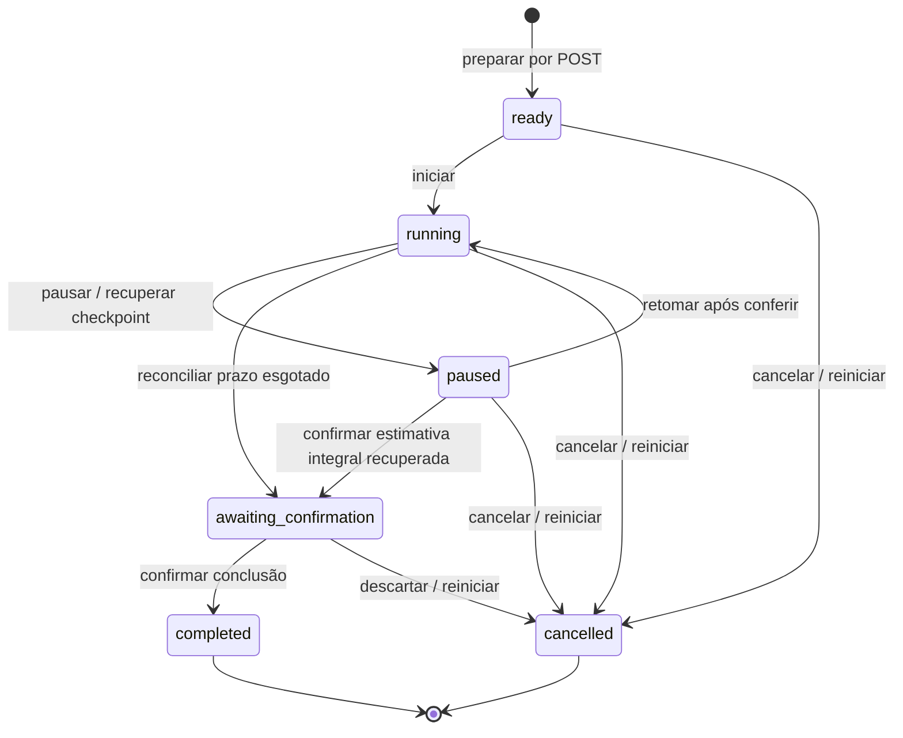

# Accio Hub — P1.2E: Plano do Pomodoro Global Persistente

**Data-base:** 2026-10-13. **Revisão:** 2026-10-17. **Estado:** APROVADO COM AJUSTES DE CONTRATO; exclusivamente E1 autorizada, sem commit da implementação. E2/E3/F não autorizadas.
Skills aplicadas: codebase-map e verification. Mapeamento focado no temporizador, seus consumidores e contratos de persistência; não constitui auditoria de todo o repositório.

Base: branch `p1-persistence`, D3 encerrada em **`0e5323c5b823e2d2d531ad8c41c35a05a7ab2045`**, mensagem `feat: implementa referencias persistentes P1.2D3`. D2 `cf9546122255f5aeba5b56f5625d4b01cbf260af` preservada como ancestral. Checkout limpo imediatamente após o commit D3; este plano e atualizações documentais posteriores ficam sem commit.

Referências: [P1.0](P1.0_ARCHITECTURE_PLAN.md), [P1.2A](P1.2A_SQLITE_PLAN.md), [B](P1.2B_VERIFICATION.md), [C](P1.2C_VERIFICATION.md), [D](P1.2D_PLAN.md), [D3](P1.2D3_VERIFICATION.md), [arquitetura](ARCHITECTURE.md), [roadmap](ROADMAP.md) e [design baseline](DESIGN_BASELINE.md).
Identidade: `0018bb4`; referência visual completa: `p0.4-approved` → `0d8bd98621cea42424373214ea5b5dc2b7faca85`, incluindo Pomodoro adaptativo homologado. A tag `p1.1-approved` também foi conferida e preservada.

## 1. Diagnóstico do Pomodoro atual

### Mapa confirmado

| Arquivo/estrutura | Responsabilidade observada | Destino proposto na E |
|---|---|---|
| `prototype/app.js` — `syncFocus`, `updateFocus`, `action` | Timer global, prazo por `Date.now`, pausa/reset/preset, renderização e contador | Referência de comportamento e aparência; transportar apenas interações necessárias |
| `prototype/state.mjs` | Valida `focusMin`, `focusLeft`, `focusRunning`, `focusEnd`, `focusRuns` no schema 4 | Referência da futura migração P1.4, sem leitura/importação pessoal na E |
| `prototype/project-space.mjs` e `project-space-view.mjs` | Composição do widget global nos espaços | Manter uma sessão compartilhada, não criar timer contextual |
| `prototype/style.css` / `rails/app/assets/stylesheets/studio.css` | `.focus-body`, `.dial`, `.dial-inner`, `.focus-actions`, `.round-btn`; anel por `--p`; adaptação clara lilás | Preservar classes, geometria, tokens, fundos e fontes |
| `rails/app/views/studio/widgets/_focus.html.erb` | Timer estático 25:00, progresso zero e botões `data-demo=focus` | Partial operacional reutilizado nas superfícies de foco |
| `studio/_widget`, `studio/_module`, `projects/_space` | Dashboard, módulo demonstrativo e espaço de projeto | Consultar/apresentar o mesmo estado SQLite |
| `studio_controller.js` | Personalização, navegação, atalhos e aviso demonstrativo de foco | Preservar responsabilidades; retirar apenas acionamento demonstrativo substituído |
| `tasks/_row.html.erb` | Tarefas reais com conclusão/edição, sem início funcional de foco | Acrescentar acionador contextual acessível, sem retirar edição |
| `FocusSession`, `FocusCommand` | Fundação B: identidade, contexto, estados, versões e recibos | Reutilizar; motor de transições será serviço próprio |
| `UserPreference.focus_duration_seconds` | Campo validado 1500/2700, ainda fora do DTO operacional C | Persistir preset por comando específico, preservando agregado C |

No protótipo, `focusEnd = Date.now() + focusLeft * 1000`; `syncFocus` recalcula o restante e incrementa `focusRuns` automaticamente ao chegar a zero. Reset/preset substituem esse estado. O intervalo de um segundo atualiza a exibição; salvamento ocorre nas ações e no término. Não existe histórico relacional nem vínculo efetivo do timer à tarefa; o play da tarefa abre Foco.

No Rails, os cliques ainda abrem o aviso demonstrativo. Não há motor HTTP de foco implementado. A presença de modelos B não significa temporizador funcional. O DTO C tem oito campos de aparência e não inclui o preset; não deve ser ampliado silenciosamente nem utilizado para transportar estado de sessão.

### Fundação relacional existente

`FocusSession`: UID opaco, `user_id`, `project_id?`, `task_id?`, `status`, `duration_seconds`, `elapsed_seconds`, `started_at`, `running_since`, `deadline_at`, `paused_at`, `completed_at`, `ended_at`, `end_reason`, timestamps e `lock_version`.

`FocusCommand`: `command_id`, proprietário, sessão, `kind`, `expected_lock_version`, `request_digest`, `parameters` e `result` JSON, timestamps. Não tem versão editável: recibos são imutáveis no Rails e no SQL.

Contratos decisivos já verificados na B e preservados na D3:

- Índice parcial `one_global_focus`: no máximo uma sessão `ready/running/paused/awaiting_confirmation` por usuário.
- UID/proprietário/contexto de foco imutáveis; FKs compostas impedem vínculos entre proprietários. Tarefa e projeto devem coincidir **na criação**, não após movimentos posteriores.
- Presets exclusivamente 1500/2700 segundos; `elapsed_seconds` inteiro entre zero e duração.
- `running` exige `running_since` e `deadline_at`; outros estados exigem ambos nulos. `paused` exige `paused_at`, exclusivamente nesse estado.
- `awaiting_confirmation` e `completed` exigem `elapsed_seconds == duration_seconds`. Logo, `awaiting_confirmation` **não pode representar interrupção ambígua parcial**.
- `completed_at` exclusivo de completed; `ended_at` exclusivo dos terminais; `end_reason` somente em cancelled, valores reset/cancelled/interrupted.
- Terminais são imutáveis e não podem ser apagados; nenhum histórico é reciclado para ready.
- Projeto arquivado impede nova sessão e retomada; permite pausar, reconciliar e encerrar sessão existente sob os limites B.
- `FocusCommand::KINDS` e CHECK SQL aceitam **somente start/pause/reset/complete**. Retomar e cancelar serão ações explícitas dentro desses contratos, sem inventar novos tipos persistidos.

Testes-chave existentes: `relational_domain_test.rb`, `relational_sql_test.rb`, `relational_transactions_test.rb` e `script/relational-check.rb`. Cobrem ocupante único, estados/datas, contexto histórico, arquivamento, recibo equivalente/incompatível, falha com rollback e reabertura. Não cobrem ainda o motor de tempo nem a interface operacional E.

## 2. Arquitetura proposta

Um estado autoritativo no SQLite, pertencente ao administrador autenticado. Timestamps/checkpoints permitem reconstrução; o navegador interpola o relógio para apresentação. Não haverá contador autoritativo em cookie/localStorage, sessão por projeto ou escrita por segundo.

Fluxo proposto:

```text
ERB compartilhado + controller Stimulus de foco
    → consulta autenticada do snapshot (GET, sem escrita)
    → comando explícito (POST, CSRF, intenção/chave, versão)
    → serviço FocusCommands
    → transação SQLite materializada antes das leituras
    → FocusSession + FocusCommand, e preferência quando aplicável
    → commit → resposta → reconciliação da apresentação
```

Componentes futuros, sem criação nesta sessão:

| Componente | Responsabilidade |
|---|---|
| `FocusController` | Autenticação, decodificação PublicUid, whitelist estrita, HTTP e snapshot |
| `FocusCommands` | Intenções, máquina de estados, contexto, versão, recibo, atomicidade |
| Cálculo de tempo isolado/testável | Projeção, checkpoint, limites e classificação de incerteza |
| Partial de foco e helper/presenter pequeno | Mesmo snapshot no Dashboard, Foco e espaço de projeto |
| `focus_controller.js` + funções pequenas de relógio/HTTP | Tick visual, comandos, estado pendente, reconciliação e mensagens |

Não adicionar fila, job periódico, Action Cable ou dependência de timer nesta entrega. Uma sessão pode continuar armazenada como running enquanto ninguém acessa a aplicação. O GET deriva que o prazo expirou; a próxima ação autenticada reconcilia o estado. Nenhum cron precisa concluir sessões em segundo plano.

Rotas conceituais: GET `/focus` ou ponte da navegação atual `/apps/focus`; GET `/focus/state`; POST `/focus/prepare`; POST `/focus/:uid/commands`; PATCH `/focus/preset`. Nomes finais seguem convenções das D1–D3. Preparar/iniciar nunca será efeito de GET ou visita Turbo. O estado vazio visual não cria uma linha ready por carregamento.

Consultas partem de `Current.user.focus_sessions`/`focus_commands`; projetos/tarefas são resolvidos pelas associações autenticadas. UID usa `PublicUid`, sem exigir UUID para registros legados. Cliente não atribui `user_id`, UID de sessão, timestamps, elapsed, estado interno ou FKs numéricas. Tokens assinados não substituem autenticação, CSRF ou validação de versão.

**Suficiência estrutural:** tabelas, campos, índices e 25 gatilhos B atendem a proposta. Metadados técnicos limitados de reconciliação podem caber em `FocusCommand.result`, sem segunda tabela de sessões. O serviço envolverá `record!` numa transação externa materializada, preservando o modelo. Precisão fracionária, snapshots históricos de nomes, contabilização parcial concluída ou relógio confiável entre reinicializações não são garantidos pelo schema atual; não serão adicionados implicitamente. Necessidade concreta futura exige justificativa e aprovação antes de alterar modelo/schema/gatilho.

## 3. Máquina de estados e comandos permitidos

Ausência de sessão ocupante é um estado de apresentação, não um sétimo status persistido. Preparar cria ready. Uma tentativa terminal continua no histórico; uma nova tentativa recebe outro UID.



Reiniciar liga a tentativa antiga a **outra** ready, dentro da mesma transação. Não é cancelled → ready na mesma linha. No contexto arquivado, o reinício associado é recusado; cancelar e preparar livre são duas decisões explícitas.

| Estado alvo | Iniciar/retomar | Pausar/reconciliar | Reiniciar | Concluir | Cancelar |
|---|---|---|---|---|---|
| ready | Iniciar → running; fixar started_at e segmento | Pausar não permitido | Cancelar com reason reset e criar nova ready | Recusar: duração não transcorrida | → cancelled, elapsed zero |
| running | Recusar novo início; replay do mesmo comando é permitido | Checkpoint → paused; prazo esgotado → awaiting_confirmation; incerteza parcial → recuperação | Encerrar anterior e preparar outra ready | Somente se prazo íntegro foi atingido e usuário confirma; nunca antecipar duração | → cancelled, sem sessão concluída |
| paused | Retomar → running, se contexto editável e revisão de tempo resolvida | Novo pause pode responder sem efeito se versão atual e sem revisão pendente | Encerrar anterior e preparar outra ready | Recusar antes da duração; estimativa recuperada integral primeiro vai para awaiting_confirmation | → cancelled |
| awaiting_confirmation | Recusar: não iniciar outro segmento | Nenhum tempo adicional; consulta/replay sem efeito | Descartar anterior e preparar outra ready | → completed, exatamente uma vez | → cancelled, sem crédito |
| completed | Nova tentativa exige intenção própria e slot livre | Não editar | Preparar nova tentativa separada; não resetar terminal | Mesma chave devolve recibo; outra chave não altera terminal | Recusar |
| cancelled | Nova tentativa exige intenção própria e slot livre | Não editar | Preparar nova tentativa separada | Recusar | Mesma chave devolve recibo; outra chave não altera terminal |

Ordem das verificações: autenticar/validar formato e escopo → verificar replay compatível → verificar versão/contexto/transição nova → aplicar. Replay de um start confirmado não tenta retomar sessão agora pausada, arquivada ou terminal. Novo start recebido atrasado é 409, sem alternância cega.

Pausar/retomar preservam `started_at`. Retomada cria somente novo segmento `running_since/deadline_at`, mantendo elapsed do checkpoint. Reinício/cancelamento preservam tentativa e recibos; nenhum DELETE. A E não oferece conclusão antecipada com crédito integral: o CHECK existente proíbe completed parcial.

## 4. Algoritmo de tempo persistente e recuperação

### Projeção ordinária

No início/retomada, capturar uma vez o horário UTC do servidor `now`, na transação. Para duração D e checkpoint inteiro E:

```text
running_since = now
deadline_at   = now + (D - E)
started_at    = now apenas no primeiro início

delta_bruto = server_now - running_since
estimativa  = min(D, E + max(0, delta_bruto))
restante    = ceil(max(0, D - estimativa))
progresso   = clamp(100 * estimativa / D, 0, 100)
```

`deadline_at` deve corresponder ao mesmo segmento; discordância com `D-E` produz recuperação, não ajuste silencioso. Para paused, o restante é D-E e não diminui. Ready tem E=0; awaiting_confirmation mostra zero e **ainda não é produtividade confirmada**.

Num pause sem incerteza, gravar `min(D, E + floor(delta))`. Limpar running_since/deadline_at. Se E novo < D, paused/paused_at=now; se E novo == D, awaiting_confirmation/paused_at=nil. Floor evita inflacionar tempo: precisão do checkpoint é de um segundo, com perda conservadora menor que um segundo por segmento. Não trocar timestamps originais nem inventar precisão maior.

GET não grava checkpoint. Tick usa snapshot com `server_now`, restante e versão; interpola a partir de um relógio monotônico da aba. Não confiar no horário local `Date.now` como autoridade. Leituras posteriores recalibram a apresentação. A animação não confirma persistência de uma ação.

### Continuidade e limites do relógio

UTC persistido não distingue trabalho efetivo de suspensão nem prova continuidade após restart. Comparação entre relógios de parede e monotônico ajuda a detectar saltos durante um processo/aba, mas não garante detecção universal de suspensão ou ajustes históricos. Não prometer essa garantia.

Proposta de classificação:

- Durante segmento com continuidade observada: comparar deltas de parede e monotônico do processo e da aba; leitura periódica apenas para reconciliação, inicialmente a cada 15 segundos quando visível.
- Gap de observação acima de 60 segundos, retorno de aba oculta prolongado, novo processo, browser reaberto, perda prolongada de rede ou divergência acima de 5 segundos: marcar continuidade desconhecida. Valores são conservadores propostos, sujeitos a aprovação e testes de throttling; não provam que houve suspensão.
- No resultado do start/resume, guardar metadados técnicos do segmento: época aleatória do processo, amostras de horário e versão. Eles são evidência auxiliar no recibo, não outro relógio autoritativo. Processo diferente não reutiliza seu relógio monotônico; em ambiente com múltiplos workers, essa diferença pode exigir revisão conservadora.
- Não introduzir tickets de observação, heartbeats persistentes ou autoridade de tempo no browser. Leituras podem manter observações auxiliares em memória do processo; perda dessa memória/diferença de processo torna a continuidade desconhecida, sem perda do checkpoint SQLite. Nenhuma observação concede crédito por si só.
- Saltos negativos, timestamps futuros/incompatíveis ou prova de continuidade ausente nunca acrescentam tempo confirmado automaticamente. Uma queda de processo entre leituras não cria um checkpoint fictício.

### Recuperação explícita

Interrupção ambígua parcial **não cabe em awaiting_confirmation**. Usar paused com o último checkpoint E confirmado. Um POST de reconciliação, versionado e com recibo kind=pause/action=reconcile, limpa o segmento, preserva E, fixa paused_at e guarda no resultado a estimativa candidata limitada, snapshot anterior e motivo da revisão.

Esse resultado permite recuperar a decisão pendente após recarga. A consulta da sessão procura o recibo pertinente à versão; resultados posteriores devem carregar/resolver explicitamente a revisão. Não depender apenas de um flag em memória. Revisão não é resolvida por pedido genérico de start.

Opções propostas:

1. **Manter checkpoint:** descartar intervalo não confirmado e retomar os minutos restantes, por decisão explícita; não apagar histórico técnico.
2. **Aceitar estimativa do intervalo:** confirmar a estimativa limitada calculada/registrada pelo servidor. Se parcial, continuar paused e depois retomar; se integral, ir a awaiting_confirmation. Não aceitar segundos/timestamps livres do browser. Estimativa inválida por salto negativo/inconsistência não oferece essa opção.
3. **Cancelar/reiniciar:** registrar cancelled com reason cancelled/interrupted/reset conforme a ação, sem produtividade adicional.

Prazo nominal esgotado pode ser reconciliado automaticamente para awaiting_confirmation por POST do cliente, sem confirmação completed e sem contador incrementado. A proposta continua exigindo confirmação explícita da conclusão, inclusive quando a aba permaneceu aberta. E=D nesse estado significa prazo nominal atingido; não prova foco trabalhado. Projeto arquivado continua permitindo essa reconciliação B.

**Regra recomendada de contabilização:** somente `completed`, obtido por decisão explícita, conta uma sessão. Replay de confirmação já persistida pode atualizar a interface automaticamente, sem novo crédito. Não há novo completed automático nesta E. Isso é uma mudança deliberada em relação ao contador automático do protótipo e depende da aprovação deste plano.

`completed_at` e `ended_at` recebem o horário real da confirmação, não um deadline fabricado no passado; o instante nominal anterior pode ser conservado no recibo. Cancelamento registra ended_at sem completed_at. Em salto de relógio, versões/recibos preservam ordem lógica; timestamps de parede não garantem ordenação cronológica perfeita.

| Situação | Comportamento proposto |
|---|---|
| Navegação Turbo | Reconsultar/reconstruir sem restart ou crédito; preservar intenção pendente |
| Reload/browser fechado e reaberto | Ler sessão/recibos; informar intervalo sem continuidade comprovada e oferecer recuperação |
| Reinício Rails | Reabrir SQLite sem seeds; época de processo mudou, segmento exige conferência conservadora |
| Suspensão/retorno Ubuntu | Reconciliação no retorno; nunca incrementar concluídas pelo gap |
| Prazo expirou com navegador fechado | GET mostra prazo esgotado; POST reconcilia awaiting_confirmation; usuário confirma/descarta |
| Resposta de comando perdida | Estado do comando é desconhecido; consultar recibo/repetir mesma chave e payload |
| Horário do browser mudou | Não altera autoridade; recalibrar apresentação pelo servidor |
| Horário do servidor mudou | Detectar quando possível; preservar checkpoint e exigir revisão; nunca clamp silencioso como prova de produtividade |
| Logout/expiração de autenticação | Interromper consultas na aba e pedir login; não cancelar sessão nem enviar comando fora da autenticação |

## 5. Contratos de comandos e presets

Adaptar ações da interface aos quatro kinds existentes. `parameters.action` é enum validado pelo serviço; não comando Ruby arbitrário, dispatch dinâmico ou novo status SQL.

| Ação pública | Kind | Parâmetros significativos | Efeito |
|---|---|---|---|
| Preparar | start | action=prepare; intenção/contexto/preset | Criar uma ready, sem iniciar relógio |
| Iniciar sem ocupante | start | action=start_new; intenção/contexto/preset | Criar ready e iniciar no mesmo commit |
| Iniciar | start | action=start | ready → running |
| Retomar | start | action=resume; decisão de revisão quando necessária | paused → running |
| Pausar | pause | action=pause | Persistir checkpoint do segmento |
| Reconciliar | pause | action=reconcile; modo restrito de recuperação | Awaiting integral ou paused parcial, sem completed |
| Resolver estimativa parcial | pause | action=resolve; manter checkpoint/aceitar candidato | Resolver revisão preservando versões/recibo |
| Reiniciar | reset | action=restart; intenção da nova ready; preset/contexto | Cancelar anterior + criar ready atomicamente |
| Cancelar | reset | action=cancel; reason restrito | Liberar slot, conservar histórico |
| Confirmar fim | complete | action=confirm | Integral → completed; nenhuma escrita em tarefa |

Envelope: `command_id` aleatório por intenção, UID público de sessão-alvo, `expected_version` inteiro, kind/action e parâmetros canônicos. Uma chave nova representa uma decisão nova. Limitar comprimento/tamanho e rejeitar tipos/atributos desconhecidos; não logar tokens ou payloads de recuperação completos.

`record!` já calcula SHA-256 de kind, chave interna da sessão, versão e JSON canônico dos parâmetros. Ordem de chaves JSON não muda identidade; kind, versão, alvo ou parâmetro diferente com mesma command_id gera 409. Resultado guarda UID, versão produzida, estado, checkpoint, contexto e identificação da nova tentativa quando houver reset. Timestamps de resposta corrente ficam fora do digest/resultado de efeito para não tornar replay diferente.

**Criação do primeiro alvo:** `record!` necessita sessão existente. Preparar utiliza intenção assinada vinculada ao usuário/operação/UID/contexto/preset, semelhante D1/D2, dentro de transação externa. Sob lock SQLite: conferir recibo/intenção/slot; criar ready com UID reivindicado; registrar recibo na mesma transação. Falha em qualquer passo reverte ambos. Replay resolve a sessão original pelo UID/recibo antes de criar qualquer nova linha. Nenhum UID livre vindo do browser é aceito.

O botão Iniciar no vazio usa `action=start_new`: a mesma transação cria ready e o bloco de `record!` inicia o segmento com versão esperada zero. Um clique basta; não há commit intermediário ou segunda requisição obrigatória. `prepare` permanece útil para a tentativa preparada e o reset. A máquina de estados continua passando por ready, sem expor um estado parcial ao outro processo.

**Reset:** recibo fica associado à sessão anterior. Primeiro terminalizar a antiga, depois inserir nova ready com UID da intenção e E=0. Isso respeita o índice parcial. `result.new_session_uid` identifica a nova tentativa; replay devolve esse UID mesmo se ela já avançou/encerrou. Falha tardia restaura antiga/slot e não deixa nova ready nem recibo parcial.

**Preset 25/45:** o botão não altera duração de running/paused/awaiting nem reinicia silenciosamente. Sem ocupante, gravar `UserPreference.focus_duration_seconds` por PATCH específico com a versão raiz C. Com ready, usar reset explícito para substituir tentativa e alterar preset, exigindo também versão da preferência; tudo na mesma transação. A versão da preferência integra o payload do comando e o resultado retorna a versão produzida. Mudanças de aparência/filtro concorrentes produzem 409; whitelist preserva todas as demais preferências/snapshots. A sessão tem duração fixada ao preparar, independentemente de futuras escolhas de preset.

Em terminal, preparar novo foco é operação nova, não escrita na antiga. Sem sessão real, um PATCH de preset usa somente o controle de versão C; não criar FocusSession artificial para registrar preferência.

## 6. Concorrência, falhas e reconciliação entre abas

Todas as operações compostas usam a mesma conexão/transação SQLite, materializada **antes** das leituras de slot, versões e contexto, como nas fases anteriores. `lock_version` continua proteção otimista; índice parcial e FKs/gatilhos permanecem proteção SQL. Mutex na aba/processo não é garantia de unicidade global.

| Disputa/falha | Resultado exigido |
|---|---|
| Duas intenções preparando simultaneamente | Uma ready; outra recebe 409 com snapshot do ocupante, sem substituir contexto |
| Mesmo comando em dois processos | Um efeito e um recibo; segundo obtém replay equivalente após reler |
| Duas confirmações com IDs diferentes, mesma versão | Um completed; outra 409; mesmo ID retorna recibo original |
| Pause/resume ou reset/complete fora de ordem | Versão antiga/transição incompatível 409; nenhuma alternância cega |
| Projeto arquiva enquanto start/resume aguarda | Commit serializado decide ordem; arquivamento vencedor impede novo trabalho |
| Erro depois de salvar sessão, antes do recibo/nova ready/preferência | Rollback integral, inclusive versões e ocupante |
| SQLite Busy/Locked | 503 recuperável, opcional Retry-After, chave/payload preservados; nenhuma resposta 500 genérica |
| Resposta HTTP perdida após commit | Consulta autenticada do recibo/replay confirma; não gerar novo ID para “tentar novamente” |

Status: 404 para UID inválido/inexistente/alheio ou contexto fora do escopo; 422 para formato/preset/parâmetros inválidos; 409 para versão/transição/intenção incompatível/slot ocupado/arquivamento; 503 para contenção. Sessão expirada segue contrato de autenticação, distinguida de sucesso JSON. Erros inesperados continuam visíveis à investigação, sem mascará-los como conflito.

Em conflito, mostrar o snapshot atual e a ação local pendente. Para novo comando após revisão, usar nova chave e nova versão, somente por decisão do usuário. Não reaplicar automaticamente pause/start/reset sobre estado remoto.

Replay retorna o **resultado histórico do comando**, não necessariamente o estado atual. Após confirmar recibo, consultar estado corrente; não rebaixar a interface de completed para running por resposta antiga. Respostas de leitura atrasadas devem ser descartadas por geração da consulta e versão; UID diferente só substitui ocupante após snapshot global corrente. Versões de UIDs diferentes não são comparadas numericamente como se fossem uma linha.

Cada aba reconsulta em conexão Turbo, retorno de visibilidade, reconexão e intervalo de leitura visível proposto. Uma indicação via BroadcastChannel pode solicitar nova leitura, sem carregar autoridade ou evitar o índice SQL; não é requisito de infraestrutura nem sincronização remota em tempo real. Convergência eventual deve ser indicada como tal.

Uma única intenção pendente fica em memória durante Turbo e impede comandos incompatíveis. Após fechamento abrupto da aba, não prometer recuperação desse envelope: servidor/recibos continuam íntegros, GET reconcilia e não inicia outra tentativa automaticamente. Buffer durável no navegador não será acrescentado implicitamente.

## 7. Integração com tarefas e projetos

| Origem | Contexto fixado no servidor |
|---|---|
| Global, sem tarefa | task_id/project_id nulos |
| Tarefa pessoal | task_id da associação do usuário; project_id nulo |
| Tarefa vinculada | task_id da associação do usuário; project_id atual da tarefa na criação |
| Espaço de projeto, sem tarefa | project_id da rota autenticada; task_id nulo |

Início a partir de tarefa não passa IDs internos arbitrários: UID e intenção contextual resolvem associações no servidor. Exigir versão da tarefa apresentada ao preparar; se foi movida/alterada, informar 409 e conferir o contexto antes de começar. Estado/versão de projeto também são conferidos na transação. Por padrão proposto, início a partir de tarefa concluída exige reabertura explícita pela D2; não reabrir automaticamente.

Se já existe ocupante, apresentar a sessão existente e seu contexto. Não trocar tarefa/projeto ao visitar outro espaço. Iniciar outra exige cancelar/reiniciar explicitamente. Uma ready já existente também ocupa o slot, embora não tenha contado segundos.

Movimento de tarefa durante execução **é permitido pela D2** quando origem/destino editáveis. A sessão conserva project_id/task_id originais; não segue o projeto novo nem recria sessão. Ao reiniciar, contexto antigo e contexto atual da tarefa podem divergir: mostrar a escolha e emitir intenção nova para o contexto atual, validada pelo servidor. Não copiar um par antigo inválido para nova sessão; não atribuir passado ao novo projeto.

Também após mover tarefa pessoal para projeto ou tarefa contextual para outro projeto: nova preparação verifica o par atual; uma sessão existente conserva inclusive seu project_id nulo/original. Retomar revalida o contexto histórico e o projeto atual da tarefa, sem reescrever nenhum vínculo.

Renomeação preserva IDs. Os modelos não guardam snapshot permanente de títulos; mostrar nomes atuais com indicação de contexto original por UID. Preservar literalmente nomes históricos exigiria outro contrato e fica fora desta E. Nenhuma FK é apagada ao arquivar.

Projeto original arquivado durante running: sessão existente pode continuar o segmento/reconciliar, pausar, confirmar fim ou cancelar sob a exceção B. **Não retomar paused, iniciar ready, alterar duração/contexto ou preparar nova tentativa associada enquanto arquivado.** Depois de pausar, oferecer restaurar projeto ou cancelar e preparar livre explicitamente. Projeto de destino atual da tarefa também deve ser editável para novo início/retomada; ele não substitui o contexto histórico.

Concluir tarefa durante foco não conclui/cancela foco; confirmar Pomodoro não conclui tarefa. Nenhuma operação E modifica tarefa, referência ou atividade de projeto implicitamente. Isso evita editar projeto arquivado pela exceção de foco. Contagens D continuam consultando os mesmos registros reais.

Se o contador simples de sessões concluídas da página Foco for transportado, ele deriva exclusivamente de `Current.user.focus_sessions.where(status: "completed")`, sem incremento paralelo, totais fictícios ou reconstrução de `focusRuns`. Histórico fica preservado no banco; gráficos, painéis estatísticos e relatórios avançados não fazem parte da E.

## 8. Interface, Turbo e acessibilidade

Reutilizar o partial de foco, ícones e CSS homologado; manter o círculo de 170 px, hierarquia tipográfica, `--p`, superfície escura atual, superfície clara lilás e cores aprovadas. Não redesenhar board/Dock nem mudar Music. Ajustes CSS, se necessários, devem ser localizados e comprovados visualmente.

Dashboard, página Foco e Visão Geral dos projetos recebem a mesma projeção de sessão. Espaço de outro projeto mostra claramente o contexto da sessão global; título nunca sugere timer independente. O widget continua personalizável em visibilidade/span, sem encerrar sessão ao ocultá-lo. Foco continua acessível pela Dock.

Proposta de um controller Stimulus de foco por shell ativo, independente de `studio_controller.js`; todas as instâncias visuais são alvos de apresentação desse controller. Disconnect cancela tick/poll/listeners; reconnect Turbo busca snapshot. Não é necessário manter um widget `data-turbo-permanent` para conservar a sessão, pois SQLite a conserva. Se houver retenção do envelope de request durante navegação, usar coordenador pequeno específico, sem duplicar timers/listeners.

Controles mantêm formato compacto: iniciar/pausar/retomar; reiniciar; preset. Cancelar/conferir fim aparecem no estado correspondente, com texto compreensível. Reinício que descarta progresso/contexto exige decisão explícita em diálogo do padrão D; Escape cancela **o diálogo**, não a sessão. Novos acionadores de tarefa devem preservar seu botão Editar.

Requisitos de apresentação:

- Nomes acessíveis atuais por ação; ícones decorativos aria-hidden; botões desabilitados/pending anunciados com motivo visível.
- Relógio não será região live atualizada a cada segundo. Anunciar somente transições, conclusão pendente, erro e mudança relevante de contexto.
- Estado running/paused/aguardando/sem resposta indicado por texto, além de cor. Anel não é a única informação de progresso.
- Snapshot atrasado/offline identificado: “Estado ainda não confirmado”; countdown local não deve prometer que pause/reset foi salvo.
- Teclado, Tab/Shift+Tab, Escape, cancelamento e retorno de foco seguem os diálogos D. Reconciliação/poll não roubam foco; updates preservam acionador por ID estável.
- Tema/destaque podem mudar durante execução sem afetar sessão/preset. Respeitar motion reduzido; nenhuma nova animação indispensável.
- Sem notificações, áudio de término, pausa automática, ciclos, duração livre, perfis, integração funcional Music ou estatísticas avançadas.

## 9. Estratégia de verificação e gates de implementação

Afirmação a provar na futura E: existe no máximo uma tentativa ocupante por usuário; comandos/retentativas são transacionais e idempotentes; reload/Turbo/restart conservam contexto e checkpoints; nenhum período incerto gera completed silenciosamente; identidade visual e B/C/D permanecem preservadas.

Todos os bancos/perfis novos serão sintéticos e isolados, com `ACCIO_DATABASE_PATH` explícito e servidores só em loopback. Não executar seeds/migrações sobre banco pessoal. Reutilizar Minitest, scripts de processos, agent-browser e axe existentes; nenhum framework novo.

| Grupo | Provas necessárias |
|---|---|
| Máquina de estados | Cada célula permitida/recusada; campos nulos/coerentes, versões, imutabilidade terminal; ready visual sem INSERT por GET |
| Tempo | Início/retomada, muitos pauses curtos, limites 0/D, deadline coerente, delta negativo/salto à frente; candidato parcial/integral; nenhuma duração inventada |
| Recuperação | Reload, browser fechado/reaberto, restart, processo diferente, aba oculta, suspensão simulada, rede perdida; revisão recuperada pelos recibos; prazo fechado → awaiting, nunca completed automático |
| Idempotência | Replay por mesma chave após commit/resposta perdida/restart; JSON com ordem diferente; kind/versão/alvo/contexto/preset alterados rejeitados; recibo inválido reverte efeito |
| Concorrência entre processos | Dois starts com intenções iguais/diferentes; duas completes; pause/resume; reset/complete; um slot e um efeito; respostas 200/replay ou 409 conforme contrato |
| Atomicidade | Falha após terminar antiga e antes da nova ready; após nova ready e antes do recibo; preset/preferência falha; rollback integral de versões/contexto/histórico |
| Contenção | Writer real BEGIN IMMEDIATE; 503 recuperável; chave conservada, nenhuma escrita parcial e retentativa após liberação |
| Contexto | Global/pessoal/projeto; UIDs Unicode/barras/%/?/#/legado; proprietário alheio; tarefa movida antes/depois; versões da tarefa; arquivamento concorrente no start/resume/pause/complete/reset |
| Histórico | UID antigo conservado em reset, mesmo started_at após retomada, end_reason correto, completed_at real uma vez, nenhuma exclusão, contexto não migra com tarefa |
| Preferências C | Preset contra tema/filtro/Dock/widget em outra aba: 409 sem overwrite; snapshot legacy preservado; logout/login/restart; preset novo não muda sessão ativa |
| HTTP/segurança | Autenticação/CSRF/cache privado; whitelist; tokens forjados/alheios; não aceitar timestamps/elapsed/user_id; 404/422/409/503; comandos só POST/PATCH |
| B/D1/D2/D3 | FKs/índices/25 gatilhos, arquivamento/restauração, dados/vínculos/contadores, URLs seguras, preferência, autenticação/admin:reset; nenhuma demonstração apresentada como foco real |

Não suspender realmente o Ubuntu nem alterar seu horário para testes. Injetar fonte de tempo nos testes do serviço e simular deltas/visibility/rede no perfil sintético. Isso prova tratamento das hipóteses simuladas; eventual ensaio operacional real deve ter autorização e relatório próprios.

Navegador: login → preset/tema → projeto/tarefa/referência → início contextual → Dashboard → outra tela/espaço → pausa/retomada → conflito entre abas → zero/conferência → confirmar uma vez → recarregar → reiniciar Rails → conferir sessão, filhos e preferências. Acrescentar reset/cancelamento, tarefa movida e projeto arquivado, estado vazio, erro 503 e resposta perdida. Verificar ausência de writes por tick com contagem de requests/comandos/versões antes e depois.

Visual: **claro/escuro × 320, 390, 768, 1440, 1920 px**, Dashboard/Foco/espaço, ready/running/paused/awaiting, preset 25/45 e acentos homologados, troca de tema/acento em execução. Capturas e resultados futuros em `docs/assets/p1.2e/`, preservando evidências anteriores. Comparar círculo, fontes, botões, lilás claro, escuro, Dock, widgets, Music, overflow/rolagem/sobreposição e foco com P0.4 e D3.

Axe separa violações e incompletos. Contraste inconclusivo **não** é aprovação; realizar medição dirigida dos controles/textos afetados. Chromium e Firefox terão resultados separados. Se agent-browser não permitir Firefox, fornecer roteiro reproduzível no Ubuntu com perfil/banco sintético, passos e observado/esperado; não reutilizar homologação P0.4/P1.1 como aprovação E ou C/D.

Gates propostos, todos dependentes de autorização de implementação E:

| Corte interno | Entregáveis | Condição de avanço |
|---|---|---|
| E1 — Contratos e motor | Serviço, cálculo, comandos, intenções, recuperação, HTTP e testes de tempo/processos | Estado/tempo/idempotência/rollback comprovados; nenhum schema/gatilho alterado |
| E2 — Interface compartilhada | ERB/Stimulus, preset versionado, ações contextuais, conflitos/foco/Turbo | Navegador prova um estado comum, sem writes por segundo ou regressão visual |
| E3 — Verificação da entrega | Suíte completa, regressões, adversariais, matriz visual e relatório `P1.2E_VERIFICATION.md` | Sem bloqueadores confirmados; limitações explícitas; revisão do usuário antes de F/commit |

Reexecutar Rails Test, RuboCop, Brakeman, Zeitwerk, sintaxe JS e `git diff --check`. Baseline atual: **103 testes/1.029 asserções**, 25 gatilhos, histórico de **152 cenários de navegador D3/regressões**. Quantidades novas serão aferidas, não prometidas antecipadamente. Adaptar oráculos que hoje exigem foco demonstrativo; não apagar cobertura C/D.

Executado **nesta sessão de encerramento D3**, não como teste de E: suíte 103/1.029 aprovada, processos D3/rollback/reabertura/503, 25 gatilhos/FKs, RuboCop 92 arquivos, Brakeman zero, Zeitwerk e 32 arquivos JS. Evidências no relatório D3 `assets/p1.2d3/closure/`. Mapeamento E foi somente leitura; nenhum temporizador E foi implementado ou testado funcionalmente.

## 10. Riscos, pendências e decisões para aprovação

| Risco | Classificação para a E | Controle/critério |
|---|---|---|
| Dois ocupantes ou conclusão duplicada | Bloqueador | Índice parcial, versão, recibo e testes em processos/abas |
| Tempo de suspensão contado silenciosamente | Bloqueador | Recuperação conservadora; completed somente explícito |
| Reset parcial perde sessão ou cria slot órfão | Bloqueador | Antiga/nova/recibo/preferência na mesma transação, falha tardia testada |
| Alteração fora do proprietário/contexto arquivado | Bloqueador | Associações/FKs/gatilhos e exceção B delimitada |
| Replay antigo faz UI mentir sobre estado corrente | Bloqueador | Distinguir recibo/snapshot, descartar respostas obsoletas |
| Perda de aparência/preset na concorrência | Bloqueador | Versão raiz C, whitelist e transação composta |
| Relógio real não recuperável após restart/suspensão | Limitação conhecida | Conferência explícita; nenhuma promessa de medição perfeita |
| Falso pedido de recuperação por throttling/múltiplos workers | Não bloqueador se explicado | Medir/testar limiares, preferir revisão a crédito silencioso |
| Perda menor que 1s por pause | Limitação do schema | Floor conservador documentado; precisão maior exige decisão própria |
| Intenção em memória perdida com encerramento abrupto | Pendência conhecida | Reconsultar recibos/slot; não criar novo foco automaticamente |
| Contraste/acento configurável inconclusivo | Pendência aberta | Medição específica; não declarar AA pela ausência de violação axe |

Pendências anteriores **preservadas**, não concluídas por este plano: validação manual Firefox C/D1/D2/D3; contraste inconclusivo; política de retenção/descarte de `legacy_cookie_backup` (preferencialmente F); hardening futuro de `SafeReferenceUrl` para hosts numéricos ambíguos; verificação operacional de backup/restauração; rascunhos em memória. P1.2E não altera serviços, scripts de backup, Vault ou integração externa.

Decisões pendentes de aprovação do planejamento:

1. **Conclusão sempre explícita na E**, inclusive ao atingir zero normalmente; término nominal só gera awaiting_confirmation, sem crédito automático. Não reutilizar `focusRuns` nem inferir sessões legadas.
2. **Recuperação parcial em paused**, com revisão/candidato no recibo; opções manter checkpoint, aceitar estimativa válida ou cancelar. Nenhum estado novo ou entrada livre de tempo.
3. **Limiar inicial de observação:** leitura visível 15s, gap 60s e divergência 5s, sujeitos a medição; múltiplos processos podem exigir conferência conservadora.
4. **Sem conclusão antecipada parcial:** cancelar conserva histórico sem crédito; completed exige preset integral pelo contrato B.
5. **Reinício como nova tentativa ready**, com UID novo e reason reset; contexto da tarefa movida exige conferência, contexto arquivado bloqueia novo trabalho associado.
6. **Presets usando preferência C existente**, versão raiz e ação separada; ready substituída explicitamente, active não alterada silenciosamente.
7. **Tarefas concluídas:** exigir reabertura D2 antes de novo início contextual; tarefa concluída durante execução não termina sessão.
8. **Sem mudança de schema/modelo/gatilhos ou novas dependências** nesta proposta. Se uma prova técnica na implementação revelar insuficiência, interromper a mudança afetada e apresentar necessidade/alternativas antes de alterá-los.

Critério de prontidão: plano revisado e autorizado; a futura E comprova unicidade, tempo/recuperação honesta, idempotência e preservação B/C/D com evidências. Aprovação do documento não encerra F, não inicia P1.3 e não autoriza migração pessoal, tag, push ou merge.


## 11. Aprovação com ajustes e corte E1 — 2026-10-17

Autorização do usuário: implementar exclusivamente máquina de estados, persistência, comandos, recuperação e contratos HTTP de backend. Registrar este plano em commit documental próprio; manter a implementação E1 sem commit para revisão. Não conectar círculo, widget, Stimulus ou outros controles da E2; não iniciar E3/F.

Os esclarecimentos abaixo prevalecem sobre sugestões anteriores:

- GET é somente leitura persistente: nenhuma sessão, checkpoint, versão ou recibo é criado/alterado. Nominal estimado, checkpoint confirmado e continuidade desconhecida são dados distintos na resposta.
- Parâmetros 15s/60s/5s são experimentais, não certificação universal de suspensão/continuidade. Observações voláteis do servidor são somente sinais conservadores, não uma fonte persistente de tempo. Outro processo/restart ou ausência de evidência exige conferência. Não são introduzidos tickets de observação ou heartbeats persistentes.
- Recuperação parcial: POST preserva E em paused; recibo imutável contém candidato calculado pelo servidor, motivo e versão resultante. O recibo mais recente por ID da sessão, compatível com sua versão, determina a recuperação pendente; nunca ordenar por relógio de parede. Resolução exige command_id, versão da sessão e ID do recibo pendente; produz outro recibo e incremento de versão mesmo mantendo E. Replays equivalentes retornam o resultado histórico; uma nova resolução obsoleta é 409. Recibos anteriores não são editados.
- Intervalo incerto, inclusive esgotado, não pode confirmar produtividade silenciosamente. Candidato integral pode ser aceito explicitamente antes de completed; candidato inválido por relógio inconsistente só admite manter checkpoint/cancelar/reset. Fim nominal com continuidade observada pode transicionar a awaiting_confirmation, ainda sem completed automático.
- Confirmar conclusão permanece explícito. Concluir parcialmente não é permitido. A máquina deve respeitar a exceção B para foco de projeto arquivado; qualquer incompatibilidade comprovada exige interromper a transição afetada e relatar, sem alterar modelo/CHECK/gatilho.
- Reutilizar apenas start/pause/reset/complete, com ações restritas. Reset preserva a tentativa anterior, novo UID e recibo no mesmo commit SQLite. Duas abas/processos devem disputar versões e slot, sem sobrescrita silenciosa.
- Contextos resolvidos no servidor e dentro da transação; tarefas concluídas exigem reabertura; movimentação não reescreve contexto histórico. Nenhuma conclusão de foco altera tarefa ou projeto.
- Preset persiste apenas 1500/2700 em UserPreference, com versão do agregado C; não substitui aparência, Dock/widgets/filtros/snapshots nem altera duração ativa. Seleção visual fica para E2.

Verificação E1: bancos sintéticos novos, relógios injetáveis, testes de todas as transições, SQL/ActiveRecord arquivado, GET sem escritas, recuperação determinística após restart, resolução concorrente/obsoleta, duas inicializações/conclusões, pause/resume e reset/complete, resposta perdida, arquivamento, movimento, rollback tardio e writer SQLite real. Reexecutar suíte Rails, RuboCop, Brakeman e Zeitwerk. Relatório próprio: `docs/P1.2E1_VERIFICATION.md`. Nenhuma validação visual E2 será alegada pela execução de testes de backend.

Pendências de Firefox C/D1/D2/D3, contraste, retenção de legacy_cookie_backup, SafeReferenceUrl/hosts numéricos, rascunhos e backup/restauração continuam abertas. Nenhuma mudança em dados pessoais, serviços, backups ou relógio/suspensão real do Ubuntu.
