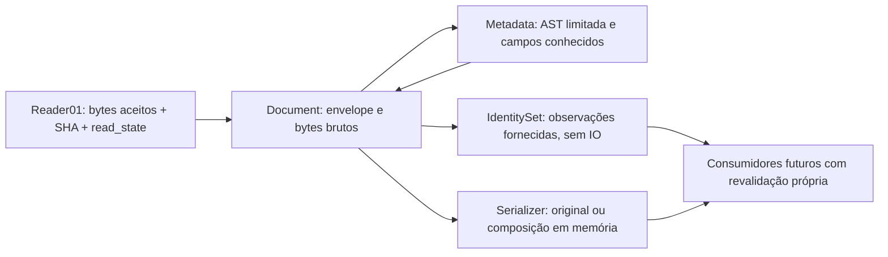

# P1.3-02 — Plano técnico de identidade e metadados Markdown

Data: **25/10/2026**. Executor: **Codex**. Estado: **CONTRATO APROVADO COM R1/R2/R3; IMPLEMENTAÇÃO TÉCNICA/SINTÉTICA AUTORIZADA**.

A decisão humana “P1.3-02: Consolidação Contratual e Implementação” aprova C-01 a C-11 originais com R1/R2/R3 da [reconciliação](P1.3_02_AUDIT_RECONCILIATION.md). Autoriza I1–I6 exclusivamente técnicos/sintéticos; I7 aguarda auditoria independente e aceite humano. Não autoriza escrita no Vault, dependências, cortes03/04, dados pessoais, commit ou push. As seções de preparação/probes/verificação documental abaixo preservam o histórico do planejamento; resultados novos estarão em [verificação02](P1.3_02_VERIFICATION.md).

## 1. Preparação e base verificadas

Checkout original: `/home/goecking/Projects/Accio-HUB`; nenhuma worktree/checkout adicional. Estado inicial limpo, branch `main`, HEAD **`9c75418aeb431f4aa454e5d0bd9420556932c1be`**, merge da P1.3-01. Após `git fetch origin`, main local, `origin/main` e `git ls-remote origin refs/heads/main` coincidiram nesse SHA. Criada **`p1.3-metadata`** diretamente dessa main, sem alterar seu conteúdo.

Consulta read-only via `gh run list` confirmou **CI completed/success** no mesmo HEAD: [execução 40243226249](https://github.com/leogoecking/Accio-Hub/actions/runs/40243226249). Não se disparou workflow nem fez push. Esse resultado é da main, não dos serviços 02 que ainda não existem.

Lidos integralmente [AGENTS](../AGENTS.md), [PRODUCT](PRODUCT.md), [ARCHITECTURE](ARCHITECTURE.md), [ROADMAP](ROADMAP.md), [plano P1.3](P1.3_PLAN.md), [decisões da Fase 0](P1.3_PHASE0_DECISIONS.md) e [encerramento 01](P1.3_01_CLOSURE.md). Inspecionados os sete serviços Vault, seus testes, contratos PublicUid, Conhecimento/Markdown do protótipo e testes relacionados. Os estados antigos de PRODUCT/ARCHITECTURE/ROADMAP são históricos; o encerramento 01 e o checkout atual confirmam a fundação implementada. Não foram atualizados esses documentos nem AGENTS.md nesta entrega.

AI Memory consultado explicitamente em `workspace: default`, `project: accio-hub-principal`, com busca de identidade/YAML/Markdown. Lida a página `sessions/01a16c95-9726-7ca3-b4c9-d5fd38226b2a.md`, registro heurístico da consolidação da Fase 0: ela contém principalmente eventos, não prova de um contrato de parser. O histórico da 01 já consultado foi confrontado com seu encerramento/código local. Nenhuma memória foi usada como autorização ou escrita manualmente. Não foi necessário aplicar preferências globais: os links relativos seguem os documentos do projeto e os entregáveis Markdown foram explicitamente pedidos.

Aplicadas as skills **codebase-map** (mapa focado, sem execução do produto) e **verification** (evidências existentes e critérios para a implementação futura). `diagnose` não foi acionada: não se está corrigindo uma falha do produto. Os probes pequenos de Psych abaixo caracterizam a biblioteca; não implementam um parser do Accio.

## 2. Escopo e exclusões

Resultado futuro02: representação imutável de documento/metadata; contrato de nota e marcador versionado; interpretação limitada e segura de YAML; diagnósticos honestos; preservação lexical; Serializer puro; detecção de colisões em coleções sintéticas fornecidas pelo chamador. Sem ID gerado na leitura e sem eleição de cópia canônica.

Não entram: escrita/criação/adopção de arquivos, journal, CAS de publicação, scanner operacional, watcher, job, rotas, controllers, UI, prévia HTML, parser completo de Markdown, importação localStorage, dados pessoais, SQLite/FTS5, mudanças de schema/migrações, resolução de projetos/tarefas via banco, integração com projetos ou configuração persistente. Os exemplos YAML são sintéticos documentais, não um Vault criado. Rails8/Hotwire e a arquitetura Fiddle/openat2 permanecem.

O contrato descreve interfaces puras futuras e decisões que os cortes04/09 terão de respeitar; essa descrição não antecipa sua implementação.

## 3. Mapa confirmado do código existente

Caminhos relativos à raiz. A leitura de código não é nova execução de testes.

| Componente examinado | Fato confirmado | Consequência para02 |
|---|---|---|
| [configuration.rb](../rails/app/services/vault/configuration.rb) | Configuração/limites imutáveis; `from_env` explícito e `protected_paths`; Budget local de bytes/tempo | Reutilizar orçamento da operação; limites do parser separados, sem alterar defaults01 |
| [root.rb](../rails/app/services/vault/root.rb) | Sessão curta; falhas de consumidor separadas das falhas de aquisição/postcheck | Não capturar erro de parser dentro do adaptador nem reclassificá-lo como erro de raiz |
| [path_policy.rb](../rails/app/services/vault/path_policy.rb) | Caminhos relativos validados; `.md` case-insensitive e basename `.accio-folder.yml` exato | Tipo físico vem dessa fronteira; ID de metadata nunca passa por essa política |
| [linux_filesystem.rb](../rails/app/services/vault/linux_filesystem.rb) | Única fronteira nativa, pins/classificação/reabertura procfs/revalidação; sem escrita | Nenhuma syscall, File.open/read ou realpath novo no parser/serializer |
| [reader.rb](../rails/app/services/vault/reader.rb) | `call(path, budget:)`; retorna bytes binários, SHA-256, metadados e métricas apenas após leitura aceita | Document recebe este resultado, não reabre seu path; body/YAML ainda não são interpretados |
| [inventory.rb](../rails/app/services/vault/inventory.rb) | Inventário físico por metadados; completo/parcial, não lê corpos | Não afirmar identidade única com base só no Inventory |
| [result.rb](../rails/app/services/vault/result.rb) | Máquina 01 imutável; `complete` significa operação concluída; `not_found/unreadable` têm escopos corrigidos | Não modificar estados/`success?`; parsing e identidade possuem resultados próprios |
| [PublicUid](../rails/app/models/concerns/public_uid.rb) | UID textual UTF-8 não branco/sem NUL; transporte `u-` Base64url, imutabilidade e proprietário server-side | Reutilizar semântica, não concern ActiveRecord no parser; não exigir UUID, usar PK ou decodificar string YAML como rota |
| [relational_domain_test.rb](../rails/test/models/relational_domain_test.rb) e [transversal_security_test.rb](../rails/test/integration/transversal_security_test.rb) | IDs com espaços, Unicode e `/` sobrevivem a rename/rotas; unicidade por proprietário/entidade | Fixtures02 devem incluir esses formatos; nenhuma mudança nos modelos/SQL |
| [state.mjs](../prototype/state.mjs) | IDs textuais/numéricos, migração JSON com cópia e defaults; legado pode ganhar UUID corretivo nesse algoritmo antigo | Não copiar geração/deduplicação do migrador para scanner YAML; conversão numérica fica na P1.4 |
| [knowledge.mjs](../prototype/knowledge.mjs) | Nota única compartilhada; folderId estável; tags/coleções; bindings por destino; renomear título não muda ID | Contratos conceituais são oráculo; não transportar mutações do estado global ou touchProjects |
| [knowledge-view.mjs](../prototype/knowledge-view.mjs) | UI/autosave 450ms em memória/localStorage; edição de propriedades separada do corpo | Somente referência de UX futura; não implementar editor nem adotar debounce de disco |
| [markdown.mjs](../prototype/markdown.mjs) | Renderizador de subconjunto, HTML escapado, HTTP(S) sem credenciais; normaliza quebras só numa string de apresentação | Não usar sua saída para serializar Markdown original ou validar YAML |
| [knowledge.test.mjs](../prototype/tests/knowledge.test.mjs) | Preservação de corpo/extras/IDs, títulos legados fora do limite de formulário, links estáveis e casos XSS | Reutilizar intenções/fixtures sintéticas; manter testes anteriores intactos |
| [testes Vault](../rails/test/services/vault/) e [helper](../rails/test/support/vault_service_test_helper.rb) | Testes independentes de Rails/SQLite, fixtures privadas e fds/snapshots | Estender o caminho isolado de testes após autorização, sem helper Rails inadvertido |

Fluxo proposto:

O fluxo não cria banco nem camada de filesystem paralela. Leitura por caminho relativo continua sendo responsabilidade do Reader 01 e de seu chamador autorizado.

## 4. Decisões herdadas versus propostas

### 4.1 Decisões já estabelecidas

| Decisão | Origem / aplicação |
|---|---|
| Markdown autoritativo; índice reconstruível separado, principal intacto | PRODUCT DEC-003, plano P1.3 §3, Fase 0 D-02; índice só 03 |
| Nota/pasta com ID estável independente de título/caminho | ARCHITECTURE/roadmap e plano P1.3 §4; PublicUid preserva legados |
| Sem geração de ID, adoção ou regravação no scan | Plano P1.3 §4; autorização atual |
| Todas as cópias de ID conflitante sem destino canônico | Fase 0 D-06, plano P1.3 §4; sem UUID/merge corretivo |
| YAML sem classes, aliases, múltiplos documentos ou chaves repetidas | Fase 0 D-04/D-07 e pedido atual; guardas aninhadas exigidas |
| Preservar desconhecidos, raw header/body e não reemitir com perdas | Plano P1.3 §4; recusar futura edição que não preserve origem |
| Leitura só pelo Reader e modelo Linux/local limitado | Encerramento 01; nenhum fallback para openat ou bypass do parser |
| `project_ids/task_ids` portáveis, sem resolver PK/owner a partir do header | Plano P1.3 §§3/8; integração só 09 |
| Parser/renderer e metadados são responsabilidades distintas | Fase 0 D-11; HTML só corte 07, dependência depende de decisão |
| Sem liberação de dados importantes, escrita ou próxima fase automática | Encerramentos P1.2/01 e autorização atual |

### 4.2 Contratos aprovados para esta execução

C-01 a C-11 foram aceitos como contrato, incorporando R1/R2/R3; isso não homologa uma implementação. Detalhes normativos no [contrato](P1.3_02_METADATA_CONTRACT.md).

| ID | Recomendação concreta | Justificativa / alternativa e custo |
|---|---|---|
| C-01 | `accio_schema: 1`, tipo externo note/folder, marcador sem parent/path autoritativos | Estrutura mínima; campos `kind/name/parent_id` autoritativos duplicariam informação física |
| C-02 | Só schema/ID obrigatórios na nota existente; presença e null explícitos; defaults apenas na composição nova; títulos legados preservados | Exigir todos os campos novos impediria leitura interoperável; defaults na leitura inventariam declarações |
| C-03 | UID textual opaco, teto de processamento4 KiB; número YAML não vira string | Compatível com valores PublicUid dentro do teto; acima dele recusar por recurso sem alterar o contrato Rails |
| C-04 | Datas RFC3339 no perfil definido, null/ausência distintos, inversão temporal com warning `date_order_anomaly` (R2), sem correção ou uso como precedência | Evita timezone/mtime implícitos; alternativa de aceitar formatos mais amplos exigiria contrato e testes próprios |
| C-05 | Marcador YAML puro com versão/ID; ausência não gera pasta gerenciada | Preserva pastas vazias e move externo; sem nome/parent persistido para ficar obsoleto |
| C-06 | Extensões seguras como árvore opaca; avisos; sem interpretação ou dump da origem | Rejeitar todo campo extra reduziria interoperabilidade; interpretá-lo genericamente ampliaria superfície |
| C-07 | Schema 1 declarado sem ID → inválido; sem schema → não gerenciado | Refinamento explícito do texto genérico da Fase 0, sinaliza documento danificado e exige aceite |
| C-08 | Envelope por bytes; somente `---`; BOM/LF/CRLF/misto preservados; Serializer original/body-only/novo; edição genérica recusada | Evita promessa de patch lexical via AST; `...` como fechamento e edição de propriedades precisam de escopo separado |
| C-09 | Eventos limitados antes de AST, inspeção estrutural e projeção explícita Core 1.2; todos anchors/tags recusados; limites candidatos | safe_load sozinho falhou nos controles; alternativa safe_load após AST ainda precisaria resolver coerções e duplicaria parsing |
| C-10 | Dimensões separadas read/parse/identity, sem alterar Result 01 | Evita que sucesso de IO aprove metadata ou identidade; novo `success?` genérico seria ambíguo |
| C-11 | Namespaces note/folder; claims conservadoras; lote parcial sem destino canônico; agregação pura | P1.2 já tem unicidade por entidade; alternativa namespace global Vault é possível, mas muda essa proposta e precisa de aceite |

O schema foi aceito como conjunto e os limites permanecem candidatos ao gate experimental; exemplos do roadmap não substituem esse contrato. Metadados desconhecidos não podem ganhar semântica nova automaticamente no mesmo schema sem revisar compatibilidade.

## 5. Arquitetura proposta dos serviços

Todos os nomes/assinaturas nesta seção são **interfaces futuras**, não arquivos criados. Evitar frameworks ou uma camada de objetos por tipo de campo.

### 5.1 `Vault::Document` — bytes, enquadramento e estado

Arquivo futuro `rails/app/services/vault/document.rb`. Entrada de integração: `from_read_result(read_result, kind:, parser_limits:, budget:)`. O chamador obtém `read_result` com `Reader#call(relative_path, budget: shared_budget)`. Entrada unitária pura poderá receber bytes sintéticos diretamente; ela não confere autorização de IO a quem fornece bytes.

Se read_state não for `complete`, devolver envelope de falha com o resultado01 preservado e `parse_status: not_attempted`, sem tentar ler/YAML ou inventar corpo. Não usar sucesso de Root `ready` como documento lido. No caso completo, conferir a forma esperada (bytes String binária, path relativo/candidato coerente e checksum), preservar origem imutável e dividir envelope por offsets binários. Não executar nada do body.

Representação mínima: `kind`, `source_read_state/code`, `raw_bytes`, `source_sha256`, `raw_header`, `raw_body`, ranges do envelope/BOM, `local_classification`, `classification`, `parse_status`, `metadata` válido ou nil, `claimed_id` conservador ou nil, `identity_status`, diagnósticos/métricas e presença de campos. `classification: identity_conflict` conserva a classe local para auditoria. Objetos, listas e strings são imutáveis sem congelar entradas mutáveis do chamador.

Nenhum `File`, IO aberto, handle nativo, caminho absoluto, leitura tardia, ActiveRecord ou método de salvar faz parte do Document. `valid_metadata?` significa somente validade local do schema, nunca unicidade global ou permissão de edição. Document de falha não contém objeto de metadados válido.

### 5.2 `Vault::Metadata` — uma AST limitada e validação

Arquivo futuro `rails/app/services/vault/metadata.rb`. Recebe apenas região YAML já limitada, tipo note/folder, limites e relógio/orçamento injetáveis. Não recebe root/Reader/path para abrir. Responsabilidade: sintaxe/política, duplicatas antes de Hash, tipos/presença, extensões opacas, datas e reivindicações seguras. Campo conhecido inválido não resulta em Metadata parcialmente “válido”.

Usar pequenos auxiliares internos, por exemplo `Metadata::Limits`, `Metadata::GuardedTreeBuilder`, orçamento do parser e `Metadata::IdentitySet`, no mesmo namespace. Separar arquivos somente se o tamanho real justificar; não criar nova dependência ou serviço permanente. A validação de UID deve reproduzir o subconjunto textual relevante do PublicUid por contrato/teste, sem carregar concern Rails ou gerar UID.

`IdentitySet` recebe descrições imutáveis de ocorrências e flag explícita de cobertura da observação, não descobre diretórios. Só agrupa por escopo/tipo/ID e devolve classificações/reivindicações/conflitos limitados. Sem resolução por título, banco, atribuição de IDs ou cache persistente. Uma observação parcial não vira catálogo completo; entradas sem ID seguramente examinável impedem afirmar unicidade daquele tipo. Testar também conflito entre documento válido e cópia com claim válida mas outro campo inválido.

02 provará o algoritmo em coleções sintéticas. Uma varredura incremental operacional, paginação/cache durável e reconciliação pertencem aos consumidores posteriores; não acrescentar scan ao Inventory 01. Para integração de laboratório, o teste coordena Inventory + Reader + Document com os orçamentos existentes.

### 5.3 `Vault::Serializer` — fidelidade sem publicação

Arquivo futuro `rails/app/services/vault/serializer.rb`. Funções puras descritas no contrato §7.1, retornando bytes/diagnóstico ou rascunho com hash original. Não recebe File/path de saída/IO, não faz rename/fsync e não atualiza timestamps por efeito colateral. Nenhuma string vinda de fonte não confiável pode definir qual método ou classe chamar.

`original` é preservação, não validação. R1: `replace_body` conserva o prefixo inteiro; exige nota managed local, leitura `complete`, parsing `valid` e identidade exatamente `unverified` ou `unique_in_observation`; recusa `conflicting`, `not_applicable`, desconhecidos, inválidos/incompatíveis e fronteira ambígua. Gera somente bytes em memória, sem promover identidade ou autorizar publicação. Composição nova exige ID e, para nota, título fornecidos; datas só são incluídas quando o chamador fornecer o instante. Defaults novos não autorizam comando de criação. A saída é validada novamente antes de ser devolvida; falha não retorna bytes como resultado aceito.

**Edição de propriedades de documentos existentes permanece recusada nesta primeira implementação 02.** Futuro patch localizado precisa provar mapeamento de offsets, preservação de comentários/campos desconhecidos e do corpo; reemitir todo YAML com Psych.dump/to_yaml não cumpre esse contrato. A etapa04 não poderá habilitar esse caminho apenas porque o serializer consegue gerar documentos novos.

## 6. Estratégia de parsing seguro

### 6.1 Pipeline recomendado

1. Receber bytes de leitura completa, já sujeitos a 2 MiB/arquivo. Validar UTF-8 sem substituição; preservar bytes binários originais. Somar tempo ao orçamento global fornecido; os bytes já foram debitados pelo Reader, não debitar outra vez.
2. Dividir o envelope em varredura linear por bytes. Aplicar teto 64 KiB e 2.048 linhas antes de chamar Psych. Não entregar o corpo Markdown ao YAML. Marcador usa o arquivo YAML inteiro, dentro do teto específico.
3. Usar `Psych::Parser` com um TreeBuilder guardado. Em eventos de início: contar documentos/containers/nós, rejeitar diretivas/anchor/tag, verificar prazo e limites **antes de anexar**. Evento alias é rejeitado imediatamente. Scalar verifica tamanho antes de integrar a AST. Interromper com erro de limite próprio e destruir referências transitórias ao sair.
4. Inspecionar iterativamente a AST, sem converter antes para Hash: raiz mapping, um documento, chaves textuais, duplicatas decodificadas em **cada mapping**, sem `<<`/chave complexa, listas/cardinalidades e profundidade. Não confiar em YAML merges ou igualdade de chaves após coerção Ruby.
5. Projetar somente campos conhecidos e preservar presença. Usar o perfil escalar Core 1.2 declarado, não o scanner implícito do loader Ruby; strings não são reparadas por coerção. Conhecidos geram valores simples; desconhecidos ficam árvores opacas, sem classes ou símbolos originados do usuário. Validar datas explicitamente após validar a string.
6. Montar Document imutável com status e diagnósticos redigidos. Descartar valores interpretados inválidos; manter raw quando a aquisição foi completa. AST nativa/transitória não precisa ficar retida se a representação opaca limitada bastar.
7. Agregar identidades apenas quando solicitado pelo chamador, com cobertura e orçamento explícitos. Antes de considerar resultado final, verificar prazo outra vez: expiração durante a montagem não vira `valid`/observação completa.

AST depois de um `parse_stream` irrestrito já teria pago todo custo de construção. A guarda em eventos antes da anexação evita esse erro, mas não elimina alocações anteriores ao callback no parser C. Não foi provada uma barreira rígida de CPU/RSS. O gate de recursos é obrigatório antes de aceitar o parser; se precisar de isolamento adicional, parar e apresentar evidência/alternativas. Não introduzir processo auxiliar por antecipação.

### 6.2 Evidência de Psych realmente coletada nesta tarefa

Ambiente observado sem boot Rails/banco: **Ruby 3.3.6, Psych 5.1.2, libyaml 0.2.5** sob Bundler congelado. Foram executados nove exemplos YAML pequenos em memória, comparando `parse_stream` e `safe_load(permitted_classes: [], permitted_symbols: [], aliases: false, symbolize_names: false)`, mais uma interrupção por callback. Não é implementação 02, ensaio de carga ou certificação da biblioteca.

| Entrada sintética | Observação real nesta sessão | Implicação para o desenho |
|---|---|---|
| `x: first` seguido de `x: second` | safe_load devolveu segundo valor; AST reteve 2 pares | Duplicata tem de ser detectada antes de Hash |
| Chave `a` repetida dentro de `x` | safe_load preservou só último `a` | Verificar todos os mappings, não só raiz |
| Stream com dois documentos | parse_stream contou 2; safe_load devolveu só primeiro | Contar documentos e inspecionar stream inteiro da região YAML |
| `id: 42`, `yes_value: yes`, `on_value: on`, null | Integer 42, true, true, nil | Carregador genérico altera tipos relevantes; não usar como contrato do Accio |
| `!ruby/object:Object` | Psych::DisallowedClass | Restrição de classes ajuda, mas não resolve os outros casos |
| Anchor e alias | Psych::AliasesNotEnabled | Rejeitar também alias no evento, antes de expansão/interpretação |
| Anchor sem alias | safe_load aceitou Array | `aliases: false` não proíbe todo anchor |
| Comentário antes/inline | Valor carregado contém apenas `x: a` | Hash não carrega a apresentação original; preservar bytes |
| `x: ação` com CRLF | Coordenadas do valor: linha0, colunas3–7 | Coluna lógica não é offset UTF-8 para patch binário |
| Handler que lança ao quarto scalar | RangeError sintético propagou | Cancelamento em callback é possível; budgets completos ainda precisam de testes |

Todos esses probes terminaram sem Rails/ActiveRecord/sqlite3 carregados. Não foram exercitados bombs, arquivos reais, grandes profundidades, CPU/RSS ou os novos contratos. O código utilizado foi fornecido por stdin em processo Ruby; nenhum script/fixture de implementação foi criado.

A documentação primária do [Psych Ruby 3.3](https://docs.ruby-lang.org/en/3.3/Psych.html) distingue APIs de evento, AST e desserialização. O desenho usa essa separação; a [fonte Psych 5.1.2](https://github.com/ruby/psych/blob/v5.1.2/lib/psych.rb) foi consultada para conferir a API da versão local. Esses contratos de biblioteca não escolhem a política de segurança do produto.

Os callbacks de [Handler](https://docs.ruby-lang.org/en/3.3/Psych/Handler.html) incluem valores, tags, anchors e início de documentos; [TreeBuilder](https://docs.ruby-lang.org/en/3.3/Psych/TreeBuilder.html) constrói a árvore em memória. A proposta de limites antes da anexação é responsabilidade do Accio. [Scalar](https://docs.ruby-lang.org/en/3.3/Psych/Nodes/Scalar.html) expõe valor/estilo; isso não fornece um editor que preserve comentários/whitespace.

O perfil de tipos proposto referencia as produções Core de [YAML 1.2.2 §10.3](https://yaml.org/spec/1.2.2/#103-core-schema). Não se afirma que o safe_load da versão local siga esse perfil; o ensaio demonstrou precisamente a divergência de escalares. A implementação futura precisa de testes explícitos para cada produção admitida/rejeitada.

## 7. Orçamentos e medição futura

Tetos candidatos completos no contrato §8: 64 KiB header/marker,16 containers de profundidade,4.096 nós, 256 pares/map, 512 itens de sequência opaca, 8 KiB/scalar, 100 ms/documento e diagnósticos limitados. Preservar 2 MiB/documento,32 MiB / 5s por operação,10.000 entradas e demais limites da 01. Parser limits são configuração própria injetável/imutável, só redutível.

O relógio é monotônico/injetável. Testes de deadline usam valores em limite−1ns/limite/limite+1ns, sem sleeps ou promessa de preempção C. Orçamento global inclui leitura+interpretação+resultado; um batch não ganha5s por nota nem 32 MiB novos por arquivo. Sem reabrir só um prefixo para contornar erro de documento excessivo.

O agregador retém apenas descrições/IDs/hash/caminho/diagnósticos limitados, nunca todos os corpos/headers; interrompe ao exceder8 MiB de texto retido ou10.000 entradas. Retenção de símbolos, cardinalidades e cópias deve ser examinada, não inferida de freezes.

**Protocolo futuro de medida:** processos Ruby novos e isolados, somente buffers/fixtures sintéticos, runtime/kernel/Psych/libyaml documentados, baseline de memória separado;20 repetições por workload para tempo/p95 e processos separados para VmHWM. Cobrir caso pequeno, todos os tetos e tetos+1, incluindo Unicode, longos comentários/escalares e muitos nós curtos. Exigir recusa no ponto de orçamento correto, sem stack overflow/expansão de alias e sem payload semanticamente válido após interrupção.

Candidatos de gate de memória: crescimento de pico sobre controle equivalente sem parser ≤32 MiB por documento e ≤128 MiB para o lote limitado. São **alvos experimentais aceitos para medir**, não limites de RSS implementados ou universais. Mesmo dentro desses alvos, documentar variância/GC e p95; deadline cooperativo não vira SLA. Se os alvos forem inadequados, propor revisão com evidência, sem reduzi-los silenciosamente para aprovar resultados.

## 8. Separação de Markdown e HTML

Frontmatter é uma região YAML; corpo é fonte Markdown opaca nesta etapa; HTML é uma projeção futura. A ausência de YAML não torna Markdown inválido nem dispara importação. Não interpretar links do corpo para acessar arquivos ou preencher `link_bindings` durante leitura02.

Reaproveitar do protótipo: fixtures de preservação do corpo, títulos/IDs e vínculos; intenções de prévia segura (HTML inerte, código escapado, links limitados, ambiguidades explícitas). Não reutilizar como serializer o HTML produzido por `renderMarkdown`, que usa uma cópia com quebras normalizadas para apresentação. O regex de WikiLinks do protótipo não é parser completo de Markdown nem parser YAML.

**Recomendação para o momento:** Psych já disponível é suficiente como dependência de sintaxe YAML a submeter ao gate. Nenhuma biblioteca Markdown adicional é necessária para ler/enquadrar bytes em 02. Renderer definitivo permanece decisão antes do consumidor 07: comparar o subconjunto JS existente com biblioteca mantida no servidor, usando as fixtures e SafeReferenceUrl. CommonMarker continua apenas candidato de extensão nativa, sem instalação, versão escolhida ou alteração do Gemfile. A autorização do parser YAML não autoriza renderer HTML.

## 9. Matriz de testes futuros — somente fixtures sintéticas

Todos os casos abaixo estão **PLANEJADOS, NÃO EXECUTADOS COMO TESTES02**. Fixtures textuais/binárias serão declaradas em testes, ou templates sintéticos copiados para sandbox privada do helper01 quando houver IO. Nenhum teste lê Vault/ACCIO_VAULT_PATH herdado, HOME, bancos/backups ou notas reais.

| ID | Casos mínimos | Oráculo objetivo |
|---|---|---|
| T01 | Nota mínima schema/ID; completa; corpo vazio; título ausente/vazio/longo legado | managed local nos formatos aceitos, ausência distinta de default, raw inalterado |
| T02 | Todos os campos presentes/ausentes/null; tipos errados individualmente; limites de listas/campos | Tabela aplicada sem coerção/default; R3 aceita tags repetidas com warning duplicate_tag, sem deduplicar; project_ids/task_ids duplicados invalidam |
| T03 | Sem frontmatter; YAML seguro sem schema; ID isolado; schema 1 sem ID; marcador vazio | unmanaged/invalid conforme C-07, nunca UUID novo ou adoção |
| T04 | YAML incompleto, raiz scalar/seq/null, fechamento ausente, delimitador com espaços/indentação, `...` | Diagnóstico exato; sem fallback que transforme YAML danificado em managed |
| T05 | Duplicata na raiz, mapping aninhado desconhecido e item de binding; `id`/`"\u0069d"` | Detectar antes de Hash; nenhuma escolha first/last; case diferente conserva distinção |
| T06 | Objetos Ruby/classes/symbol/regexp/binary/timestamp/tag local, inclusive dentro de extensão | Política rejeita todas as tags; nenhum `init_with`, alocação de classe arbitrária ou símbolo de entrada |
| T07 | Alias, anchor isolado, ciclos, alias bomb, merges e `<<` citado | Recusa antes de expansão; controles não instanciam objetos; contadores/parcialidade honestos |
| T08 | Dois docs em marker; stream vazio; diretivas; fim explícito; `---` no corpo ou em scalar block | Um documento na região YAML; régua Markdown após fechamento não é reparseada como YAML |
| T09 | Core true/false, yes/on, null/~, números inteiros/hex/octal/float, quotes e escapes | Perfil escalar explícito; `id: 42` recusado, `id: "42"` conservado; sem YAML 1.1 implícito |
| T10 | Chave complexa, numérica/bool/null, chave vazia, mesmo texto em estilos diferentes | Chaves textuais únicas; sem merge e sem coerção de key |
| T11 | UTF-8 inválido no header/corpo/ID; UTF-16/BOM errado; NUL no ID; escapes/Unicode multibyte | incompatible/invalid correto, nenhuma substituição de bytes ou normalização |
| T12 | BOM, LF, CRLF, quebras mistas, tabs/espaços, EOF sem newline; Unicode antes das posições | `original` idêntico por bytes/SHA; offsets por bytes comprovados |
| T13 | Comentários, ordem, flow/block, multiline literal/folded, extensões aninhadas e conhecidas opacas | Origem integral conservada; extensão segura não é descartada nem executada |
| T14 | Datas com Z/offset/fração, null/ausente, calendário inválido, date-only, -00:00, ordem invertida | Perfil RFC3339 estrito; R2: inversão bem formada com warning date_order_anomaly, valores preservados; demais erros invalidam, sem mtime/clock/default/arredondamento |
| T15 | IDs legados textuais com espaços, `/`, Unicode, tokens `u-` literais; numéricos YAML | Valores preservados; sem exigir UUID/usar path/token/PK; contrato PublicUid anterior intacto |
| T16 | Duas cópias ID igual com corpo/hash igual e diferente; permutar ordem das entradas | Todas conflitantes sem destino; independência da ordem; nenhum UUID/merge |
| T17 | ID igual nota/pasta, IDs diferentes com corpo igual, basenames iguais em pais diferentes | Namespaces tipados e ausência de deduplicação por path/título/hash |
| T18 | Cópia inválida com claim segura, versão futura com mesmo ID, YAML sem claim extraível | Bloqueio conservador e coverage incomplete; nenhuma cópia válida eleita silenciosamente |
| T19 | Lote parcial por leitura negada/mudança/tempo/bytes/memória; path repetido | Sem unicidade/canônico afirmados; erros locais e conflitos conhecidos preservados |
| T20 | Nota/pasta movida/renomeada; mesmo path reocupado por ID diferente | ID acompanha documento/marcador observado; caminho não transfere vínculos |
| T21 | Marcador da raiz/pasta vazia, sem marcador, marcador inválido/duplicado, parent/name opacos | Sem ID ou parentesco inventado; corpo da nota não herda validade do marker |
| T22 | `original` e `replace_body` sem alteração em matriz BOM/EOL/comentário/extras | Round-trip **byte a byte** nos dois estados R1, não apenas equivalência de Hash |
| T23 | Corpo novo, fechamento em EOF, metadata edit genérico, origem inválida/conflitante | R1: unverified/unique_in_observation permitidos; demais estados recusados; header/prefixo idêntico ou recusa exata, nenhum dump destrutivo |
| T24 | Composição nova de nota/marcador com ID/título conforme tipo, instante opcional explícito e defaults; reparse da saída | Valores/presença equivalentes; ID não gerado; sem tocar disco/clock/banco |
| T25 | Bytes/linhas/nós/depth/map/seq/scalar/IDs/dígitos da versão/listas no teto−1/teto/teto+1 | Aceitar exatamente o que cabe e interromper excesso sem árvore aprovada/parcial mascarada |
| T26 | Deadline antes/durante/depois dos eventos e montagem final; limite exato | parse_timeout/limit_exceeded; zero falso managed/observação completa |
| T27 | Exceções Psych previstas, exceção de programação, diagnóstico desconhecido | Erro redigido; programação não engolida; nunca resultado válido por fallback |
| T28 | Reader 01 falha/unconfigured/blocked/special/symlink/hardlink/changed | Nenhuma chamada de parser; Result 01/bytes/métricas preservados, nenhum bypass de IO |
| T29 | Imutabilidade profunda, entradas do chamador mutáveis e stress de resultados | Sem mutação de origem, crescimento não limitado de símbolos/cache ou handles pendentes |
| T30 | Integração sintética Inventory→Reader→Document/IdentitySet/Serializer | Snapshots conteúdo/metadados/fds antes/depois iguais; escrita somente pelo setup do teste |
| T31 | Corpo com HTML/scripts/YAML hostil, WikiLinks, fences e `---` | Bytes inertes; nenhuma rede, eval, HTML confiável, execução ou extração de novo binding |

Casos de tag/alias/geração de IDs precisam de controles negativos instrumentados: callbacks/gerador/IO que falham se forem alcançados indevidamente. Provar que o oráculo detecta a versão sem guarda, sem executar conteúdo hostil no host. Não introduzir skips essenciais nem enfraquecer os testes01/legados para acomodar o parser.

Arquivos futuros sugeridos: `rails/test/services/vault/document_test.rb`, `metadata_test.rb`, `serializer_test.rb` e `metadata_identity_test.rb`; helpers01 reutilizados sem boot Rails. Dados UTF-8 inválidos serão criados por bytes escapados, não arquivos pessoais. Não foram criados nesta tarefa.

## 10. Critérios objetivos de aceite da implementação futura

1. Contrato C-01–C-11 revisado e aceito; nenhuma decisão pendente apresentada como comportamento aprovado.
2. T01–T31 com resultados previstos observados, falhas/skips/recusas separados; matriz de campos e limites parametrizada e inspecionada contra enfraquecimento do oráculo.
3. Nenhuma classe/símbolo executável desserializado, alias/merge expandido ou duplicata sobrescrita; um único documento YAML da região correta, sem ler corpo como stream.
4. `original` byte a byte em toda fixture adquirida; body-only conserva prefixo bruto; operação não representável recusada; saída nova validada; sem escrita/publicação.
5. IDs não gerados/reparados na leitura. Todas as cópias colidentes sem destino; parcialidade e claims inválidas conservadoras sem falsa unicidade.
6. Nenhum bypass do Reader/PathPolicy/adaptador; estados01 e proteção contra links/especiais/corridas mantidos; parser só chamado após aquisição completa.
7. Tetos medidos em casos adversariais; limites/prechecks observados, memória/tempo reportados e lacunas da libyaml explicitadas. Falha dentro do modelo suportado bloqueia a parte afetada.
8. Testes puros sem Rails/ActiveRecord/sqlite3. Suíte completa Vault em tmpfs/ext4; regressão de contratos de IDs e protótipo, RuboCop, Brakeman e Zeitwerk aplicáveis. Comandos futuros exatos no relatório da implementação; não são resultados desta tarefa.
9. Regressão Rails/SQL quando da implementação em banco **novo, sintético, privado, RAILS_ENV=test e ACCIO_DATABASE_PATH/ACCIO_QA_EVIDENCE explícitos**, seguindo wrappers já auditados. Preservar 25 gatilhos,36 índices, quatro fingerprints e migrações P1.2; nunca rodar testes/migrations no banco padrão para conveniência.
10. Sem dependência instalada, interface/CI/AGENTS/schema alterado ou consumidor operacional. Relatório de verificação 02, auditoria independente e aceite humano antes do encerramento; sem avanço automático03/04.

O CI atual já roda Rails, SQL, Node, RuboCop/Brakeman/Zeitwerk. O caminho isolado e as medições precisam constar na verificação local futura; CI verde anterior não prova esses ensaios. Não alterar o workflow nesta tarefa ou inserir fallback permissivo para um runner não suportado.

## 11. Plano incremental após autorização específica

| Passo futuro | Mudança restrita | Gate antes de seguir |
|---|---|---|
| I1 — Contrato/fixtures | Congelar tabelas, estados, limites e casos sintéticos do contrato aprovado; testes de presença/IDs/envelope | Oráculos negativos claros; R1/R2/R3 consolidados antes do código |
| I2 — Document | Recepção de Result 01, framing binário, raw/presença/status imutáveis | Sem IO/banco; UTF-8/BOM/EOL/fronteiras e erros01 demonstrados |
| I3 — Metadata | GuardedTreeBuilder, AST segura, perfil escalar, campos/marker/extensões/datas | Testes de tags/aliases/duplicatas/multidoc/tipos e limites antes de converter valores |
| I4 — Identidades | Função pura de claims/agrupamento/cobertura por tipo | Todas cópias sem canônico, permutações/claims inválidas/lotes parciais comprovados |
| I5 — Serializer | Original, body-only e composição nova em memória; edição genérica recusada | Round-trip exato, reparse e recusas sem escrita |
| I6 — Integração e medidas | Orquestração só em testes, com Reader/Budget01; medição adversarial e regressões | P1.3-01/P1.2 preservadas; limites e efeitos observados; relatório honesto |
| I7 — Revisão | Auditoria independente e aceite humano dos resultados | Nenhum comando04 ou índice03 é consequência automática |

Não criar um scanner operacional ou uma fila para fazer I4/I6 funcionar. Se API01 se mostrar insuficiente, registrar o motivo e submeter mudança pontual de contrato antes de implementá-la; não duplicar acesso a arquivos. Arquivos grandes/árvores acima do orçamento são resultados parciais esperados, não justificativa automática para expandir escopo.

## 12. Riscos e decisões pendentes

- **Semântica YAML diferente entre ferramentas:** Core 1.2 versus loader Ruby/editores; testar escalares e documentar o perfil. Não prometer compatibilidade universal Obsidian/VS Code por causa de YAML válido.
- **Fidelidade aparente:** AST/Hash não bastam para comentários/offsets. Manter raw e recusar patch genérico é a recomendação; um editor completo sem perdas não está aprovado.
- **Recursos antes de callback:** byte cap não é sandbox de CPU/RSS. Guardas e medidas precisam demonstrar adequação no runtime; não há prova de resistência universal a bugs nativos da libyaml.
- **Identidade incompleta:** lote inteiro não atômico, limites de leitura impedem concluir catálogo grande e documento ilegível pode esconder colisão. Resultado deve preservar ausência de canônico; não inferir unicidade do cache.
- **Legado:** títulos vazios/longos, IDs numéricos do protótipo e UID público maior que o teto têm tratamentos diferentes; os novos tetos/classificações exigem aceite e não migram dados.
- **Reconhecimento de gestão:** schema 1 sem ID como inválido é refinamento aceito (C-07). Não alterar esse ponto silenciosamente durante implementação.
- **Namespace:** recomenda-se note/folder separados; a separação note/folder foi aceita para I4.
- **Extensões futuras:** aceitar opacos hoje não permite reinterpretá-los depois sem contrato de versão/compatibilidade.
- **Plataforma e operação:** restrições Linux/openat2/procfs, mesmo UID, movimentos após último check, in-place e deadlines cooperativos da 01 continuam. Windows, liberação C, recuperação conjunta e custódia de chaves/backups não são homologados por 02.

Não há necessidade demonstrada de instalar uma biblioteca nesta tarefa. Caso os probes/limites futuros revelem bloqueio concreto de Psych, apresentar reprodução e alternativas antes de mudar dependência ou arquitetura. Não reabrir Rust/Fiddle por preferência tecnológica.

## 13. Histórico — verificação da entrega documental e Git

Executado nesta tarefa: inspeção Git local/remoto/CI, leitura/mapa, consulta de memória, conferência da disponibilidade de Psych e os pequenos probes em memória acima; revisão das duas propostas contra requisitos/contratos, links locais, whitespace e preservação por hashes. **Não foram executados testes dos serviços 02, suíte Rails/SQL/Vault, benchmark de recursos, build, browser ou migrações.** Não há nova implementação para aprovar por suíte verde.

Foi capturado um manifesto SHA-256 dos **4.165 arquivos rastreados** da base. O gate documental exige todos byte a byte iguais ao final, incluindo AGENTS.md, serviços/testes01, Gemfile/lockfile, CI, interface, schema, migrações e evidências anteriores. Apenas os dois documentos deste planejamento devem aparecer como não rastreados; index vazio, HEAD inalterado e uma única worktree original.

Comandos de revisão usados: `git status --short --untracked-files=all`, `git diff --check`, `git diff --cached --check`, inspeção direta de whitespace dos arquivos novos (que diff normal não examina), comparação de hashes e verificação de destinos dos links Markdown locais. Leituras remotas não criam autorização de push ou novos dados locais de produto.

Entrega prevista: este plano e o [contrato 02](P1.3_02_METADATA_CONTRACT.md), sem staging/commit/push/merge/tag. A branch é **p1.3-metadata**, derivada da main sincronizada no SHA inicial; nenhuma próxima etapa iniciada. **Registro histórico do planejamento; autorização atual e gates da implementação estão no cabeçalho e na verificação02.**
