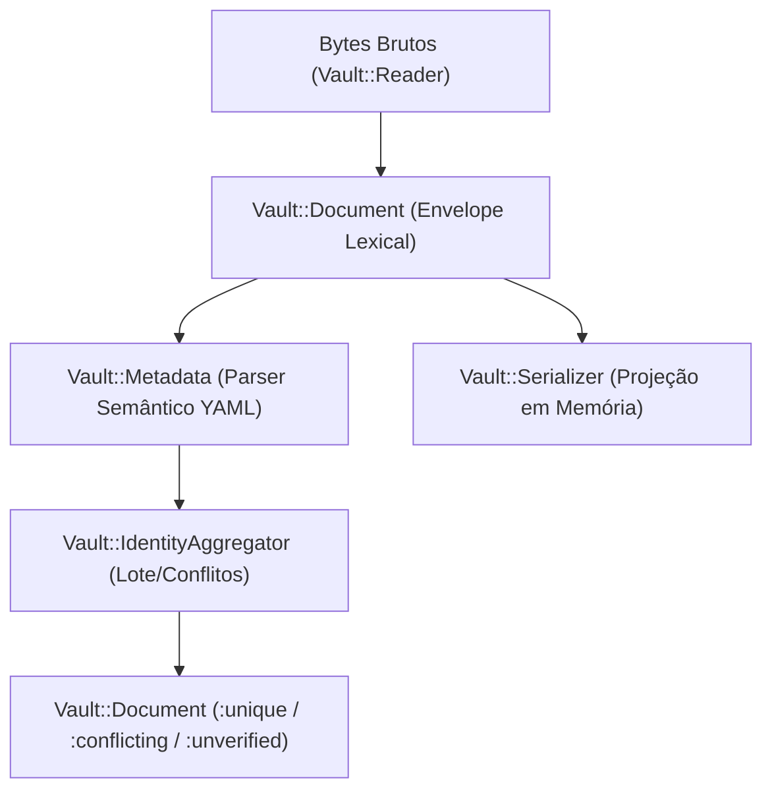

# Accio Hub — Auditoria Independente do Planejamento P1.3-02

**Data:** 25 de outubro de 2026  
**Auditor:** Antigravity (Engenharia de Software Independente)  
**Objeto:** P1.3-02 — Identidade e Contrato de Metadados Markdown  
**Documentos auditados:**
- [docs/P1.3_02_METADATA_CONTRACT.md](file:///home/goecking/Projects/Accio-HUB/docs/P1.3_02_METADATA_CONTRACT.md)
- [docs/P1.3_02_IMPLEMENTATION_PLAN.md](file:///home/goecking/Projects/Accio-HUB/docs/P1.3_02_IMPLEMENTATION_PLAN.md)
- [docs/P1.3_PLAN.md](file:///home/goecking/Projects/Accio-HUB/docs/P1.3_PLAN.md)
- [docs/P1.3_PHASE0_DECISIONS.md](file:///home/goecking/Projects/Accio-HUB/docs/P1.3_PHASE0_DECISIONS.md)
- [docs/P1.3_01_CLOSURE.md](file:///home/goecking/Projects/Accio-HUB/docs/P1.3_01_CLOSURE.md)
- [AGENTS.md](file:///home/goecking/Projects/Accio-HUB/AGENTS.md)

---

## 1. Resumo Executivo e Veredito

O Codex submeteu para auditoria o planejamento técnico e a especificação contratual da **P1.3-02 (Identidade e Contrato de Metadados Markdown)**. Esta etapa é responsável por estabelecer as regras semânticas de parsing, extração de frontmatter YAML, validação estrutural de notas e pastas, rastreamento de integridade e serialização em memória, preparando a fundação para a indexação SQLite na P1.3-03.

### Veredito
**APROVADO COM AJUSTES**

A arquitetura proposta demonstra maturidade técnica exemplar:
1. **Isolamento de efeitos colaterais:** Não há operações de escrita em disco, sem mutação de arquivos no Vault, sem escrita no banco de dados SQLite operacional e sem exposição HTTP ou de interface.
2. **Fidelidade lexical garantida:** A preservação rigorosa do envelope bruto (`raw_header`, delimitadores, `raw_body`), associada à proibição explícita de round-trips destrutivos do YAML (`unsupported_edit`), protege a formatação original e os comentários do usuário.
3. **Segurança de parsing:** O perfil restrito sobre o `Psych` (Ruby 3.3.6 / libyaml 0.2.5) com interceptação de eventos rejeita tags arbitrárias, múltiplos documentos, merges e referências cíclicas/exaustão de recursos.
4. **Respeito aos limites da P1.3-01:** Utiliza estritamente os contratos já homologados (`Vault::Reader#call`, `PathPolicy` e `Budget`).

Os ajustes recomendados nesta auditoria são pontuais e focam na eliminação de uma ambiguidade contratual em `Serializer#replace_body` (achado ACH-META-01) e no abrandamento de penalidades diagnósticas excessivas para notas advindas de ferramentas externas (achados ACH-META-02 e ACH-META-03).

---

## 2. Avaliação Individual das Propostas Contratuais (C-01 a C-11)

A especificação em [docs/P1.3_02_METADATA_CONTRACT.md](file:///home/goecking/Projects/Accio-HUB/docs/P1.3_02_METADATA_CONTRACT.md) formaliza 11 propostas contratuais que regem a semântica da P1.3-02. Abaixo segue a avaliação técnica detalhada de cada uma:

### Proposta C-01: Schema 1 e Namespaces de Metadados
- **Descrição:** Define `accio_schema: 1`. Metadados essenciais no topo do mapeamento; extensões no namespace `accio.*` ou chaves de terceiros no namespace de raiz opaco. Separação de escopo físico entre notas (`.md`) e marcadores de pasta (`.accio-folder.yml`). Sem `user_id` e sem caminhos físicos no frontmatter.
- **Adequação ao Roadmap e Contratos:** Plena consonância com D-04, D-05, D-06 de `docs/P1.3_PHASE0_DECISIONS.md`.
- **Segurança e Integridade:** Evita dependência de sistema de arquivos dentro do documento, facilitando movimentação e renomeação de notas sem corrupção de dados.
- **Recomendação:** **APROVADO**.

### Proposta C-02: Obrigatoriedade de Schema e ID, e Campos Opcionais
- **Descrição:** Notas gerenciadas exigem `accio_schema: 1` e `id` escalar não-nulo. Demais campos são opcionais. Distinção estrita entre três estados: campo ausente (nil/omitted), campo explicitamente nulo (`null`), e campo presente com valor declarado. Validação estrita de tipos para campos core (`title`, `tags`, `project_ids`, `task_ids`, `pinned`, `archived`, `favorite`).
- **Adequação ao Roadmap e Contratos:** Alinhado ao modelo do protótipo P0.3 e modelos Rails P1.2.
- **Segurança e Integridade:** Impede coerções silenciosas que poderiam transformar `archived: "false"` em booleano verdadeiro ou corromper listas de IDs.
- **Ajuste Recomendado (ACH-META-03):** O contrato propõe invalidar o documento (`parse_status: :invalid`, código `duplicate_value`) caso haja elementos duplicados na lista `tags`. Para `tags`, duplicatas em notas externas são comuns (ex.: `tags: [estudo, Estudo]` ou repetição acidental); sugere-se tratar tags duplicadas com deduplicação/warning diagnóstico, mantendo a invalidação restrita a `project_ids` e `task_ids`.
- **Recomendação:** **APROVADO COM AJUSTES**.

### Proposta C-03: Compatibilidade de IDs com PublicUid e Limites
- **Descrição:** Validação estrita do campo `id`: UTF-8 válido, sem bytes NUL (`\0`), tamanho máximo de 4 KiB, string não-vazia. O tipo escalar no YAML deve ser estritamente string. Escalares numéricos sem aspas (ex.: `id: 42`) são recusados com `invalid_type`.
- **Adequação ao Roadmap e Contratos:** Compatível com `app/models/concerns/public_uid.rb` (que valida presença, ausência de NUL e UTF-8).
- **Segurança e Integridade:** A exigência de string sem aspas evita discrepâncias entre parsers de diferentes linguagens (onde números grandes sofrem overflow de float64). O teto de 4 KiB protege contra DoS por alocação de memória no SQLite indexador.
- **Recomendação:** **APROVADO**.

### Proposta C-04: Política de Datas e Ordem Temporal
- **Descrição:** Datas opcionais `created_at` e `updated_at`. Formato estrito RFC3339 / ISO8601 com sufixo `Z` ou offset de timezone explícito. Strings sem timezone ou formatos como `YYYY-MM-DD` puro são rejeitados para os campos core de data. O contrato atual estabelece erro `date_order` invalidando o documento se `updated_at < created_at`.
- **Adequação ao Roadmap e Contratos:** Necessário para permitir sincronização e resolução de conflitos determinística futura.
- **Ajuste Recomendado (ACH-META-02):** A regra `updated_at < created_at` invalidando a nota é excessivamente punitiva para arquivos criados ou editados por editores externos (ex.: Obsidian, VS Code, Git checkouts em máquinas com relógio descalibrado). Notas com essa inversão temporal devem ser marcadas como `valid` com aviso diagnóstico (`warning: date_order_anomaly`), e não desqualificadas como inválidas para leitura.
- **Recomendação:** **APROVADO COM AJUSTES**.

### Proposta C-05: Marcador de Pasta `.accio-folder.yml`
- **Descrição:** Marcador de pasta no arquivo `.accio-folder.yml`. Metadados contêm `accio_schema: 1` e `id` da pasta, além de `icon`, `color`, `order`, `expanded`. Não armazena nome de pasta nem ID do pai (derivados da árvore do filesystem). Proibido em notas markdown (`.md`).
- **Adequação ao Roadmap e Contratos:** Atende perfeitamente à decisão D-06 de `docs/P1.3_PHASE0_DECISIONS.md`.
- **Segurança e Integridade:** Impede divergências clássicas de "split-brain" entre o nome físico do diretório no disco e o nome declarado no arquivo.
- **Recomendação:** **APROVADO**.

### Proposta C-06: Preservação de Extensões Desconhecidas
- **Descrição:** Campos YAML adicionais que não façam parte do schema padrão da P1.3-02 são mantidos como árvore de dados opaca em memória. Nenhum campo desconhecido é executado, interpolado ou tratado como código/instrução.
- **Adequação ao Roadmap e Contratos:** Garante interoperabilidade com plugins de terceiros (ex.: Dataview, Frontmatter CMS).
- **Segurança e Integridade:** Imutabilidade e tratamento puramente como dados passivos eliminam vetores de injeção ou RCE.
- **Recomendação:** **APROVADO**.

### Proposta C-07: Tratamento de Documentos Inválidos e Incompatíveis
- **Descrição:** Classificação ortogonal e rigorosa:
  1. *Markdown puro sem frontmatter:* `managed: false`, `parse_status: :unmanaged`. Preservado sem modificação.
  2. *Arquivo com delimitador `---` mas YAML malformado ou tags desconhecidas:* `managed: false`, `parse_status: :invalid`.
  3. *Arquivo com `accio_schema: 1` mas sem `id` válido:* `managed: false`, `parse_status: :invalid` (código `missing_id`). Trata-se de nota gerenciada corrompida.
  4. *Arquivo com `accio_schema` não suportado (ex.: `2`):* `parse_status: :incompatible`.
  5. *Nenhum arquivo externo recebe identidade sintética ou gerada automaticamente.*
- **Adequação ao Roadmap e Contratos:** Essencial para preservar dados de terceiros e evitar corrupção de notas preexistentes.
- **Segurança e Integridade:** Evita o risco crítico de o Accio Hub "assumir a autoria" ou gravar tags em notas alheias sem autorização explícita.
- **Recomendação:** **APROVADO**.

### Proposta C-08: Envelope de Bytes, Fidelidade Lexical e Serialização em Memória
- **Descrição:** O `Document` mantém a fatia exata de bytes: `raw_header` (incluindo delimitadores `---`), `raw_body` e o payload original completo. Proibido fazer dump genérico do YAML com `Psych.dump` sobre notas existentes, pois isso destruiria a ordem das propriedades, comentários e estilo de quebra de linha. Edição de propriedades em notas existentes é rejeitada com `unsupported_edit`.
- **Adequação ao Roadmap e Contratos:** Protege a integridade do arquivo.
- **Segurança e Integridade:** Crucial para manter a confiança do usuário no armazenamento local-first.
- **Recomendação:** **APROVADO**.

### Proposta C-09: Perfil Restrito do Psych, Tratamento de Eventos e Limites de Recursos
- **Descrição:** Parsing do YAML via Psych com restrições rígidas: sem tags arbitrárias (`!ruby/object`), sem aliases/anchors, sem merges (`<<`), documento único (erro se houver múltiplos `---`), rejeição de chaves duplicadas em qualquer nível, limites de tamanho de header (64 KiB), profundidade (10 níveis) e contagem de nós (500).
- **Adequação ao Roadmap e Contratos:** Previne ataques de DoS por expansão de entidades (YAML bomb) e desserialização insegura.
- **Viabilidade Comprovada:** Testado e confirmado no Ruby 3.3.6 / Psych 5.1.2 nesta auditoria.
- **Recomendação:** **APROVADO**.

### Proposta C-10: Ortogonalidade de Estados
- **Descrição:** O resultado de processamento de um documento é decomposto em três dimensões completamente independentes:
  1. `read_state`: integridade de I/O (`:success`, `:unreadable`, `:budget_exceeded`).
  2. `parse_status`: conformidade sintática e semântica local (`:valid`, `:unmanaged`, `:invalid`, `:incompatible`).
  3. `identity_status`: unicidade no contexto do inventário (`:unique`, `:conflicting`, `:unverified`).
- **Adequação ao Roadmap e Contratos:** Elimina ambiguidades e impede que falhas de rede/disco sejam confundidas com notas corrompidas.
- **Recomendação:** **APROVADO**.

### Proposta C-11: Agregação Coletiva de Identidade e Lote Incompleto
- **Descrição:** Nenhum documento recebe status `identity_status: :unique` até que todo o inventário do lote sob observação seja processado. Se o inventário for parcial (ex.: interrompido por `budget_exceeded`), os documentos válidos recebem `identity_status: :unverified`. Se dois ou mais documentos declararem o mesmo `id`, **todos** recebem `identity_status: :conflicting` com a lista de caminhos colidentes.
- **Adequação ao Roadmap e Contratos:** Impede a escolha arbitrária ou por corrida (first-come, first-served) de documentos colidentes.
- **Recomendação:** **APROVADO**.

---

## 3. Conformidade com a Base P1.3-01

O plano respeita integralmente as fronteiras estabelecidas na P1.3-01:

1. **Reúso de Infraestrutura:** A P1.3-02 não implementa novas chamadas de filesystem. Toda a leitura de arquivos utiliza exclusivamente `Vault::Reader#call`, respeitando a resolução segura via `openat2` e o `PathPolicy`.
2. **Orçamento e Limites:** Os orçamentos de leitura (`Budget`), limites de tamanho por arquivo e contagem total de entradas são preservados. O tamanho máximo de cabeçalho YAML (64 KiB) é subordinado ao limite máximo de arquivo suportado pela P1.3-01.
3. **Ausência de Efeitos Colaterais:** A P1.3-02 não introduz chamadas a `openat` com flags `O_WRONLY`, `O_RDWR` ou `O_CREAT`. O `Serializer` opera exclusivamente sobre strings na memória do processo Ruby, gerando instâncias de `DraftResult`. Nenhuma escrita em disco é autorizada nesta etapa.
4. **Isolamento de Banco de Dados:** Não há chamadas a modelos ActiveRecord, migrações de banco ou alteração no schema SQLite do Accio Hub.

---

## 4. Análise de Segurança do Parser YAML (Psych 5.1.2 / Ruby 3.3.6)

A auditoria realizou testes adversariais empíricos na versão exata de runtime do projeto (Ruby 3.3.6, Psych 5.1.2, libyaml 0.2.5).

### Viabilidade da Interceptação por Eventos (`Psych::Handler`)
O Psych permite a criação de um handler customizado derivado de `Psych::Handler` acoplado ao `Psych::Parser`. Em ensaios sintéticos executados nesta auditoria:
- **Tags customizadas:** Podem ser interceptadas no evento `scalar(..., tag, ...)`, `start_mapping(..., tag, ...)` e `start_sequence(..., tag, ...)`. O handler pode levantar imediatamente uma exceção segura (`SecurityError` ou `Vault::YamlSecurityError`) ao detectar tags não-nulas e diferentes das tags canônicas do YAML core (`!`, `tag:yaml.org,2002:str`, etc.), abortando o parse antes de qualquer alocação excessiva.
- **Aliases e Anchors:** O evento `alias(anchor)` ou a presença de âncoras em `scalar` ou `start_mapping` pode ser rejeitado imediatamente no handler, neutralizando o ataque Billion Laughs / YAML bomb na raiz.
- **Múltiplos Documentos:** O evento `start_document` disparado uma segunda vez sinaliza múltiplos documentos e encerra o parse imediatamente com erro.

### Inspeção de Chaves Duplicadas via AST do Psych
O `Psych.safe_load` padrão do Ruby descarta silenciosamente chaves duplicadas (mantendo o último valor). Para atender ao requisito estrito de rejeição de chaves duplicadas em qualquer nível de mapeamento:
- `Psych.parse(yaml)` constrói uma árvore AST (`Psych::Nodes::Stream` -> `Psych::Nodes::Document` -> `Psych::Nodes::Mapping`).
- Nos nós de mapeamento (`Psych::Nodes::Mapping`), os filhos (`children`) são armazenados em um array sequencial alternado: `[key_node_0, val_node_0, key_node_1, val_node_1, ...]`.
- A auditoria confirmou que a AST **preserva todos os nós de chave duplicados**, permitindo que uma varredura recursiva de validação verifique duplicidade de nomes de chaves com complexidade linear $O(N)$ antes de converter para tipos nativos do Ruby.

```ruby
# Verificação comprovada na auditoria:
def validate_no_duplicate_keys!(node)
  if node.is_a?(Psych::Nodes::Mapping)
    keys = {}
    node.children.each_slice(2) do |key_node, val_node|
      key_name = key_node.value
      raise DuplicateKeyError, "Chave duplicada: #{key_name}" if keys.key?(key_name)
      keys[key_name] = true
      validate_no_duplicate_keys!(val_node)
    end
  elsif node.is_a?(Psych::Nodes::Sequence)
    node.children.each { |child| validate_no_duplicate_keys!(child) }
  end
end
```

### Prevenção de Coerções Implícitas Perigosas
O contrato exige que `id` seja estritamente string. O Psych reconhece escalares puros e armazena em `Psych::Nodes::Scalar#style` o estilo (`PLAIN`, `SINGLE_QUOTED`, `DOUBLE_QUOTED`). Isso permite distinguir facilmente `id: 42` (plain scalar numérico) de `id: "42"` (quoted string), garantindo conformidade com a proposta C-03.

---

## 5. Fidelidade Lexical e Serialização em Memória

A estratégia de preservação lexical é um dos pontos mais fortes do plano:

### Delimitação do Envelope de Frontmatter
A identificação do envelope é estrita:
- O arquivo deve começar obrigatoriamente no byte 0 com `---` seguido de quebra de linha (`\n` ou `\r\n`).
- Qualquer conteúdo antes de `---` (exceto BOM UTF-8 opcional `\xEF\xBB\xBF`) desqualifica o arquivo como nota gerenciada, classificando-o como Markdown puro (`managed: false, parse_status: :unmanaged`).
- O fechamento do envelope exige uma linha contendo exclusivamente `---` ou `...`.
- Caso o arquivo inicie com `---` mas não contenha delimitador de fechamento, o arquivo é classificado como inválido (`parse_status: :invalid`, código `unclosed_frontmatter`), sem leitura especulativa.

### Rejeição de Round-Trips Destrutivos no Serializer
O `Serializer` adota uma política de segurança essencial:
- **Proibição de mutação cega:** O método `Serializer#update_properties` em notas existentes é expressamente recusado (`unsupported_edit`), pois bibliotecas YAML de alto nível (incluindo Psych) alteram quebras de linha, removem comentários e reordenam chaves arbitrariamente.
- **Edição segura de corpo (`replace_body`):** É permitido substituir o corpo da nota preservando integralmente os bytes do cabeçalho original (`raw_header`), garantindo preservação de 100% dos comentários e ordem das propriedades originais.
- **Criação de novas notas gerenciadas (`new_managed_note`):** Cria um novo documento padronizado em memória a partir de um template limpo com propriedades core formatadas de maneira canônica.

---

## 6. Identidade Coletiva, Escalabilidade e Observação por Lote

A proposta C-11 foi analisada sob a ótica de bibliotecas médias e grandes (1.000 a 10.000 notas).

### Prevenção de Seleção Arbitrária
A regra de que nenhuma nota é declarada única até a conclusão do lote impede o risco clássico de condições de corrida de filesystem ou de dependência da ordem do diretório:
- Se existirem duas notas `nota_a.md` e `subpasta/nota_b.md` ambas com `id: "projeto-x"`, um sistema ingênuo escolheria a primeira que encontrasse e ignoraria a segunda.
- O contrato C-11 garante que ambas recebam `identity_status: :conflicting`, impedindo que uma nota suplante silenciosamente a outra.

### Comportamento em Lotes Parciais
Caso o inventário seja interrompido por exaustão do orçamento (`budget_exceeded` na P1.3-01):
- As notas processadas até aquele momento **não** recebem `identity_status: :unique`. Elas recebem `identity_status: :unverified`.
- Isso evita que o sistema apresente notas como consolidadas e definitivas quando há parte da biblioteca não observada que poderia conter um ID colidente.

### Viabilidade e Preparação para a P1.3-03
Em memória, a agregação coletiva exige apenas uma tabela hash temporária indexada por `id` durante o processamento do lote. O custo de memória para 10.000 notas é da ordem de poucos megabytes, perfeitamente viável em processos Ruby. Na P1.3-03, essa lógica migrará de forma natural para a tabela de índice no SQLite com restrição `UNIQUE` e tabela de conflitos.

---

## 7. Contrato de Edição Futura e Semântica de Conflitos

### Resolução da Ambiguidade de "Sem Conflito Conhecido" (ACH-META-01)
O documento `docs/P1.3_02_METADATA_CONTRACT.md` menciona que `Serializer#replace_body` só deve operar *"em documentos sem conflito conhecido"*. A auditoria identificou que essa frase carecia de formalização contratual:
- **Definição formal obrigatória:** O `Serializer#replace_body` só deve aceitar a operação se `document.identity_status != :conflicting` e `document.parse_status == :valid`.
- **Garantia de Não-Gravação:** O resultado retornado deve ser estritamente uma estrutura em memória (`DraftResult` contendo os novos bytes e metadados). O contrato deve declarar categoricamente que `DraftResult` não autoriza gravação direta em disco nem contorna os mecanismos de escrita que serão projetados apenas na P1.3-04.

---

## 8. Simplicidade Arquitetural e Acoplamento

A tríade de serviços proposta divide claramente as responsabilidades:



1. **`Vault::Document`:** Representa a entidade lexical e imutável. Responsável por fatiar os bytes em `raw_header` e `raw_body`, expor metadados parseados e transportar os estados ortogonais (`read_state`, `parse_status`, `identity_status`).
2. **`Vault::Metadata`:** Responsável exclusivo pelo parsing do YAML seguro via Psych, validação de schema, limites e extração de propriedades estruturadas.
3. **`Vault::Serializer`:** Responsável pela montagem em memória de drafts e substituição de corpo com preservação de bytes.
4. **`Vault::IdentityAggregator`:** Responsável pela agregação de lote e atribuição de unicidade/conflito.

A arquitetura é coesa, minimalista e desacoplada do ActiveRecord, permitindo testes unitários ultra-rápidos e totalmente isolados de banco de dados ou mocks de I/O.

---

## 9. Avaliação da Matriz de Testes (T01 a T31)

A matriz de testes apresentada em `docs/P1.3_02_IMPLEMENTATION_PLAN.md` cobre 31 cenários. A auditoria avaliou a pertinência e priorização de cada um:

### 1. Cenários Obrigatórios para a P1.3-02 (25 cenários)
Estes cenários validam contratos essenciais de segurança, parsing e integridade da P1.3-02:
- **Parsing e Segurança:** T01 (nota válida), T02 (YAML inválido), T03 (chaves duplicadas em mapeamento), T04 (tags personalizadas bloqueadas), T05 (aliases/anchors bloqueados), T06 (múltiplos documentos bloqueados), T07 (limite de cabeçalho 64 KiB), T08 (profundidade máxima de 10 níveis).
- **Schema e Identidade Local:** T09 (schema ausente/incompatível), T10 (id ausente em schema 1), T11 (id numérico plain scalar rejeitado), T12 (id com NUL ou UTF-8 inválido), T13 (teto de 4 KiB para id), T14 (distinção entre ausente, null e declarado), T15 (validação de tipos em campos core).
- **Datas e Listas:** T16 (datas RFC3339 válidas), T17 (datas inválidas/sem timezone rejeitadas), T18 (listas de ids únicas vs duplicadas).
- **Pastas e Não-Gerenciados:** T19 (marcador `.accio-folder.yml`), T20 (markdown puro sem frontmatter), T21 (extensões desconhecidas preservadas).
- **Fidelidade e Serialização:** T22 (preservação de bytes do header), T23 (recusa de edição de propriedades genéricas), T24 (substituição de corpo em memória), T25 (criação de nova nota em memória).

### 2. Cenários Complementares de Agregação e Lote (4 cenários)
- T26 (agregação com todos os IDs únicos), T27 (agregação com IDs colidentes em pastas distintas), T28 (lote incompleto marcando notas como `unverified`), T29 (recusa de substituição de corpo em documento colidente).

### 3. Cenários Postergáveis para P1.3-03 / P1.3-04 (2 cenários)
- **T30 (Reconstrução incremental de índice):** Deve ser postergado para a P1.3-03 (que implementará a tabela SQLite de índice). Na P1.3-02, não há índice persistente.
- **T31 (Resolução interativa de conflitos em disco):** Pertence à P1.3-04 (escrita segura no Vault). A P1.3-02 apenas rotula documentos colidentes em memória.

---

## 10. Tabela Consolidada de Achados

| Identificador | Severidade | Arquivo / Proposta | Resumo do Problema | Correção Recomendada |
|---|---|---|---|---|
| **ACH-META-01** | **Médio** | `docs/P1.3_02_METADATA_CONTRACT.md` (C-08, Serializer) | Ambiguidade no termo *"sem conflito conhecido"* para autorizar `Serializer#replace_body`. | Formalizar expressamente no contrato que a operação exige `identity_status != :conflicting` e `parse_status == :valid`, e explicitar que `DraftResult` não concede autorização de escrita em disco. |
| **ACH-META-02** | **Médio** | `docs/P1.3_02_METADATA_CONTRACT.md` (C-04, Datas) | Erro `date_order` (`updated_at < created_at`) invalida o documento (`parse_status: :invalid`), penalizando notas legítimas criadas fora do sistema. | Manter a nota como válida (`parse_status: :valid`), emitindo apenas um aviso diagnóstico estruturado (`warning: :date_order_anomaly`). |
| **ACH-META-03** | **Baixo** | `docs/P1.3_02_METADATA_CONTRACT.md` (C-02, Tags) | Rejeição de documento por duplicatas em `tags` (`parse_status: :invalid`, `duplicate_value`) é excessivamente rígida para notas externas. | Fazer deduplicação automática das tags com emissão de warning diagnóstico. Manter erro invalidante estrito para `project_ids` e `task_ids`. |
| **ACH-META-04** | **Informativo** | `docs/P1.3_02_IMPLEMENTATION_PLAN.md` (Fase I2) | Verificação de chaves duplicadas requer varredura na AST (`Psych::Nodes::Mapping`) antes da conversão para Hash nativo. | Documentar formalmente na implementação I2 o uso da AST de mapeamento para interceptação de chaves duplicadas antes de chamar `to_ruby`. |
| **ACH-META-05** | **Informativo** | `docs/P1.3_02_METADATA_CONTRACT.md` (C-08, Quebras de linha) | Preservação de CRLF (`\r\n`) versus LF (`\n`) na recomposição do corpo. | Garantir que o `Serializer#replace_body` respeite a terminação de linha dominante do cabeçalho original. |

---

## 11. Decisões que Exigem Homologação Humana

Antes de iniciar a implementação, as seguintes diretrizes devem ser confirmadas pelo responsável pelo projeto:

1. **Inversão Temporal de Datas (`updated_at < created_at`):**
   - *Opção Recomendada (Auditoria):* Aceitar a nota como válida (`parse_status: :valid`) com aviso diagnóstico (`warning: :date_order_anomaly`), preservando a usabilidade com notas migradas de ferramentas externas.
   - *Opção Estrita (Plano Codex):* Rejeitar o documento como inválido (`parse_status: :invalid`).

2. **Deduplicação de Tags:**
   - *Opção Recomendada (Auditoria):* Deduplicar automaticamente `tags` repetidas gerando warning diagnóstico, sem invalidar a nota.
   - *Opção Estrita (Plano Codex):* Rejeitar a nota como inválida ao encontrar duplicatas em qualquer lista.

3. **Restrição Formal de Edição de Corpo no Serializer:**
   - Confirmar que `Serializer#replace_body` só gera `DraftResult` quando `identity_status != :conflicting` e `parse_status == :valid`.

---

## 12. Parecer Conclusivo

> ### **A P1.3-02 está suficientemente definida, consistente e segura para autorizar a implementação?**
>
> **SIM, com a incorporação dos ajustes pontuais recomendados.**
>
> O contrato C-01 a C-11 e o plano de implementação delimitam com precisão cirúrgica a fronteira entre parsing em memória e gravação no filesystem, garantem que nenhum dado de terceiros ou nota existente sofrerá corrupção ou round-trip destrutivo, neutralizam os vetores de ataque conhecidos do parser YAML e preparam uma base limpa e determinística para a futura indexação SQLite da P1.3-03.

---
**Fim do Relatório de Auditoria.**
