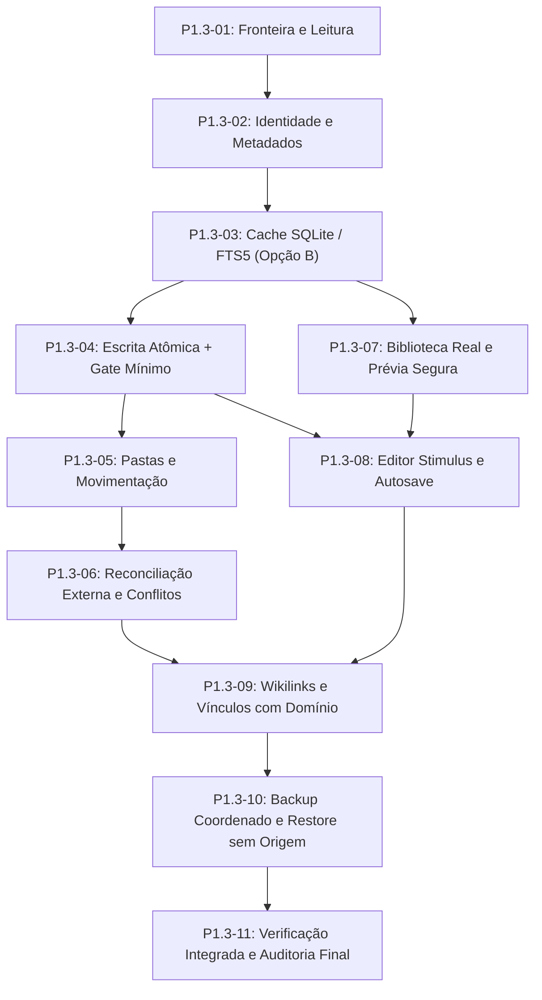

# Accio Hub — Relatório de Auditoria Independente: P1.3 / Fase 0

> **Status da Auditoria:** APROVADO COM AJUSTES  
> **Data:** 24/10/2026  
> **Auditor:** Antigravity (Auditor de Arquitetura Independente)  
> **Documentos Auditados:**  
> - [`docs/P1.3_PLAN.md`](P1.3_PLAN.md) (Proposta de plano do Vault Markdown)  
> - [`docs/ADR_PLATFORM_STRATEGY.md`](ADR_PLATFORM_STRATEGY.md) (Decisão de plataforma: Rails + PWA)  
> **Alvo Normativo:** [`AGENTS.md`](../AGENTS.md), [`PRODUCT.md`](PRODUCT.md), [`ARCHITECTURE.md`](ARCHITECTURE.md), [`ROADMAP.md`](ROADMAP.md), [`P1.0_ARCHITECTURE_PLAN.md`](P1.0_ARCHITECTURE_PLAN.md) e [`P1.2_FINAL_CLOSURE.md`](P1.2_FINAL_CLOSURE.md).

---

## Sumário Executivo

Esta auditoria independente analisou a proposta arquitetural para a **P1.3 (Vault Markdown)** elaborada pelo Codex, cobrindo estratégia de plataforma, arquitetura de persistência, modelo de segurança em sistemas de arquivos, concorrência, contratos de dados e estratégia de recuperação.

O plano apresentado demonstra rigor conceitual, profundo respeito aos contratos homologados na P1.2 e maturidade na delimitação dos limites de segurança em ambiente local-first. Não foram identificadas falhas de arquitetura que exijam rejeição ou replanejamento estrutural.

Classificação final: **APROVADO COM AJUSTES**.

São estipulados cinco ajustes obrigatórios e decisões técnicas prévias que devem ser formalmente homologados antes do início da primeira etapa de implementação (`P1.3-01`), com destaque para a antecipação de uma prova mínima de recuperação de arquivos na etapa `P1.3-04` e a adoção formal do **SQLite derivado separado (Opção B)** para indexação FTS5.

> [!IMPORTANT]
> **Esta auditoria NÃO autoriza a implementação do Vault Markdown**, não autoriza migração ou importação de dados pessoais, não altera configurações de sistema e não realiza commits, merges ou tags no repositório.

---

## 1. Base Normativa e Preservação de Contratos

A proposta em [`docs/P1.3_PLAN.md`](P1.3_PLAN.md) e [`docs/ADR_PLATFORM_STRATEGY.md`](ADR_PLATFORM_STRATEGY.md) foi examinada contra os contratos consolidados no encerramento técnico da P1.2 ([`docs/P1.2_FINAL_CLOSURE.md`](P1.2_FINAL_CLOSURE.md)):

1. **Autenticação e Sessão Local:** O plano preserva o modelo de administrador único (`users.id = 1`), autenticação local com sessões `AuthSession`, rota estrita em loopback (`127.0.0.1`) e política CSRF.
2. **Domínio Transacional SQLite:** O agregador de preferências (`AppearancePreferences`), projetos, tarefas, referências e o Pomodoro global (`FocusCommands`/`FocusTime`) continuam operando sob o banco principal e seus 25 gatilhos SQL, sem sofrer acoplamento destrutivo pelo Vault.
3. **Contrato de Backup F3b/F5:** A integridade do arquivo de contrato [`rails/config/sqlite_backup_contract.json`](../rails/config/sqlite_backup_contract.json) — baseada na whitelist exata de quatro fingerprints SHA-256 de schema, 25 gatilhos e 36 índices — é explicitamente defendida e preservada na proposta.
4. **Isolamento de Escopo:** A documentação respeita a classificação:
   * **Nível A (Técnico):** Aprovado.
   * **Nível B (Sintético):** Aprovado com ressalvas.
   * **Nível C (Uso pessoal com dados importantes):** **NÃO AUTORIZADO**.

**Conclusão da Seção:** Os contratos existentes estão 100% preservados no desenho da proposta.

---

## 2. Estratégia de Plataforma (ADR)

O documento [`docs/ADR_PLATFORM_STRATEGY.md`](ADR_PLATFORM_STRATEGY.md) ratifica a decisão de manter a stack canônica: **Ruby on Rails 8 + Hotwire + PWA**.

### Avaliação Crítica de Alternativas
* **Tauri 2:** Exigiria a orquestração de um processo sidecar para o runtime Ruby/Rails, criação de pontes IPC complexas em Rust, e introduziria matrizes de renderização heterogêneas (WebKitGTK no Linux vs. WebView2 no Windows). Como o servidor Rails já roda localmente no host com latência de loopback praticamente nula (< 2ms) e possui acesso direto ao disco, um wrapper Tauri adicionaria complexidade operacional sem ganho mensurável nesta fase.
* **Electron:** Introduziria uma sobrecarga massiva de distribuição (> 150 MB de runtime Chromium/Node embarcado), ampliaria a superfície de ataque exigindo auditoria frequente de segurança contra CVEs de Node/Chromium, e não resolveria a execução do backend Ruby.
* **Flutter:** Descartaria integralmente todo o acervo visual ERB/CSS aprovado na baseline P0.3/P0.4 e toda a camada de apresentação Stimulus da P1.1/P1.2, exigindo uma reescrita completa da interface em Dart e redefinição dos contratos HTTP.

**Parecer:** A recomendação **Rails + PWA** é tecnicamente sólida, proporcional, sustentável e mantém o foco no objetivo central do produto: um organizador pessoal local-first confiável. Não existe justificativa técnica ou de negócio para introduzir novos frameworks desktop na Fase 1.

---

## 3. Arquitetura SQLite: FTS5 e Indexação de Conhecimento

### 3.1 Investigação e Reprodução Técnica do Problema Prospectivo
O plano do Codex apontou que adicionar tabelas virtuais FTS5 ao banco de dados SQLite principal causaria uma falha no serviço existente [`SqliteBackupSnapshot`](../rails/app/services/sqlite_backup_snapshot.rb). 

A auditoria reproduziu o problema em ensaio sintético em memória no ambiente Rails local:

```ruby
# Ensaio sintético executado via rails runner / ruby em memória
require "sqlite3"
require_relative "app/services/sqlite_backup_snapshot"

db = SQLite3::Database.new(":memory:")
db.execute("CREATE VIRTUAL TABLE notes_fts USING fts5(title, body)")
db.execute("INSERT INTO notes_fts(title, body) VALUES (?, ?)", ["teste", "conteudo"])

SqliteBackupSnapshot.read(db)
```

**Resultado da Evidência Empírica:**
```text
sqlite_version: 3.53.2
table_xinfo size: 4
select * columns: 2
ERROR: SQLite3::SQLException: 3rd ORDER BY term out of range - should be between 1 and 2:
SELECT * FROM "notes_fts" ORDER BY 1,2,3,4
```

**Causa Raiz Confirmada:**
1. Em tabelas virtuais FTS5, a `PRAGMA table_xinfo` lista 4 colunas (as 2 colunas declaradas mais 2 colunas ocultas internas).
2. O método `SqliteBackupSnapshot.read` itera sobre `table_xinfo` e gera uma cláusula `ORDER BY 1,2,3,4`.
3. No entanto, `SELECT * FROM notes_fts` projeta apenas as 2 colunas públicas não-ocultas. O SQLite aborta a consulta imediatamente com erro de range.
4. Além disso, a criação de uma única tabela virtual FTS5 gera cinco tabelas de suporte (*shadow tables*) em `sqlite_master` (`notes_fts_data`, `notes_fts_idx`, `notes_fts_content`, `notes_fts_docsize`, `notes_fts_config`), o que alteraria drasticamente a estrutura inspecionada e invalidaria os hashes SHA-256 de schema homologados na P1.2F5.

### 3.2 Comparativo: Opção A vs. Opção B

| Critério | Opção A: Banco Principal Unificado | Opção B: Banco de Índice Separado e Reconstruível |
|---|---|---|
| **Complexidade de Código** | Baixa no Rails (conexão única), mas **alta** no backup: exige refatorar `SqliteBackupSnapshot` e criar tratamento para tabelas virtuais. | Moderada no Rails (conexão `KnowledgeRecord` secundária via `connects_to`), mas **nula** no backup principal. |
| **Integridade de Domínio** | Risco de acoplamento indevido: impor foreign keys rígidas do SQLite sobre notas Markdown externas falha caso o usuário crie/edite arquivos externamente. | Respeita a autoridade do filesystem: o arquivo `.md` é a fonte da verdade; o banco é mero cache derivado e descartável. |
| **Contrato de Backup P1.2** | **Quebra o contrato homologado:** exige nova rodada de recalibração de 4 fingerprints SHA-256 e reauditoria completa do gate F5. | **Preserva o contrato 100% intacto:** o banco transacional principal permanece intocado, sem alteração de schema ou gatilhos. |
| **Desempenho e Concorrência** | Escritas pesadas de indexação/varredura disputam locks WAL com comandos frequentes de Pomodoro (`FocusCommands`) e Tarefas. | **Isolamento total de locks:** indexações em lote no banco de busca não competem com transações críticas do domínio. |
| **Recuperação de Desastre** | Corrupção no índice FTS5 contamina todo o banco do usuário. | Resiliência máxima: se o índice for corrompido, basta apagar o arquivo do cache e reindexar a partir dos arquivos `.md`. |

### 3.3 Recomendação da Auditoria
**Recomenda-se formalmente a Opção B (Banco Separado para o Índice de Conhecimento).**

**Critérios Objetivos de Aprovação para a Opção B:**
1. O banco secundário deve ser configurado com `database_tasks: false` no Rails para garantir que `bin/rails db:migrate` e `bin/rails db:schema:load` operem exclusivamente sobre o banco de domínio.
2. A aplicação deve operar sob uma classe base abstrata `KnowledgeRecord < ActiveRecord::Base` com conexão isolada apontando para `ACCIO_KNOWLEDGE_INDEX_PATH`.
3. Proibição de tentativas de `JOIN` ou chaves estrangeiras SQL entre os dois bancos; vínculos de tarefas/projetos devem ser resolvidos na camada de aplicação via UIDs sob o escopo do usuário autenticado.
4. O índice de conhecimento não deve ser incluído no pacote de backup conjunto autoritativo: ele deve ser reconstruído do zero a partir do Vault após qualquer restauração.

---

## 4. Contrato de Markdown e Arquivos

### Avaliação dos Pontos Críticos
1. **Identidade Estável:** O uso de `id: "..."` (UUID opaco ou identificador estável) no frontmatter YAML desacopla o arquivo de seu nome e localização, replicando com fidelidade o modelo do protótipo P0.4.
2. **Serialização Sem Perdas (Fidelidade Lexical):**
   * *Diagnóstico:* O plano reconhece que bibliotecas de serialização padrão (`YAML.dump` / `Psych`) destroem a formatação original, reordenam chaves e eliminam comentários inseridos por editores como Obsidian ou VS Code.
   * *Exigência:* A estratégia proposta — **isolar a mutação no corpo sem tocar no cabeçalho** e, para mutações de propriedades, manter preservação localizada de campos opacos — é essencial.
3. **Marcadores de Pastas (`.accio-folder.yml`):**
   * A solução de manter um marcador com `id` em cada pasta resolve a atribuição de identidade estável a diretórios, permitindo movimentações e renomeações sem perda de vínculos.
4. **Arquivos Não Gerenciados:**
   * A política de inventariar arquivos `.md` sem frontmatter como "não gerenciados" (modo somente leitura, sem injeção silenciosa de IDs no scan) é uma salvaguarda indispensável para não corromper diretórios de notas pré-existentes do usuário.

### Decisões Técnicas que Devem Estar Fechadas Antes da Escrita
Antes de implementar `P1.3-04` (primeira escrita em disco), as seguintes especificações devem estar formalizadas:
* Formato estrito do schema de metadados (`accio_schema: 1`, chaves obrigatórias e tipos aceitos).
* Limites máximos de segurança: tamanho máximo de arquivo aceito para leitura/indexação (ex.: 2 MB), limite de profundidade de pastas (ex.: 8 níveis) e limite de comprimento de caminho.
* Política explícita de tratamento de IDs duplicados: marcar ambos os arquivos como colidentes/inválidos na listagem até reconciliação explícita do usuário.

---

## 5. Segurança, Filesystem e Concorrência

### 5.1 Proteção de Filesystem
* O modelo proposto de validação componente a componente de caminho, rejeição de `..` (traversal), caracteres nulos (`\0`), caminhos absolutos fornecidos pelo cliente, barras invertidas e Alternate Data Streams (ADS) no Windows atende às melhores práticas de defesa em profundidade.
* A exigência de `lstat` e conferência de `realpath` contra a raiz configurada previne ataques via links simbólicos ou hardlinks.
* O plano reconhece honestamente o limite de ameaça: em um sistema operacional monousuário, nenhum software de espaço de usuário oferece garantia absoluta contra outro processo malicioso executado com o mesmo UID.

### 5.2 Escrita Atômica e Concorrência
* **Protocolo de Escrita Seguro:**
  1. Criação de arquivo temporário com permissões restritas (`0600`) no mesmo diretório do alvo.
  2. Escrita do conteúdo e execução de `fsync` no temporário.
  3. Substituição atômica via `File.rename`.
  4. Execução de `fsync` no diretório pai (em ambientes POSIX).
* **Concorrência Otimista (CAS):** Uso de `expected_file_sha256` calculado sobre o arquivo completo antes da escrita, retornando HTTP 409 em caso de divergência.
* **Fronteira com Editores Externos:** A auditoria aprova a distinção honesta feita no plano: o Accio Hub pode garantir consistência interna e serialização de seus próprios processos Rails, mas **não pode impor locks a editores de terceiros (Obsidian/VS Code) que ignoram travas de SO**. A garantia de "interoperabilidade sequencial com detecção de concorrência observada" é a única promessa tecnicamente sustentável.

---

## 6. Backup, Restauração e Recuperação de Desastre

### 6.1 Posicionamento da Etapa de Backup (P1.3-10) e Ajuste Necessário
Na proposta original, o backup coordenado e restauração sem banco de origem estão alocados na penúltima entrega (`P1.3-10`).

> [!WARNING]
> **Vulnerabilidade Metodológica:** A gravação real de arquivos no disco tem início na etapa `P1.3-04` (Comandos de criação/edição e diário recuperável). Manter cinco etapas subsequentes manipulando o sistema de arquivos sem nenhuma validação prévia de capacidade de recuperação representa um risco de regressão tardia.

**Ajuste Obrigatório A-01:**
* **Introduzir um Gate de Recuperação Mínima na etapa `P1.3-04`:**
  A etapa `P1.3-04` deve demonstrar, através de teste sintético isolado, que um diretório de arquivos gerados e seu diário de operações podem ser recuperados e validados em um diretório novo sem perda de dados.
* A etapa `P1.3-10` permanece responsável pelo pacote integrado e coordenado (SQLite de domínio + Vault Markdown) e restauração limpa sem banco pré-existente.

### 6.2 Confirmação de Limites de Liberação
A auditoria reitera: a conclusão com sucesso de todos os testes sintéticos da P1.3 **não concederá liberação para uso com dados pessoais importantes (Nível C)**. A liberação de Nível C continua bloqueada pelas pendências operacionais externas (política de redundância física, custódia de `master.key` e procedimento homologado por operador humano na P1.4).

---

## 7. Análise da Sequência e Complexidade das Etapas

A proposta distribui o escopo em 11 entregas incrementais. A auditoria avaliou a coerência e dependências de cada etapa:



### Oportunidades de Simplificação e Cuidados
1. **Parser Markdown (P1.3-02 / P1.3-07):** Evitar a introdução prematura de gems que dependem de extensões nativas em C/Rust (como `CommonMarker`) sem prova de compatibilidade e portabilidade no Windows. O subconjunto de Markdown validado em `prototype/markdown.mjs` deve ser a referência funcional primária.
2. **Debounce do Autosave (P1.3-08):** O limiar de 450 ms do protótipo em memória é inadequado para escrita em disco com `fsync`. Recomenda-se elevar o debounce no cliente Stimulus para 1.500 ms – 2.000 ms de inatividade, complementado por disparo imediato em evento `blur`, atalho `Ctrl+S` e troca de contexto.
3. **Notas Ligadas a Projetos Arquivados (P1.3-09):** A política deve ser conservadora: notas associadas a projetos arquivados tornam-se de leitura estrita dentro do espaço do projeto, mas a nota global permanece editável em sua própria biblioteca, sem que isso altere os timestamps ou o estado imutável do projeto arquivado.

---

## 8. Parecer e Respostas aos Quesitos da Auditoria

### 1. O modelo Rails + PWA permanece adequado?
**Sim.** Permanece como a solução de melhor custo-benefício arquitetural, com alta reutilização de contratos, interface aprovada e isolamento nativo de rede e sistema. Nenhum wrapper desktop se justifica nesta etapa.

### 2. É recomendável utilizar um SQLite separado para FTS5?
**Sim, enfaticamente (Opção B).** A inclusão de FTS5 no banco principal quebra de forma demonstrável o leitor de snapshots (`SqliteBackupSnapshot`), invalidando o contrato de backup e a auditoria da P1.2F5. O banco separado garante isolamento de I/O, simplicidade de recuperação e preservação integral dos contratos homologados.

### 3. O contrato de Markdown está pronto para implementação?
**Parcialmente pronto.** O arcabouço conceitual está validado, mas as especificações exatas de schema do frontmatter, tratamento de comentários YAML e limites de I/O devem ser formalmente homologadas na etapa `P1.3-02` antes da primeira escrita em disco.

### 4. A estratégia de escrita e concorrência é implementável?
**Sim.** A combinação de escrita atômica temporária com `fsync`, substituição via `File.rename` e detecção de conflitos CAS via `expected_file_sha256` é viável, comprovável e honesta quanto aos limites de escritores externos.

### 5. O backup deve ter algum gate antecipado?
**Sim.** Conforme o Ajuste A-01, a etapa `P1.3-04` deve conter uma prova mínima de recuperação de arquivos e diário em diretório sintético limpo antes de permitir a expansão para movimentação de pastas e edição via interface.

### 6. A sequência P1.3-01 a P1.3-11 é adequada?
**Sim.** A progressão é lógica e desacoplada, sujeita aos ajustes de gate antecipado em `P1.3-04` e calibração de autosave em `P1.3-08`.

### 7. Quais decisões exigem aprovação humana antes ou durante a implementação?
1. **Aprovação da Opção B (SQLite derivado separado para índice de Conhecimento).**
2. **Definição e congelamento do schema de frontmatter YAML na P1.3-02.**
3. **Escolha da tecnologia de parser Markdown (priorizando zero dependências nativas adicionais).**
4. **Política semântica de notas compartilhadas com projetos arquivados.**
5. **Especificação do formato de manifesto do backup conjunto (P1.3-10).**

---

## Conclusão da Auditoria

O planejamento entregue pelo Codex em [`docs/P1.3_PLAN.md`](P1.3_PLAN.md) e [`docs/ADR_PLATFORM_STRATEGY.md`](ADR_PLATFORM_STRATEGY.md) é classificado como:

### **APROVADO COM AJUSTES**

O projeto está apto a prosseguir para o planejamento detalhado da etapa **`P1.3-01` (Fronteira do Vault e Leitura Segura)** assim que as decisões prévias acima forem confirmadas pelo usuário, mantendo todas as travas vigentes de segurança e sem uso de dados pessoais.
