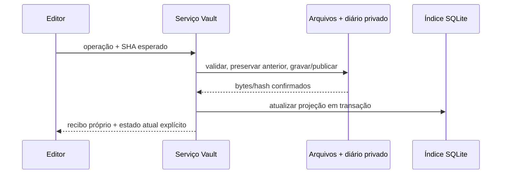

> **Estado atual — 25/10/2026:** P1.3-01 encerrada no escopo técnico/sintético por aceite humano após revalidação independente. Ver [encerramento técnico](P1.3_01_CLOSURE.md) e [recheck](P1.3_01_AUDIT_RECHECK.md). O texto abaixo preserva o registro de sua própria execução; estados e proibições anteriores não substituem esse aceite específico. P1.3-02 e nível C continuam sem autorização.

# Accio Hub — P1.3 / Fase 0: plano do Vault Markdown

Data original: 23/10/2026. Consolidação: **24/10/2026**, após auditoria independente **APROVADO COM AJUSTES**. **Somente consolidação documental autorizada pelo pedido humano desta sessão; implementação não autorizada.** Nenhuma entrega funcional abaixo foi iniciada ou fica automaticamente autorizada por este documento.

A instrução atual autoriza especificamente incorporar os ajustes e detalhar a P1.3-01, resolvendo para este escopo documental a divergência histórica de autorização registrada em AGENTS.md. Não altera retroativamente autorizações nem libera etapas funcionais. Rastreabilidade, pendências e interpretação da auditoria em [P1.3_PHASE0_DECISIONS.md](P1.3_PHASE0_DECISIONS.md); próxima etapa em [P1.3_01_IMPLEMENTATION_PLAN.md](P1.3_01_IMPLEMENTATION_PLAN.md).

## 1. Preparação, referência e escopo

Registro histórico da preparação original de 23/10 (não reexecutado nesta consolidação): branch `main`, checkout inicialmente limpo, HEAD **`56a1189c7bdaa800cb44168a51edc3292cc95a76`**, idêntico a `origin/main` após fetch. A ancestralidade do encerramento P1.2 `10c661f` foi conferida. O [CI da main](https://github.com/leogoecking/Accio-Hub/actions/runs/39995794677) foi observado como **completed/success**, no mesmo SHA. Não foi feito merge, pull, checkout de outra branch ou disparo manual de workflow.

Referências: [AGENTS](../AGENTS.md), [PRODUCT](PRODUCT.md), [ARCHITECTURE](ARCHITECTURE.md), [ROADMAP](ROADMAP.md), [P1.0 aprovado](P1.0_ARCHITECTURE_PLAN.md), [baseline visual](DESIGN_BASELINE.md), [encerramento P1.2](P1.2_FINAL_CLOSURE.md), [F3b](P1.2F3B_VERIFICATION.md), [F5-01](P1.2F5_01_CORRECTION_VERIFICATION.md) e [CI](CI_VERIFICATION.md). Trechos históricos que descrevem produto ainda demonstrativo não substituem o código atual ou a conclusão P1.2.

Objetivo futuro: transportar a experiência Accio Knowledge homologada no protótipo para arquivos Markdown reais, com índice SQLite reconstruível e integração incremental ao Rails. Preservar Rails + Hotwire, CSS, Dock/Widgets/Music, autenticação, preferências, projetos/tarefas/referências e o Pomodoro único. Estratégia de plataforma em [ADR_PLATFORM_STRATEGY.md](ADR_PLATFORM_STRATEGY.md): **Rails + PWA permanece principal**; não se propõe implementar contêiner desktop.

P1.2 continua A aprovada, B aprovada com ressalvas, **C não autorizada**. Este plano inclui investigar e testar recuperação sem origem, mas não autoriza executá-la nem concede liberação operacional. Migração/importação pessoal permanece P1.4. Não inclui anexos/execução de plugins, grafo, editor visual rico, embeddings, IA, sincronização/offline multi-dispositivo ou exclusão física de notas.

## 2. Mapa confirmado — codebase-map

Mapa focado em Conhecimento e fronteiras reutilizáveis; arquivos indicados como futuros nas seções seguintes ainda não existem.

| Área | Evidência no checkout | Reutilização / cuidado |
|---|---|---|
| Domínio do protótipo | `prototype/knowledge.mjs`: saveNote/saveFolder, validação, filtros e resolveNoteLinks | Reutilizar contratos e fixtures, substituir adapter localStorage; não transportar o estado global inteiro |
| Biblioteca/editor | `prototype/knowledge-view.mjs`: árvore, coleções, propriedades, modos, captura, autosave450ms, foco e painéis | Transportar markup/classes e comportamento para ERB/Stimulus; manter buffer/seleção durante Turbo |
| Markdown | `prototype/markdown.mjs` e testes de Conhecimento | Subconjunto permitido, HTML inerte, links seguros, fonte preservada; parser definitivo precisa de decisão explícita |
| Identidade/vínculos | `prototype/state.mjs`, `project-space.mjs`, `tests/knowledge.test.mjs` | IDs numéricos/textuais, projectIds múltiplos, folderId, extensões desconhecidas, noteLinks por ID após renomeação |
| Aparência | `prototype/style.css`, Rails `studio.css`/`foundation.css`, fontes e partials do shell | Classes/tokens `.accio-knowledge`, `.knowledge-*`, `.markdown-preview` são referência; F4 de foco/contraste prevalece sobre copiar CSS antigo sem revisão |
| Superfícies Rails | `studio/_module`, `widgets/_notes`, `_shell`, `projects/_space` | Conhecimento/captura ainda demonstrativos; projetos reais não exibem notas fictícias. Substituir gradualmente por estados reais |
| Segurança | Authentication, ApplicationController, PublicUid, SafeReferenceUrl | Sessão/CSRF/no-store; rotas u-Base64url reversíveis, owner server-side e URLs HTTP(S) sem DNS |
| Comandos/UI | ProjectCommands/TaskCommands/ReferenceCommands; controllers form/modal/ui dedicados | Erros409/422/503, campos mantidos, intenção/replay e diálogo acessível; não ampliar studio_controller.js como monólito |
| Preferências | AppearancePreferences/UserPreference/DockShortcut/WidgetPlacement | CAS do agregado C intacto; novos estados do editor não devem sobrescrever aparência/preset/filtros |
| SQL/backup | SqliteBackupSnapshot, SyntheticSqliteBackup, contrato JSON e testes F5-01 | Fingerprint literal, cinco migrações, quatro variantes e contagens25/36 são da geração P1.2; nova estrutura exige evolução explícita |
| Testes | prototype/tests, Rails tests, scripts SQL/processos/browser, `.github/workflows/ci.yml` | CI atual não instala agent-browser nem cobre o fluxo visual F5; não confundir testes Node/Rack com navegador |

No protótipo uma nota possui `id,title,body,projectIds,folderId,tags,favorite,collection,createdAt,updatedAt,noteLinks`, além de extensões. Pastas possuem `id,name,parentId`; ciclos e irmãos de nome equivalente são rejeitados. Busca é substring com remoção de acentos em título/corpo/tags. Recentes/Favoritos são consultas; Capturas/Diário usam `collection`. Diário não cria nota diária automaticamente. Não existe exclusão física homologada.

Fatos específicos que o transporte deve preservar: uma nota compartilhada é um único registro; título/pasta/projeto não definem identidade; edição de metadados não reescreve o corpo; vínculos já resolvidos por ID sobrevivem a renomeações. Leitura do código e das fixtures não constitui nova execução dos testes.

## 3. Fontes da verdade e fronteiras propostas

| Informação | Autoridade | Reconstrução / regra |
|---|---|---|
| Corpo e propriedades portáveis da nota | Arquivo `.md` com frontmatter versionado | Nunca salvar conteúdo a partir de uma cópia desatualizada do índice |
| Identidade das pastas | Diretório e marcador `.accio-folder.yml`, conforme P1.0 | Pai/caminho derivados da estrutura física; marcador preserva ID inclusive em pasta vazia |
| Projetos/tarefas/referências/preferências/foco/conta | SQLite transacional P1.2 | Não são reconstruídos de Markdown nem alterados automaticamente por scanner |
| Busca, backlinks, metadados de listagem | Projeções SQLite/FTS5 | Podem ser removidas/reconstruídas sem perder propriedades/vínculos portáveis |
| Rascunho ainda não salvo | Buffer explicitamente identificado e, se aprovado, reserva recuperável separada | Não é nota oficial; não afirmar persistência do arquivo |
| Intenções/versões anteriores de gravação | Diário privado de recuperação e cópias anteriores | Evidência operacional; não segunda biblioteca consultada como fonte corrente |

**Decisão consolidada por instrução humana atual: Opção B, SQLite separado, privado e inteiramente reconstruível para o índice de Conhecimento**, mantendo o SQLite transacional P1.2 intacto. É uma separação de cache dentro do mesmo Rails, não microserviço ou outra fonte da verdade. Justificativa concreta:

1. O backup P1.2 exige os quatro fingerprints, digest de cinco migrações e contagens exatas25/36; adicionar índices ao banco principal invalidaria esse contrato.
2. Um ensaio adicional **somente em memória** criou uma tabela FTS5 sintética com title/body. SELECT* oferece2 colunas, mas table_xinfo inclui também2 ocultas. O leitor atual SqliteBackupSnapshot tenta ORDER BY1,2,3,4 e recebe `3rd ORDER BY term out of range`. Nenhum arquivo, motor ou schema foi alterado. É incompatibilidade prospectiva com um tipo de tabela ainda ausente da P1.2, não defeito novo de seus bancos homologados.
3. Indexação não deve aumentar a contenção dos comandos transacionais do foco/preferências. Perder o cache é recuperável por arquivos; perder o banco de domínio não é.

O custo arquitetural adotado nesta consolidação é uma conexão/cache adicional e ausência de FK SQL entre bancos. Associações internas de pasta/nota/tag/link terão restrições de proprietário no índice; project_ids/task_ids são referências portáveis resolvidas exclusivamente por Current.user no banco principal. Validar contexto no servidor e tratar vínculos órfãos continua obrigatório, inclusive sob arquivamento concorrente. Não afirmar integridade referencial SQL entre esses dois arquivos.

### Ciclo próprio do índice — responsabilidade da P1.3-03

- Configuração futura `knowledge` por ambiente, `database_tasks: false` e `schema_dump: false`, com base abstrata `KnowledgeRecord < ActiveRecord::Base` e conexão exclusiva (`connects_to`); `ApplicationRecord`, modelos e conexão principal permanecem intactos. A forma final da configuração Rails será comprovada em fixtures antes de homologar o corte03.
- `ACCIO_KNOWLEDGE_INDEX_PATH` é explícito, sem fallback para `ACCIO_DATABASE_PATH` ou banco padrão. Ausente: índice indisponível/não configurado, sem conexão criadora no boot ou em GET. Validar pai privado existente, caminho fora do Vault/checkout/públicos/backups e identidade por dispositivo/inode; rejeitar aliases, links e coincidência com domínio/WAL/SHM, inclusive quando o arquivo ainda não existir (validar pai e nome).
- Prever `rails/db/knowledge_index/` para definições versionadas exclusivas, fora de `db/migrate`, e serviço `KnowledgeIndex::Schema` com versão própria. Não incluir as migrações do índice no digest de cinco migrações do domínio nem alterar `db/schema.rb` ou `sqlite_backup_contract.json`.
- Preparação somente por futuro comando local explícito `knowledge:index:prepare`, com destino validado, inicialmente em `RAILS_ENV=test` e fixture sintética. Criação exclusiva em staging privado, schema/FTS e verificações próprios, publicação sem overwrite; nunca inicializar silenciosamente por consulta. Nome do comando é proposta, não tarefa existente.
- Evolução: comparar versão declarada; versão futura/desconhecida desabilita o índice, sem downgrade ou limpeza automática. Rebuild explícito constrói geração nova a partir do Markdown, verifica identidades/colisões e publica somente se íntegra. Conservar geração anterior na falha; não descartar arquivos automaticamente. Mudanças de schema são versionadas mesmo sendo cache.
- Provar em bancos novos sintéticos que `db:migrate`, `db:schema:load`, `db:prepare`, setup/reset e preparação de testes não criam, migram, limpam ou exportam o índice. Testar comandos aplicáveis e recusar tarefas destrutivas genéricas que atinjam o cache; não confiar apenas na opção de configuração. O runner específico de Conhecimento prepara seu próprio índice explicitamente.
- Sem `ATTACH`, JOIN ou FK entre bancos. UIDs de projeto/tarefa são resolvidos no escopo autenticado pela aplicação; FKs internas do índice têm contrato próprio. Separar locks de banco reduz contenção SQLite, mas CPU/disco continuam compartilhados: não prometer isolamento total de I/O.

Estes serviços/comandos não serão criados na P1.3-01 nem nesta consolidação. O gate03 deve comprovar quatro fingerprints e SQL dos 25 gatilhos/36 índices originais, negativos F5 preservados e ausência de efeitos nas tarefas existentes.

**Não incluir esse índice derivado como banco autoritativo no backup conjunto:** registrar sua versão para reconstrução, preservar SQLite de domínio + Markdown/markers + recuperação necessária. O contrato e os quatro hashes P1.2 permanecem inalterados nessa opção; a integridade SQL do índice terá contrato/testes próprios, incluindo tabelas FTS e shadow tables.

Alternativa A avaliada e não adotada: índices no banco principal, com FKs e joins diretos, mas exigiria migrações aditivas, evolução explícita do leitor de snapshots para FTS5, gerações de contrato e novas variantes test/development ×migrate/load. Não basta acrescentar um hash ou tornar contagens flexíveis. Essa alternativa só deverá avançar mediante aprovação específica que justifique alterar os mecanismos homologados; não integra o plano consolidado.

## 4. Organização, identidade e formato

Raiz futura configurada localmente por parâmetro explícito, por exemplo `ACCIO_VAULT_PATH`, fora do checkout, assets públicos, bancos e backups. A aplicação inicia com Conhecimento **não configurado** quando ausente; não cria diretórios ou IDs por GET. A configuração/adopção será um comando local deliberado, inicialmente somente sintético. Não oferecer um endpoint que aceite qualquer caminho absoluto do host.

Estrutura ilustrativa, não criada:

```text
<vault>/
  .accio-folder.yml
  Inbox/.accio-folder.yml
  Inbox/Ideia.md
  Estudos/.accio-folder.yml
  Estudos/Planejamento.md
<estado-privado-da-instalacao>/
  vault-operations/       # intenções, recibos e recuperação, não servido na web
```

Coleções não obrigam diretórios especiais nem cópias por projeto. Uma nota pode estar em Estudos e ligada a vários projetos. Nome de arquivo legível e portátil, sufixo derivado do UID somente para colisões; título pode mudar sem renomear arquivo. Um movimento explícito muda caminho, preservando UID. Nunca usar UID bruto como caminho: UIDs legados podem conter barras, Unicode e caracteres especiais. URL usa a codificação PublicUid existente; filename é outra representação.

Rascunho de frontmatter para **novos arquivos gerenciados**, a aprovar:

```yaml
---
accio_schema: 1
id: "nota-sintetica-1"
title: "Planejamento"
tags: [estudo, projeto]
project_ids: ["projeto-sintetico-1"]
task_ids: []
favorite: false
collection: notes
link_bindings:
  - label: "Título anterior"
    target_id: "nota-sintetica-2"
---
```

`task_ids` é extensão proposta nesta P1.3, não contrato já implementado. As demais chaves seguem a proposta P1.0; `project_ids`/`task_ids` usam UIDs públicos, não PKs internas. Proprietário vem da instalação/administrador autenticado, nunca de frontmatter. Não exigir UUID em IDs legados nem normalizar seu conteúdo. Novas notas poderão gerar UUID. A migração de IDs numéricos do protótipo para representação textual com origem preservada pertence à P1.4.

Datas opcionais e explícitas, strings ISO8601; não inventar created_at histórico a partir de mtime/updated_at do índice. Guardar separadamente “observado no disco” e data declarada. `collection` permite notes/capture/journal; Recentes e Favoritos são projeções. Body é Markdown original, não HTML.

Leitura/serialização:

- UTF-8 e preservação de BOM/EOL quando suportados; encoding inválido, tamanho excedido ou estrutura desconhecida tornam o arquivo incompatível/read-only, conservando bytes. Limites operacionais iniciais de leitura devem ser aprovados antes do corte01 e medidos nele; limites do parser/AST devem ser fechados no corte02. Valores de 2 MiB/8 níveis são candidatos, não requisitos de produto homologados; exceder limites gera diagnóstico, nunca truncamento apresentado como documento completo. Entradas reais não são autorizadas.
- YAML seguro, sem objetos/classes arbitrárias, aliases, múltiplos documentos ou chaves duplicadas; verificar AST e tipos, não apenas safe_load. Campos desconhecidos representáveis permanecem preservados; extensões incompatíveis não viram defaults silenciosos. [Psych](https://docs.ruby-lang.org/en/3.3/Psych.html) oferece parsing seguro, não garantia automática de preservação lexical.
- GET/indexação não reformatam arquivos. Edição só de corpo conserva header bruto; edição de propriedades precisa conservar campos desconhecidos/comentários e body por edição localizada verificada. Se a implementação não puder representar fielmente um header, recusar alteração de metadados em vez de reemitir todo YAML com perdas. Conversão exige comando explícito e diff revisável.
- Arquivos sem accio_schema/ID são **não gerenciados**: inventariar/ler com segurança, sem gerar ID durante scan. Adoção futura explícita preserva original e resolve campos existentes; não importar automaticamente um diretório pessoal.
- ID removido/duplicado/campo obrigatório ausente não provoca UUID novo, união de arquivos ou troca de destino. Todas as cópias com mesmo UID entram em conflito, mesmo com bytes iguais: nenhuma é canônica, editável ou destino resolvido. Inventário conserva caminhos/checksums separados por observação; a unicidade de NoteIndex vale apenas para identidades válidas, e diagnósticos de colisão ficam separados por caminho. Rebuild não escolhe a primeira/última cópia. Reconciliação futura é explícita, sem renumerar ou mesclar automaticamente. Mesmo conteúdo com UIDs diferentes permanece distinto.
- `.accio-folder.yml` contém versão/ID, sem duplicar pai/caminho autoritativos. Renomear/mover diretório atualiza as projeções; marcador ausente/duplicado exige tratamento explícito.

## 5. Segurança do filesystem

Todas as operações passam por um serviço do Vault e escopo do administrador. Consultas recebem UID; o servidor resolve o caminho validado. Não concatenar path vindo de rota, título, WikiLink ou frontmatter.

Política consolidada, sujeita à prova no corte01: raiz canônica privada do usuário da instalação; validar cada componente, tipo e destino. Recusar traversal, absolutos fornecidos pelo cliente, UNC/drive/ADS indevidos, barras invertidas usadas como escape, NUL/controles, escapes recodificados, dispositivos/FIFO/socket, symlinks, hardlinks múltiplos e saídas por junction/reparse point. Checagem por prefixo textual de realpath não basta; verificar limites de componente, lstat/fstat e a identidade dos diretórios/arquivos usados.

Criação usa exclusividade/no-clobber; substituição só em alvo conhecido e versão esperada. Limitar travessia/profundidade, arquivos e leitura; não atravessar mounts filhos inesperados. Arquivos de configuração do Obsidian, scripts e conteúdo Markdown não podem autorizar execução. A raiz não é servida como diretório público; sem uploads, fetch remoto, DNS, plugins ou execução de blocos de código.

Linux: testar modos0700/0600 e APIs disponíveis. Windows: avaliar ACLs, case-insensitivity, nomes reservados/trailing dots/spaces, locks de arquivos, antivírus e reparse points. Não declarar que chmod ou NOFOLLOW resolvem ambos os sistemas. Se a proteção necessária não estiver demonstrada, essa combinação de SO/filesystem fica sem escrita habilitada até revisão.

**Limite de ameaça:** processos maliciosos com o mesmo UID podem alterar o Vault e o runtime. Revalidação lexical, realpath e NOFOLLOW no componente final não eliminam a corrida de troca de um diretório pai. O corte filesystem deve demonstrar a contenção sob o modelo adotado; necessidade de APIs por descritor/capacidade nativa deve ser apresentada antes de adicionar extensão/dependência. Não alegar isolamento contra outro processo com privilégios equivalentes.

## 6. Gravação, idempotência e recuperação

Contrato proposto: `operation_id` estável, UID, payload digest e `expected_file_sha256` do **arquivo completo**. O SHA do índice não substitui ler/conferir o arquivo atual. Versão do agregado C não deve ser usada para salvar nota. Não reutilizar FocusCommand nem criar outro motor de foco.

Sequência a testar:

1. Autenticar/CSRF, validar parâmetros permitidos/contexto e obter lock entre processos do Hub para UID/caminhos envolvidos.
2. Abrir alvo seguro e capturar bytes/hash; recusar versão obsoleta sem descartar o buffer.
3. Persistir intenção, versão anterior e payload recuperável em área privada; nenhuma credencial nos recibos/logs.
4. Escrever temporário exclusivo no mesmo filesystem/diretório do alvo, validar conteúdo e sincronizar; revalidar versão/caminhos antes da publicação.
5. Publicar por primitiva de substituição testada na plataforma; sincronizar diretório quando suportado e verificar bytes publicados.
6. Atualizar projeções em transação SQLite, registrar conclusão/recibo. Se arquivo foi salvo mas índice falhou, informar **arquivo salvo / índice pendente**, não falha genérica nem rollback fictício.



**Gate A-01 no corte04:** antes de movimentos05 ou escrita UI08, comprovar recuperação mínima do conjunto de arquivos/markers sintéticos e diário em diretório novo, com fidelidade e falhas/restart conforme o aceite04. Não é recuperação conjunta do banco principal com Vault, reservada ao10.

Filesystem e SQLite **não compartilham uma transação ACID**. Estados de recuperação devem distinguir intenção, arquivo publicado, índice pendente e concluído, sem modificar recibos históricos. Reinício inspeciona diário + arquivo antes de permitir novas escritas conflitantes; operações ambíguas não são reaplicadas automaticamente. Repetição equivalente retorna recibo, acompanhada da leitura corrente; mesma chave/payload diferente retorna409. Perda de resposta não autoriza criar outra nota ou aceitar a versão de outra aba.

Movimento de arquivo/pasta terá diário próprio, validação dos dois caminhos, ausência de destino e UID preservado. Não fazer copy/delete silencioso entre filesystems. Movimento em lote não é transação global: itens concluídos e pendentes precisam de estado recuperável. Renomeação apenas de caixa e colisões Unicode/casefold requerem testes específicos; normalização para comparação não altera IDs ou bytes originais.

Falhas de disco cheio/permissão/fsync, processo morto e índice ocupado devem preservar a última versão confirmada ou evidenciar publicação incerta. Arquivos anteriores/rascunhos não terão TTL/descarte automático neste escopo. “Salvo” só após confirmação do arquivo; “indexado” é estado separado. Durabilidade contra queda física de energia não se presume a partir de SIGKILL ou File.rename. [File/Ruby](https://docs.ruby-lang.org/en/3.3/File.html) expõe operações dependentes da plataforma; a prova deverá ser empírica no ambiente suportado.

### Concorrência com VS Code, Obsidian ou agentes externos

Locks do Hub serializam o Hub, não editores que os ignoram. Hash antes/depois e cópia anterior detectam conflitos observados, mas existe janela TOCTOU entre comparação e substituição; escrita atômica evita arquivo parcial, não resolve CAS com escritor externo arbitrário.

**Garantia inicial proposta:** interoperabilidade sequencial com editores externos e CAS forte entre comandos do Hub; conflitos externos detectados preservam buffer/versão anterior e exigem escolha explícita. Não prometer zero perda de uma versão externa nunca observada. O corte06 deverá testar gravação externa tanto por truncate/write quanto por replace, inclusive nessa janela. Se a exigência for garantia completa durante edição simultânea irrestrita, esse gate permanece bloqueado até aprovar coordenação entre editores ou uma primitiva de captura/substituição verificável por plataforma. Não mascarar o problema com mais polling ou watcher.

## 7. Índices, pesquisa e reconciliação

Estruturas conceituais novas, ainda não implementadas:

| Projeção | Conteúdo / restrições propostas |
|---|---|
| NoteIndex | user_id, uid único por proprietário, caminho relativo, checksum bruto, título, corpo de busca derivado, propriedades, status de compatibilidade e geração observada |
| FolderIndex | user_id/uid, caminho, pai derivado, checksum do marcador; unicidade de caminho e identidade |
| NoteProjectIndex / NoteTaskIndex | UIDs declarados, resolução autorizada e status de vínculo; sem FK entre cache e banco principal |
| NoteTagIndex / NoteLinkIndex | Tags e destinos por UID derivados do arquivo, vínculo de origem/target, estado resolvido/ausente/ambíguo |
| FTS5 | Título/corpo/tags no banco derivado; nunca canal de escrita da nota ou entrada no leitor de backup P1.2 |

Relações órfãs permanecem declaradas no arquivo e sinalizadas; não apagar UIDs da fonte por falta de registro SQLite. Não revelar nomes de registros alheios na resolução. Uma nota duplicada/incompatível não deve ser arbitrariamente escolhida como destino.

Probe estritamente em memória nesta Fase0: gem sqlite3 **2.9.6**, SQLite **3.53.2**, `sqlite_compileoption_used('ENABLE_FTS5')=1`, sem boot Rails ou banco em disco. Isso confirma a opção compilada localmente, **não** desempenho, tokenizer escolhido ou disponibilidade universal no Windows/runner. O ensaio FTS5 em memória da seção3 confirmou a necessidade de separar o índice do leitor de backup atual. O corte03 deverá exercitar o índice completo e sua integridade.

Recomendação a ensaiar: FTS5 com suporte a substring/trigram e tratamento de acentos compatível com as fixtures atuais; consultas curtas precisam de fallback limitado sobre projeção normalizada, não varredura de todos os arquivos a cada tecla. Unicode61/prefixo isoladamente não equivalem à busca substring P0.4. Não expor operadores MATCH/SQL arbitrários; compilar entrada literal, bind parameters e limitar tamanho/custo. HTML de snippets será escapado. A seleção final de tokenizer e limites depende do teste de equivalência e medição. [FTS5](https://www.sqlite.org/fts5.html) documenta tokenizers e operações de reconstrução; a política de busca é decisão do produto.

Reindexação completa: varrer somente a raiz aprovada, validar snapshots estáveis de arquivo, montar geração nova e publicar transacionalmente. Preservar geração anterior enquanto reconstruindo, exibindo desatualização; falha não produz biblioteca vazia apresentada como sucesso. Nunca remover dados transacionais ao reconstruir índices.

Mudança externa: checksum é prova; mtime/tamanho são otimizações. Validar novamente ao abrir/salvar. Propor reconciliação inicial e periódica em lotes, usando ActiveJob já disponível e exclusão entre processos; índice é derivado, logo perda de job deve ser recuperável por varredura, sem fila durável nova por antecipação. Intervalo, custo e adapter serão fechados após ensaio; não reutilizar os limiares15/60/5 do Pomodoro. Watcher é opcional somente com necessidade demonstrada. GET pode ler o arquivo para conferir frescor, mas não gravar IDs, metadados ou iniciar adoção.

Arquivo removido externamente vira ausente/conflitante; não destruir silenciosamente backlinks, vínculos ou histórico. Remover e recriar caminho com outro UID não transfere relações. Rebuild deve recuperar a mesma biblioteca e os mesmos destinos duráveis a partir de arquivos/marcadores, sem depender do corpo salvo no índice antigo.

## 8. Relacionamentos, links e compatibilidade editorial

`project_ids` e `task_ids` no arquivo são autoritativos. Renomear projeto/tarefa não altera vínculos; mover tarefa não muda automaticamente os project_ids da nota. Arquivar projeto não apaga arquivos. Concluir foco/tarefa não edita conteúdo da nota, e nota não conclui/reabre tarefas.

Política conservadora proposta para homologação antes do corte09: espaço arquivado estritamente somente leitura, inclusive para conteúdo, propriedades e vínculos. A nota global compartilhada pode ter corpo/propriedades não relacionais editados na biblioteca; isso não altera timestamps, lock_version, estado ou atividade do projeto arquivado. Vínculos com arquivados ficam congelados, inclusive na biblioteca, até fluxo explícito aprovado. O espaço exibe conteúdo corrente, **não** snapshot histórico imutável. Não habilitar a integração até aceite humano dessa semântica; se a prova de preservação falhar, manter comandos bloqueados. Não enfraquecer ProjectWriteProtection de tarefas/referências para resolver esse ponto.

Para comandos que alterem vínculos contextuais, propor reserva transacional curta/materializada no SQLite de domínio durante a validação final e publicação do arquivo, serializando com arquivamento; temporários/validação pesada devem estar prontos antes dessa janela. A atualização do índice é posterior e reconstruível, sem transação distribuída. O corte09 deve provar a ordem com processos independentes e medir contenção sem mudar os comandos E1/C. Se essa coordenação não puder preservar os contratos, não habilitar a operação até aprovar outra solução. Mudanças externas de metadados são entradas a reconciliar, não comandos que possam alterar tarefas/projetos ou contornar owner-scope; inconsistências permanecem no arquivo com diagnóstico.

Atividade de notas deve ser uma projeção distinguível; reindexar não toca Project.updated_at, lock_version ou preferências. Integração com ordenação recente da Biblioteca exige critério aprovado, sem inventar história para notas externas sem datas.

WikiLinks:

- Preservar `noteLinks` como `link_bindings` portável; destinos persistidos por ID prevalecem sobre novo título equivalente. Ambiguidade nunca escolhe primeiro resultado.
- Suportar inicialmente `[[Título]]`, conforme P0.4; aliases, headings, block IDs e transclusões só após contrato próprio. Backlinks são derivados de origens/destinos, não cópias de conteúdo.
- Resolver um novo candidato e persistir sua identidade são operações distintas. GET/scan não podem reescrever todas as notas para fixar destinos. Para preservar o caso P0.4 em que um alvo é criado depois da origem, o corte09 deverá propor comando explícito/journalizado de fixação de bindings, com CAS por arquivo e estado parcial visível. Candidatos ainda não persistidos não podem ser apresentados como vínculos duráveis após rebuild. Não substituir essa prova por cache no SQLite.
- Links Markdown relativos só navegam para arquivos/notas permitidos após resolução interna; não criar href file:, caminhos de host ou acesso a arquivo fora da raiz. Links HTTP(S) passam pela política SafeReferenceUrl existente, sem DNS/fetch.

VS Code edita Markdown e oferece prévia, mas isso não garante semântica dos metadados Accio. Obsidian usa arquivos e links por nome/caminho; suas propriedades não oferecem edição completa de estruturas aninhadas. Portanto `link_bindings` pode exigir modo fonte; o Hub não promete que outro editor respeite seus IDs. Preservar bytes e propriedades comuns, validar alterações externas, documentar diferenças. Renomear um arquivo no Obsidian pode modificar links por sua própria política; reconciliar o resultado, não desativar a segurança do Hub. [VS Code Markdown](https://code.visualstudio.com/docs/languages/markdown), [Obsidian properties](https://help.obsidian.md/properties), [links](https://help.obsidian.md/links).

Prévia: recomendar parser mantido no servidor, HTML bruto desabilitado, allowlist de sanitização Rails e SafeReferenceUrl, sem imagens/fetch/scripts/iframes. Não marcar corpo como html_safe nem converter caminhos de nota em HTML confiável. O subconjunto/renderizador P0.4 fornece fixtures/oráculo; não propor parser Ruby por regex. Uma avaliação curta comparará reaproveitamento do renderer JS seguro versus parser servidor; CommonMarker é apenas candidato com extensão nativa, **não dependência aprovada/instalada**. [Projeto CommonMarker](https://github.com/gjtorikian/commonmarker). Aprovar parser/custo antes de modificar Gemfile. Prévia de buffer pode usar POST autenticado/CSRF sem persistência, com no-store e sem logar conteúdo.

Agentes de IA futuros serão escritores não confiáveis sujeitos aos mesmos UIDs, hashes, escopo, confirmação e recuperação. Markdown/frontmatter não concede permissão, não executa comandos e não constitui instrução administrativa confiável. Nenhuma integração, credencial, MCP ou API de IA entra nesta fase.

## 9. UI, autosave e contratos HTTP propostos

Biblioteca, árvore, coleções, filtro de projeto, editor Markdown/prévia/leitura, propriedades, favoritos e captura reutilizarão classes e semântica P0.4. Dashboard e projetos consultam NoteIndex/repositório únicos, sem dados fictícios em superfícies conectadas. Conteúdo do editor permanece em controller especializado; não substituir textarea nem retirar foco/seleção por polling/Turbo Streams.

Rotas conceituais `/knowledge`, `/knowledge/:uid` e comandos de notas/pastas, não caminhos de arquivos. Compatibilidade com `/apps/knowledge` por redirect autenticado. Não há autorização para criar essas rotas agora. Separar controllers de biblioteca/form/editor e motor de arquivos; nunca ampliar o DTO de aparência sem decisão.

Autosave:450ms permanece referência histórica do adapter em memória, não valor adotado para disco. No corte08 comparar450/1.500/2.000ms com fixtures sintéticas de tamanhos variados e fsync, medindo gravações por minuto, p50/p95 de publicação, tempo até confirmação, contenção e preservação do último buffer. 1.500–2.000ms é faixa candidata recomendada pela auditoria, sujeita a evidência e aceite de UX, sem limiar definitivo arbitrário. Blur, Ctrl+S e troca de contexto solicitam flush pelo mesmo coordenador, sem publicar em caso de conflito e sem prometer conclusão ao fechar o navegador; uma gravação por nota em voo, sequência de buffers e versão confirmada. Resposta antiga não limpa rascunho novo. `operation_id` e payload ficam estáveis na retentativa; não aplicar versão remota automaticamente após409. Buffer, estado incerto e mensagem acessível permanecem após timeout/503. Ctrl+S/troca de nota/Turbo usam o mesmo contrato. Sem gravações por segundo ou polling que confirme produtividade do foco.

Estados textuais separados: alterado localmente, salvando, arquivo salvo, índice pendente, conflito, indisponível, rascunho recuperável. Reserva durável de rascunho precisa de política de privacidade/retenção; não se promete sobrevivência a fechamento abrupto apenas com beforeunload ou memória. Uma reserva de recuperação não é fonte corrente da nota. GET não cria sessões/arquivos/IDs nem confirma edições.

HTTP:404 para UID inválido/inexistente/alheio;422 para conteúdo/metadados inválidos;409 para SHA/identidade/contexto obsoletos;503 recuperável para contenção/indisponibilidade esperada. Publicação do arquivo seguida de falha de índice deve retornar recibo/estado específico que permita reconciliar, sem induzir criação duplicada. Nenhuma mensagem expõe path absoluto, corpo de outra nota ou detalhes internos desnecessários.

## 10. Backup conjunto e recuperação sem banco original

A prova mínima de arquivos/operações do corte04 não satisfaz esta etapa: o corte10 exige recuperação completa e coordenada do **SQLite principal + Vault**, com origem indisponível e preparo de segurança no destino.

Criar futuro contrato de pacote **versionado para SQLite + Vault**, preservando decodificação/recusas de pacotes P1.2. Não confundir restart, exportação de snapshot legado ou cópia do arquivo principal WAL com backup coordenado. A [Online Backup API](https://www.sqlite.org/backup.html) cobre SQLite; não fornece uma transação com arquivos Markdown externos.

Proposta para o corte10, somente sintético até autorização posterior:

1. Concluir/suspender comandos Hub por barreira global de escrita e drenar operações pendentes; não introduzir essa barreira em E1 nesta Fase0. Obter uma geração coerente de notas/metadados e snapshot SQLite pela API existente.
2. Copiar conteúdos/marcadores/diretórios vazios para staging privado, inventariar demais arquivos regulares e exclusões explícitas; não descartar desconhecidos silenciosamente. Journal/versões necessárias à recuperação também entram com escopo definido; secrets e caches não entram.
3. Manifesto registra geração, versão de formato/schema, caminhos relativos, tamanhos/hashes, IDs, consistência, migrações e informações de recuperação sem segredos. Validar estrutura, duplicações e limites antes da publicação sem overwrite.
4. Editores externos devem estar coordenados/parados, ou cobertos por snapshot de filesystem testado. Dupla leitura de hashes detecta mudanças observadas, mas não prova captura pontual de um Vault alterado livremente; nessa situação recusar a alegação de backup consistente. A solução portátil inicial será janela explícita sem escritores externos, não alteração dos backups Ubuntu.
5. Reabrir/verificar todo pacote antes de anunciá-lo restaurável. Hash não é assinatura/autenticação contra quem controla o mesmo usuário; proteção/redundância/custódia permanecem decisões operacionais.
6. Restauração recebe **somente pacote, diretório novo privado e configuração externa aprovada**; a fixture de autorização sintética identifica o destino. Deve funcionar com o diretório original inteiramente ausente, sem instanciar o caminho F3b que exige origem preexistente. Nunca restaurar sobre fonte/destino existente.
7. Comparar fidelidade de arquivos e domínio antes de preparo de segurança; depois revogar AuthSessions somente no destino, gerar segredo novo, manter password_digest, reconfigurar raízes e reconstruir índices quando necessário. Não reproduzir comandos/recibos antigos ou creditar tempo ao foco. Não disponibilizar HTTP antes de estado coerente e preparo seguros.
8. Novo processo autentica com login legítimo, recusa cookies antigos e mantém notas/vínculos/foco. Procedimento por operador, chaves externas e política de guarda precisam de provas próprias antes de C; uma execução sintética não concede essa liberação.

Nada é implementado nos mecanismos F3b existentes agora. A futura evolução de backup é um corte explícito de compatibilidade, não permissão para remover guardas ou editar whitelist por conveniência. Não integrar Restic/rclone/systemd, automatizar backups ou usar instalações pessoais.

## 11. Entregas propostas — cada uma exige autorização própria

Os nomes de arquivos são destinos sugeridos, não arquivos criados nesta Fase0. Testes novos devem usar raízes/fixtures sintéticas explícitas; modelos/migrações novas somente após aprovação do respectivo contrato.

### P1.3-01 — Fronteira do Vault e Leitura Segura

Plano exclusivo detalhado em [P1.3_01_IMPLEMENTATION_PLAN.md](P1.3_01_IMPLEMENTATION_PLAN.md), ainda aguardando autorização. O inventário01 é físico/read-only; gestão e validação semântica de IDs só no corte02.

- **Objetivo:** raiz configurada, estado não configurado e inventário físico read-only, candidatos Markdown/markers e desconhecidos, sem validar gestão antes do contrato02.
- **Arquivos:** futuros `app/services/vault/root.rb`, `path_policy.rb`, `reader.rb`, configuração explícita e `test/services/vault/*`.
- **Contratos:** seção5; GET não cria diretório/ID; paths relativos resolvidos no servidor, sem symlinks/hardlinks/arquivos especiais.
- **Riscos:** traversal/TOCTOU/reparse points, permissões e encoding; não confundir path lexical válido com alvo seguro.
- **Testes:** caminhos absolutos/Unicode/escapes/UNC/nomes reservados, troca de pai/alvo, links, arquivo gigante, permissão negada; nenhum acesso fora da fixture.
- **Aceite:** bloqueios demonstrados, arquivos intocados e lacunas por plataforma explícitas.
- **Dependências:** aprovação Fase0 e modelo de ameaça.
- **Limitações:** sem escrita, adoção ou suporte Windows declarado sem execução nativa.

### P1.3-02 — Identidade e contrato de metadados

- **Objetivo:** parser/validador e estratégia de serialização fiel, sem operação em Vault pessoal.
- **Arquivos:** futuros `vault/document.rb`, `metadata.rb`, `serializer.rb`, fixtures textuais sintéticas/testes; avaliar parser Markdown sem instalar nesta etapa documental.
- **Contratos:** seção4, campos desconhecidos/IDs/markers, datas ausentes, sem aliases/classes YAML; nenhum reparo silencioso.
- **Riscos:** perda lexical, coerção de tipos, IDs duplicados e incompatibilidade Obsidian.
- **Testes:** BOM/CRLF/misto, tabs/espaços, YAML duplicado/objetos/aliases, extensões, headers opacos e round-trip byte a byte onde declarado.
- **Aceite:** contrato YAML completo homologado antes da primeira escrita04: versão, chaves obrigatórias/opcionais, tipos estritos, IDs/duplicados, datas, nulos, enums, listas, extensões, markers, encoding/BOM/EOL e limites de bytes/AST/profundidade/tempo; fixtures válidas/inválidas e fidelidade lexical comprovadas. Exemplo da seção4 não substitui contrato. Parser/dependência de prévia decidido antes do consumidor07, podendo ser avaliado no02.
- **Dependências:**01.
- **Limitações:** sem importação P0.4, sem aplicação automática de defaults a arquivos externos.

### P1.3-03 — Projeções SQLite/FTS5 isoladas e reconstruíveis

- **Objetivo:** cache SQLite separado, índices reconstruíveis de fixtures lidas e pesquisa equivalente, preservando o banco principal e seu backup.
- **Arquivos:** futura base KnowledgeRecord, modelos NoteIndex/FolderIndex e associações derivadas, schema/migrações exclusivos do cache, configuração de conexão/caminho, `vault/indexer.rb`, `knowledge_query.rb` e testes/CI próprios; sem migrações no domínio P1.2.
- **Contratos:** seções3/7; caminho/conexão independentes, fonte sempre em arquivo, isolamento de proprietário e validação explícita dos vínculos entre bancos; schema do cache versionado/reconstruível.
- **Riscos:** abrir banco errado, violar isolamento entre owners, aplicar migração de cache no domínio, FTS shadow tables e busca diferente.
- **Testes:** conexões/paths recusados, schema/FTS/FKs internos do cache, original25/36 por nome/SQL e quatro hashes P1.2 inalterados, negativos F5-01 preservados, reconstrução após apagar somente o cache e buscas curtas/acentos/Unicode/operadores adversariais.
- **Aceite:** domínio/recibos/contrato de backup intactos; índice descartável/reconstruível; nenhuma leitura do cache pelo leitor F3b; nenhuma FK entre bancos alegada ou teste eliminado.
- **Dependências:**01/02, Opção B já adotada documentalmente e homologação do contrato técnico próprio do índice; implementação03 exige autorização específica. Alternativa A exigiria decisão humana que reabra o escopo.
- **Limitações:** sem edição de notas/UI e sem homologação operacional.

### P1.3-04 — Comandos de criação/edição, diário e Gate de Recuperação Mínima A-01

- **Objetivo:** publicar arquivos e recuperar falhas sem usar o índice como conteúdo autoritativo.
- **Arquivos:** futuros `vault/commands.rb`, `atomic_writer.rb`, `operation_journal.rb`, testes de IO/processos; reutilizar padrões de intenção existentes, sem FocusCommand.
- **Contratos:** seção6; expected SHA, operação estável, no-clobber, recibo próprio e estados arquivo/índice separados.
- **Riscos:** resposta perdida, disco cheio, fsync/rename, duplicação após restart e recuperação parcial.
- **Testes:** dois processos, mesma intenção divergente, conflito de SHA, falhas antes/depois da publicação, SIGKILL, índice indisponível e replay.
- **Aceite:** versões/recibos preservados; nenhuma nota duplicada; publicação incerta visível; sem rollback ACID fictício. **Gate A-01 obrigatório antes de avançar a05 ou habilitar escrita UI08:** recuperar arquivos/markers sintéticos gerados e diário em diretório novo privado; comparar bytes, hashes, IDs, metadados desconhecidos, versões anteriores e estados de operações, com falhas injetadas antes/depois de publicação e reinício. Recuperar usando o conjunto de recuperação capturado, sem depender dos arquivos originais; itens ambíguos bloqueados, sem replay automático nem perda silenciosa. Emitir inventário pré/pós e relatório de limitações.
- **Dependências:**01–03, contrato YAML02 homologado e desenho do ensaio A-01 aceito antes de iniciar04. A-01 comprova recuperação mínima de arquivos/operações, **não** restore completo do SQLite principal + Vault: isso permanece no10.
- **Limitações:** só fixtures; garantia de concorrência externa permanece condicionada ao06, sem exclusão física ou retenção automática.

### P1.3-05 — Pastas e movimentos preservando identidade

- **Objetivo:** criar/renomear/mover arquivos e pastas com IDs/links preservados.
- **Arquivos:** futuros `vault/folder_commands.rb`, `move_operation.rb`, markers e testes de recuperação.
- **Contratos:** caminho é localização, não identidade; rejeitar ciclos/colisões/cross-filesystem e destino existente.
- **Riscos:** movimento parcial, case-only rename, reaparecimento do caminho antigo por editor externo.
- **Testes:** pastas vazias/subárvores, Unicode/casefold, falha/restart em cada fase, mesmos UIDs após rebuild e conflito de destino.
- **Aceite:** inventário recuperável, sem perda/duplicação silenciosa e sem alteração de vínculos por nome.
- **Dependências:**04.
- **Limitações:** sem copy/delete entre volumes, delete/expurgo ou garantia Windows não testada.

### P1.3-06 — Reconciliação externa e conflitos

- **Objetivo:** observar edições externas e oferecer recuperação explícita sem descartar rascunhos.
- **Arquivos:** futuros `vault/reconciler.rb`, job de indexação e testes de múltiplos escritores.
- **Contratos:** checksum, geração, readonly/incompatível/ausente; seção6 limita honestamente CAS de escritores externos.
- **Riscos:** corrida final de replace, truncamento em andamento, UID removido/duplicado e jobs concorrentes.
- **Testes:** editor sintético via write/replace durante cada fase de save, polling perdido/restart, exclusão/recriação, perda de índice e presença de buffer não salvo.
- **Aceite:** nenhuma sobrescrita silenciosa nos cenários declarados; garantia externa/limite aceito explicitamente; falha essencial bloqueia habilitar escrita UI.
- **Dependências:**03–05; decisão do modelo de cooperação externa.
- **Limitações:** watcher só se medido; sem prometer defesa contra processo malicioso com mesmo UID.

### P1.3-07 — Biblioteca real e prévia segura

- **Objetivo:** substituir a biblioteca demonstrativa por consulta real, mantendo identidade e leitura segura.
- **Arquivos:** futuros `KnowledgeController`, partials de biblioteca/editor/leitura, queries/helper/renderer; `studio/_module`, `widgets/_notes`, routes e CSS pontual quando necessário.
- **Contratos:** coleções/pastas/busca/filtro/favoritos; renderização não executável, fonte textual intacta e URL F2a.
- **Riscos:** XSS, HTML/URLs, nota fictícia confundida com persistida, regressão de layout e contagens.
- **Testes:** HTML/eventos/schemes/links relativos, código/fences, alvo ambíguo, estados vazios/incompatíveis e Chromium nos dois temas/cinco larguras.
- **Aceite:** mesmos registros em biblioteca/dashboard, zero conteúdo fictício nas superfícies conectadas, prévia sem fetch/execução e interface consistente.
- **Dependências:**03, renderer/dependência aprovada em02; consulta pode preceder escrita UI.
- **Limitações:** sem anexos, HTML bruto ou paridade completa Obsidian/CommonMark prometida.

### P1.3-08 — Editor, propriedades e captura

- **Objetivo:** conectar comandos seguros ao editor e captura rápida existentes.
- **Arquivos:** futuros controllers Stimulus knowledge_editor/form/library, rotas de comandos, partials, shell e testes JS/browser dedicados.
- **Contratos:** seção9; preservar buffer/seleção/foco, estado salvo distinto de índice, retentativa por mesmo envelope e navegação segura.
- **Riscos:** autosave fora de ordem, navegação Turbo/reload, falha intermediária e preferência sobrescrita.
- **Testes:** timeout/409/503/resposta perdida, duas abas, tema durante edição, keyboard/diálogos/Escape/retorno de foco, captura e recarga.
- **Aceite:** arquivo confirmado em disco; nenhuma resposta antiga apaga edição nova; mesma nota nas telas; C/E1/F1 intactos.
- **Dependências:**04–07 e decisão sobre reserva de rascunho.
- **Limitações:** sem editor rico, fila offline automática ou promessa de rascunho durável não testada.

### P1.3-09 — Links/backlinks e projetos/tarefas

- **Objetivo:** integrar IDs, notas compartilhadas e relações com domínio existente.
- **Arquivos:** futuros queries/associações derivadas, resolvedor/command de bindings, views de projetos/tarefas/busca e testes integrados.
- **Contratos:** seção8; arquivo autoritativo, alvo por UID, órfãos visíveis, readonly de arquivados e nenhum efeito automático em tarefas/foco.
- **Riscos:** binding só em cache, renomeação ambígua, múltiplas escritas parciais e edição indireta de arquivado.
- **Testes:** alvo criado depois da origem, binding durável/rebuild, título duplicado, rename/move, nota em dois projetos, tarefa movida/concluída e arquivamento concorrente.
- **Aceite:** links duráveis reconstruíveis, compartilhamento sem cópia, owner-scope, decisões de arquivo arquivado/fixação aprovadas e nenhum campo P1.2 alterado indevidamente.
- **Dependências:**06/08 e decisões relacionais explícitas.
- **Limitações:** sem grafo, transclusões ou reescrita silenciosa de outras notas.

### P1.3-10 — Backup coordenado e restore sem origem

- **Objetivo:** comprovar recuperação do conjunto em diretório/processo novos sem banco/raiz originais disponíveis.
- **Arquivos:** futuros serviços/CLI de pacote Vault versionado, manifesto, validação/restore e runners sintéticos; adapters/contratos F3b somente após autorização do corte.
- **Contratos:** seção10; sem live-source obrigatório, sem overwrite, preservação pré-segurança e sanitização apenas no destino.
- **Riscos:** captura inconsistente, perda de metadados/recibos, pacote adulterado/traversal, credenciais ressuscitadas e dependências externas omitidas.
- **Testes:** escritores coordenados e não coordenados, transações WAL, corrupção/hash/schema/migrações/path adulterados, SIGKILL, fonte inteiramente indisponível, índice removido, segredo novo, cookie antigo recusado/login/restart/GET.
- **Aceite:** comparação lógica domínio + hashes de arquivos, mesmas identidades/vínculos e nenhum tempo inventado; recusa HTTP antes do preparo; relatório de configuração/chaves necessárias ao operador.
- **Dependências:**03–09, política de snapshot e autorização específica de recuperação sem origem.
- **Limitações:** exclusivamente sintético; sem Restic/rclone/backups Ubuntu, automação ou concessão de C.

### P1.3-11 — Verificação integrada e auditoria

- **Objetivo:** verificar a fase completa e produzir proposta de encerramento, sem homologação automática.
- **Arquivos:** futuros relatório/evidências P1.3, testes Rails/JS/browser/SQL e extensão CI necessária, sem enfraquecer o CI mínimo existente.
- **Contratos:** criar nota → associar projetos/tarefa → Markdown → edição externa → conflito → mover/renomear → reconstruir índice → backup → restore sem origem → login/restart; domínio P1.2 preservado.
- **Riscos:** aprovar somente happy path ou extrapolar Chromium/sintético para uso pessoal/Windows.
- **Testes:** suíte atual inteira e nova, RuboCop/Brakeman/Zeitwerk, SQL do domínio e do cache por versão, Node/P0.4, processos e Chromium;320/390/768/1440/1920, temas/fundos, axe e teclado/foco. Firefox/revisão humana e Windows com resultados separados.
- **Aceite:** sem bloqueadores no escopo declarado, evidências reproduzíveis, auditoria independente e aceite humano; níveis A/B/C reavaliados separadamente.
- **Dependências:**cortes anteriores aprovados.
- **Limitações:** CI atual não cobre browser; job separado exige toolchain/fixtures explicitamente aprovados. Ausência de teste nativo não vira compatibilidade homologada.

## 12. Matriz de riscos e decisões de aprovação

| Risco / decisão | Severidade / efeito | Encaminhamento obrigatório |
|---|---|---|
| Path escape/symlink/reparse/TOCTOU | Crítica: acesso fora da raiz | Gate01 e modelo de ameaça; APIs adicionais somente após justificativa |
| Sobrescrita por editor externo | Alta: versão não observada pode ser perdida | Gate06; aprovar interoperabilidade sequencial/cooperação ou solução de captura atômica por plataforma |
| Arquivo/índice/journal divergentes | Alta: falso “salvo” ou replay incorreto | Gate04 e falhas em cada etapa; arquivo autoritativo e estados recuperáveis |
| FTS no banco principal quebra o contrato/leitor de backup | Alta: recusa ou erro ao calcular snapshot | Opção B adotada; Gate03 prova isolamento e preserva quatro hashes/25/36 originais |
| Backup de Vault ativo sem coordenação | Alta: pacote mistura instantes | Gate10; recusar captura consistente não demonstrada, sem mudar backups Ubuntu |
| Restore depende da origem / chaves omitidas | Alta: falsa recuperação operacional | Gate10 sem fonte + configuração externa documentada; C continua separado |
| Binding apenas no índice | Alta: renomeação/rebuild perde destino | Gate09; decidir fixação durável e operações parciais explícitas |
| Nota compartilhada com arquivado | Média/alta: alteração indireta ambígua | Aprovar política da seção8 antes de integrar; manter proteção Task/Reference |
| Frontmatter reemitido com perdas | Alta: conteúdo/propriedade externa perdida | Gate02; preservar raw e recusar mutação não representável |
| Novo parser Markdown | Alta para XSS; custo operacional nativo | Decidir renderer/parser e eventual dependência após ensaio; não instalado agora |
| Busca FTS diferente de substring | Média: regressão funcional | Equivalência com fixtures e fallback limitado; não aceitar apenas buscas fáceis |
| Windows/Firefox/PWA não exercitados | Cobertura pendente | Sem certificação presumida; validar plataforma antes de suporte operacional |

Decisões concretas ainda solicitadas à revisão: esquema de frontmatter/markers e adoção; contrato técnico do índice separado e limites dos vínculos entre bancos; formato novo de pacote conjunto sem relaxar o contrato P1.2; cooperação com editores externos e garantia exigida; política de arquivados/atividade/bindings; parser e dependência; rascunhos/limites/retentativa; escopo do pacote conjunto e recuperação sem origem sintética. As recomendações acima não substituem essas aprovações.

## 13. Provas e condições de avanço

Baseline histórica: encerramento P1.2 registra220 testes Rails/3.595 asserções, JS41, protótipo66,25 gatilhos/36 índices e17 checkpoints F5. São referências preservadas, não teto para novos testes nem resultados reexecutados nesta Fase0. O CI verde observado é do SHA main registrado, não de uma implementação futura do Vault.

Cada corte deverá apresentar diff, contratos, fixtures sintéticas, resultados positivos/negativos, regressões e limitações; manter mudanças sem commit até revisão quando assim autorizado. Evolução de schema deve distinguir o domínio P1.2 do cache reconstruível; testar upgrade/rebuild do cache, reinício, dados antigos, falha transacional e restauração dos formatos homologados. Retorno de versão de código não autoriza down migration destrutiva.

Auditoria independente antecede o encerramento final. O gate A cobre implementação, B integração sintética e C liberação para dados importantes. P1.3 não poderá considerar C aprovado só por notas salvas/reindexadas ou backup sintético restaurado; guarda/redundância, chaves, procedimento por operador e validação humana permanecem exigências próprias. A futura migração pessoal P1.4 requer autorização separada.

## 14. Registro histórico — executado na elaboração original de 23/10

Executado: inspeção read-only do código/protótipo/contratos, fetch e igualdade da main, consulta de resultado CI, documentação oficial das plataformas/formatos e dois probes SQLite em memória (opção FTS5 e compatibilidade prospectiva do leitor com tabela virtual). Não foram executadas suítes, migrations em disco, jobs, aplicações, navegador, exportações ou restaurações; não se acessou Vault/banco/diretório privado do usuário. Nenhuma dependência foi instalada.

Na elaboração original, somente [ADR_PLATFORM_STRATEGY.md](ADR_PLATFORM_STRATEGY.md) e este plano foram entregues, **sem commit e sem staging**. Sem código funcional, notas operacionais, importação, branch funcional nova, push, merge ou tag. Aguardar revisão e auditoria independente antes de qualquer implementação da P1.3.


## 15. Consolidação documental de 24/10/2026

Pedido humano atual autoriza exclusivamente esta consolidação e o detalhamento01. Incorpora Opção B, gate A-01, contratos antes da escrita, limites experimentais, colisões explícitas, preservação de desconhecidos, concorrência realista, autosave medido e política conservadora de arquivados. Não altera o relatório original do Antigravity. A matriz resolve a ambiguidade de classificação por registro complementar, sem atribuir números novos ao auditor.

Checkout desta revisão: branch `docs/w2-ai-memory-workflow`, HEAD `56a1189c7bdaa800cb44168a51edc3292cc95a76`, com alterações documentais preexistentes preservadas. Leituras locais e consulta AI Memory sem síntese LLM; evidência histórica do Antigravity não foi reexecutada nem convertida em resultados Codex. Não se consultou CI remoto nesta consolidação.

Entregáveis: este plano, ADR atualizado, [matriz de decisões](P1.3_PHASE0_DECISIONS.md) e [plano01](P1.3_01_IMPLEMENTATION_PLAN.md). Revisão documental/links/whitespace e integridade da auditoria são verificações desta entrega; ensaios funcionais descritos são futuros. Sem código, banco secundário, Vault, notas/bancos pessoais, dependências, migrações, commit, push, merge ou tag. **Aguardar aprovação humana do plano01 e autorização explícita restrita à sua implementação sintética.**
